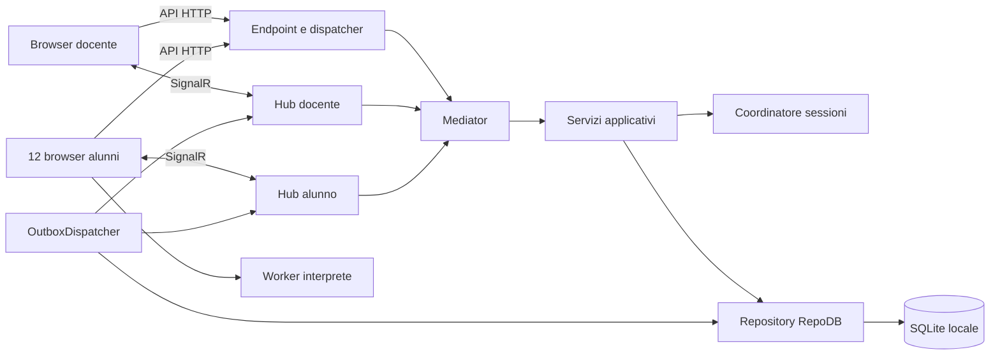

# Codì: specifica tecnica della piattaforma didattica

Versione: 0.61 — Progetto tecnico iniziale approfondito
Data: 14 novembre 2026
Stato: proposta implementativa, non software già realizzato
Documento funzionale di riferimento: [Specifiche della piattaforma didattica](./SPECIFICHE_PIATTAFORMA_DIDATTICA.md)

## 1. Scopo, convenzioni e livello di definizione

Questa specifica traduce i requisiti funzionali in componenti, dati, contratti, stati e procedure implementabili. Il sistema deve consentire a un docente di condurre una lezione su 12 PC di bambini di 8–9 anni, mantenendo semplice il client e centralizzando la regia.

Le tecnologie richieste sono .NET 10, Angular, SignalR, SQLite, RepoDB e Blockly; la logica applicativa è organizzata in comandi e query mediati da **Mediator** (§4.4). Le restanti decisioni di questo documento costituiscono la **baseline tecnica proposta**: possono essere modificate nelle revisioni successive, ma l'implementazione deve seguire una scelta coerente e documentata.

Convenzioni:

- **DEVE** indica un requisito necessario per il comportamento descritto.
- **PROPOSTA** identifica un valore o una scelta implementativa ancora da validare.
- **DA VALIDARE** identifica una verifica tecnica prima del rilascio, non una funzionalità già collaudata.
- Nomi di classi, endpoint, tabelle ed eventi sono contratti di progetto; gli esempi non costituiscono codice di produzione completo.
- Negli esempi JSON gli identificativi sono UUID; revisioni e sequenze a 64 bit sono stringhe decimali, per evitare perdita di precisione in JavaScript.
- I valori numerici di prestazione sono obiettivi da misurare in laboratorio.

Il documento funzionale prevale sul tecnico in caso di conflitto. Un cambiamento di comportamento va riportato in entrambi. La realizzazione iniziale copre l'infrastruttura e un'attività dimostrativa; il disegno tecnico comprende già l'evoluzione Blockly.

### 1.1 Stato osservato e perimetro aggiornato

La rianalisi del sorgente `f059b9b` e gli interventi del 1 ottobre 2026 sono descritti nella
[mappa di ripresa](docs/RIPRESA-SVILUPPO.md). Sono presenti organizzazione di base,
anagrafica esercizi e sequenza LessonExercise. Associazioni corso-classe, iscrizioni e
contenuti/immagini sono eliminati dal prodotto per decisione esplicita dell'utente:
non sono contratti futuri da reintrodurre. La sessione collegherà direttamente classe e lezione;
JoinSession creerà una partecipazione con nome, senza Enrollment.

T0–T6 hanno evidenze locali nel [registro](.github/STATO-SVILUPPO.md).
T4 comprende regia idempotente, stati per destinatario, conferme, autorizzazione temporanea,
osservazioni docente e una dimostrazione finita. Il [rapporto T4](docs/T4-REGIA-AFFIDABILE.md)
distingue i test automatici dal collaudo nel browser e dal futuro laboratorio. T5 comprende
salvataggi con revisione e impronta, checkpoint, copie locali, permessi conclusivi e ripristino
dopo un riavvio del server.
T7 è realizzato e collaudato nel browser: il player Blockly esegue il progetto in un Web Worker con il
protocollo di §13.6, produce checkpoint ripristinabili (§13.7), gestisce l'ACK di pausa con soglia e
dichiara l'esito locale, marcato `ClientReported` (§13.8). Restano da decidere la verifica sul server
(D-10) e il laboratorio su 12 PC. T8 è realizzato e validato localmente: l'anteprima dei blocchi non è
un salvataggio, vive in una cache in memoria, e il docente la riceve con freschezza, revisione e
indicazione di parzialità, leggendola solo per l'alunno che ha davanti. Il percorso dell'anteprima
(metodo hub e lettura nel dettaglio del docente) è stato collaudato nel browser il 7 ottobre 2026
insieme alla pagina dei partecipanti; resta non esercitato in browser soltanto il ripiego HTTP oltre i
24 KiB, coperto dai test locali. Resta il laboratorio su 12 PC (T9).
L'ultima porzione, del 7 ottobre 2026, ha spostato la vista d'insieme della classe dalla regia a una
pagina dedicata, `/admin/sessions/:id/participants`, con una card per alunno e le azioni del singolo:
§14.1 e §14.3 descrivono quello stato (revisione 0.35 di questo documento).
Tutte le porzioni da T0 a T8 hanno evidenze locali nel registro di stato; il laboratorio su 12 PC è di
T9.
L'ingresso in aula usa il **codice di lezione** di otto cifre (0.37): `StartSession` lo genera e la
regia lo mostra al docente, `/api/v1/public/in-play` dice alla home se una lezione è in play, e
`JoinSession` accetta il codice oppure la catena. I codici errati sono contati in memoria per browser
e per indirizzo (§17.3). La scelta di scuola e classe resta come ripiego.
La pagina dell'alunno mostra lo stato con **riquadri a icona colorata e parole** e consente la **prova
locale** del proprio programma, con l'animazione della scena (0.38): la prova vive nella pagina, non
nel worker, e non produce checkpoint né telemetria (§13.1, §13.5, §14.4).
Il catalogo eseguibile contiene 51 comandi e 32 query.
La presenza di un contratto futuro nel catalogo della specifica non prova la sua implementazione.
Due editor contemporanei della stessa lezione restano fuori perimetro.


## 2. Indice

1. [Scopo e convenzioni](#1-scopo-convenzioni-e-livello-di-definizione)
2. [Vincoli e decisioni](#3-vincoli-e-decisioni-architetturali)
3. [Componenti e repository](#4-componenti-e-struttura-del-repository)
4. [Dominio e invarianti](#5-dominio-e-invarianti)
5. [Stati e transizioni](#6-modello-di-stato-e-transizioni)
6. [Database SQLite](#7-progettazione-del-database-sqlite)
7. [Persistenza RepoDB](#8-accesso-ai-dati-con-repodb)
8. [Identità e accesso](#9-identita-autenticazione-e-autorizzazione)
9. [API HTTP e CQRS](#10-api-http-e-dispatcher-cqrs)
10. [SignalR e protocollo](#11-protocollo-signalr)
11. [Comandi e sincronizzazione](#12-algoritmi-di-regia-e-sincronizzazione)
12. [Blockly e motore](#13-progettazione-degli-esercizi-blockly)
13. [Frontend Angular](#14-progettazione-del-frontend-angular)
14. [Salvataggio e monitoraggio](#15-salvataggio-telemetria-e-monitoraggio)
15. [Errori e recupero](#16-gestione-dei-guasti-e-del-recupero)
16. [Sicurezza applicativa](#17-sicurezza-applicativa-e-trattamento-dei-dati)
17. [Installazione e operatività](#18-installazione-configurazione-e-operativita)
18. [Test e prestazioni](#19-strategia-di-test-e-collaudo)
19. [Convenzioni e verifica](#20-convenzioni-di-sviluppo-verifica-e-manutenzione-del-repository)
20. [Piano di implementazione](#21-piano-tecnico-di-implementazione)
21. [Decisioni aperte](#22-decisioni-aperte-e-rischi-tecnici)
22. [Fonti](#23-riferimenti-tecnici)

## 3. Vincoli e decisioni architetturali

### 3.1 Configurazione iniziale

| Decisione | Baseline proposta | Motivazione |
|---|---|---|
| Distribuzione | Un solo processo ASP.NET Core e un solo database SQLite. | Carico contenuto e gestione semplice nel laboratorio. |
| Interfaccia | Due SPA Angular nello stesso workspace: `web.admin` e `web.frontend` (public). | Bundle, routing e stili indipendenti; contratti e motore condivisi. |
| UI amministrativa | Spartan UI (Brain e Helm) con Tailwind CSS 4. | Controlli accessibili e sorgenti dello stile personalizzabili; interfaccia alunni separata, con Three.js decorativo (§14.4). |
| Hosting | Frontend e API sullo stesso origin HTTPS. | Cookie, connessioni live e pubblicazione più semplici. |
| Accesso dati | RepoDB con `Microsoft.Data.Sqlite`. | Rispetta lo stack richiesto e mantiene esplicite query e transazioni. |
| Regia | Comandi HTTP persistiti, distribuzione SignalR, conferme SignalR. | Un solo ingresso per le mutazioni del docente e recupero dopo errori di rete. |
| Mediazione | CQRS con Mediator, un handler per caso d'uso e dispatcher generico. | Policy, validazione e transazioni uniformi, routing non duplicato per ogni richiesta. |
| Lavoro degli alunni | Progetto persistente sul server; stato live frequente in memoria. | Equilibrio tra affidabilità e numero di scritture. |
| Esecuzione | Interprete didattico TypeScript in Web Worker. | Controllo delle istruzioni e separazione dal rendering. |
| Autore | Editor Blockly integrato nell'area admin. | Creazione e prova degli stessi esercizi assegnati agli alunni. |
| Monitoraggio | Replica dei dati di scena e progetto, in sola lettura. | Visibilità didattica senza streaming video. |
| Ripristino | Rientro conservativo in pausa quando lo stato esecutivo non è certo. | Evita partenze impreviste. |

Non sono previsti broker esterni, Redis, Kubernetes, servizi cloud obbligatori o un database per ogni scuola. Un'eventuale distribuzione su più istanze richiederà una nuova decisione architetturale: il coordinatore in memoria e SQLite locale non vanno replicati senza riprogettazione.

### 3.2 Versioni e verifica iniziale

Il backend ha target `net10.0`. Le versioni di SDK, Angular, Node.js, TypeScript, Blockly, RepoDB e provider devono essere fissate in file di configurazione e lockfile durante il primo passo implementativo.

Per Angular selezionare una release supportata e la corrispondente combinazione Node.js/TypeScript usando la [matrice ufficiale Angular](https://angular.dev/reference/versions). Non scegliere indipendentemente le versioni più recenti di ogni componente.

La mediazione usa **Mediator** con generatore di sorgenti; la versione di partenza proposta è `2.1.7`, già adottata su altri progetti dell'organizzazione, **DA VALIDARE** con .NET 10 in T0 (§22, D-01). MediatR non è previsto: dalla versione 13 la licenza è commerciale per uso professionale.

Il pacchetto provider candidato è `RepoDb.Sqlite.Microsoft`; la documentazione descrive l'integrazione con SQLite, ma la combinazione concreta con .NET 10 deve superare un prototipo di lettura, scrittura, transazioni e mapping. Riferimento: [RepoDB SQLite](https://repodb.net/tutorial/get-started-sqlite/).

Bloccare le dipendenze con `global.json`, gestione centralizzata NuGet e lockfile NuGet/npm. Le versioni non vengono inventate in questo documento.

### 3.3 Confine del controllo

Il server pilota il player dell'applicazione. Non pilota Windows, altre schede, mouse o tastiera del sistema operativo. I client browser sono cooperanti: un utente tecnicamente competente potrebbe modificare il JavaScript locale, ma il server deve comunque impedire accessi ai dati e comandi non autorizzati.

Modalità chiosco e gestione dei dispositivi sono attività esterne al progetto. La presenza online indica comunicazione recente con l'applicazione, non attenzione del bambino.

## 4. Componenti e struttura del repository

### 4.1 Vista dei componenti



### 4.2 Progetti

```text
Codi/
  SPECIFICHE_PIATTAFORMA_DIDATTICA.md         Requisiti funzionali: prevale in caso di conflitto
  SPECIFICA_TECNICA_PIATTAFORMA_DIDATTICA.md  Contratto tecnico: questo documento
  Qwerty.Codi.slnx                        Soluzione dei progetti .NET (.slnx)
  .github/                                    Personalizzazioni per lo sviluppo agentico (§20.1)
  src/
    Qwerty.Codi.Domain/         Entità, stati e invarianti
      Organization/ Courses/ Lessons/ Sessions/ Exercises/
    Qwerty.Codi.Application/    Casi d'uso e mediazione
      Commands/ Queries/ Behaviors/ Contracts/ Authorization/ Abstractions/ Errors/
    Qwerty.Codi.Infrastructure/ RepoDB, SQLite, file, realtime
      Persistence/ Migrations/ Files/ Realtime/ BackgroundJobs/
    Qwerty.Codi.Api/            Trasporto e composizione
      Dispatch/ Endpoints/ Hubs/ Middleware/ Configuration/
    Qwerty.Codi.Web/            Workspace Angular (fuori dalla soluzione .NET)
      projects/
        admin/                        Docente, autore e regia; Spartan UI
          package.json                Solo script start per web.admin
        public/                       Ingresso alunni e player
          package.json                Solo script start per web.frontend
      libraries/
        api/                          Trasporto HTTP e contratti comuni
        exercise-engine/              Catalogo Blockly e serializzazione condivisi
  tests/
    Qwerty.Codi.Domain.Tests/
    Qwerty.Codi.IntegrationTests/
    Qwerty.Codi.ProtocolTests/
  docs/
    contracts/ adr/ operations/
```

Dipendenze: `Qwerty.Codi.Domain` non dipende da altri progetti; `Application` dipende da `Domain`; `Infrastructure` implementa le interfacce di `Application`; `Api` compone i servizi e ospita il dispatcher; i test di integrazione e di protocollo dipendono da `Api`, i test di dominio no. I DTO esposti sono distinti dalle entità persistenti.

La soluzione `Qwerty.Codi.slnx` raggruppa i sette progetti .NET; `Qwerty.Codi.Web` è un workspace npm e non compare nella soluzione. Le applicazioni CLI `web.admin` e `web.frontend` hanno build e avvio separati. Dipendenze, `node_modules` e lockfile sono unici nella root Web; ogni app ha un `package.json` minimo che definisce soltanto `start`, senza duplicare le dipendenze.

Le sottocartelle tematiche del backend si popolano durante gli incrementi T1–T7. Nel workspace web le app hanno ciascuna `src/app`; `core/`, `shared/`, `features/` e `ui/` dell'admin restano nel suo progetto. Trasporto HTTP e motore condivisi vivono in `libraries/` e non dipendono dall'admin.

### 4.3 Servizi principali

| Servizio | Responsabilità |
|---|---|
| `OrganizationService` | Scuole, classi, archiviazione e vincoli organizzativi. |
| `CourseService` | Corsi e relative lezioni. |
| `LessonService` | Lezioni e ordine delle attività. |
| `ExerciseAuthoringService` | Bozze, validazione e pubblicazione immutabile. |
| `SessionAdmissionService` | Apertura ingressi e partecipazione diretta alla sessione. |
| `SessionCommandService` | Validazione, applicazione e persistenza dei comandi docente. |
| `SessionCoordinator` | Serializzazione delle mutazioni per sessione. |
| `ParticipantConnectionRegistry` | Connessioni, epoch del browser attivo, presenza e revoca. |
| `SnapshotService` | Stato consistente per docente o singolo partecipante. |
| `AttemptService` | Progetti, tentativi, checkpoint e salvataggi conclusivi. |
| `ExecutionLeaseService` | Permessi temporanei per il funzionamento del player. |
| `TelemetryService` | Ultimo stato live e distribuzione alla dashboard. |
| `OutboxDispatcher` | Invio di notifiche persistite, ritentativi e gestione degli eventi superati. |
| `RecoveryService` | Pausa delle sessioni dopo il riavvio e invalidazione delle connessioni precedenti. |

Gli hub sono adattatori sottili e senza stato persistente proprio. Il registro connessioni e il coordinatore sono singleton thread-safe; i repository hanno durata limitata all'operazione. Un servizio singleton non conserva connessioni SQL né servizi scoped: crea uno scope per ogni unità di lavoro.

### 4.4 CQRS, mediazione e dispatcher

Ogni caso d'uso è un record immutabile con nome pubblico, policy e validazione proprie, più il suo handler. Il trasporto HTTP e gli hub delegano a questa struttura invece di contenere regole applicative.

| Elemento | Responsabilità |
|---|---|
| Record di comando | Descrive una mutazione: identificativi, revisione attesa, destinatari e payload tipizzato. |
| Record di query | Descrive una lettura: filtri, paginazione e proiezione. Non modifica stato persistente. |
| Handler | Uno per richiesta; contiene il caso d'uso e usa repository e servizi applicativi. |
| Behavior di pipeline | Validazione, transazione, idempotenza, audit e logging applicati in modo uniforme. |
| Registro delle richieste | Scopre i record all'avvio, ne espone nome e policy e rifiuta l'avvio se manca una policy. |
| Dispatcher HTTP | Due endpoint generici che risolvono il nome, verificano la policy e delegano al mediator. |
| Gestore delle eccezioni | Converte le eccezioni applicative tipizzate in Problem Details con status stabile (§10.7). |

Regole di struttura:

- Il nome pubblico della richiesta è dichiarato dal record e non deriva dal nome del tipo: la classe si può rinominare senza rompere il client.
- Un handler non risolve altre richieste in modo nascosto: la composizione avviene nei servizi applicativi condivisi di §4.3.
- Gli handler non usano `HttpContext`, hub o stato di connessione SignalR: ricevono dati espliciti e restituiscono risultati tipizzati.
- Gli handler non aprono connessioni proprie durante una transazione già aperta (§8.2).
- Telemetria frequente e presenza non sono comandi: non producono scritture persistenti e restano servizi in memoria (§15.1).

## 5. Dominio e invarianti

### 5.1 Gerarchia

```text
Scuola → Classe ← Sessione di lezione → Lezione ← Corso
                       ↓                  ↓
                  Partecipante       LessonExercise → Esercizio
                       ↓
                    Tentativo → Progetto e checkpoint
Sessione → Comando → Destinatari → Conferme
```

La sessione collega direttamente una classe e una lezione del corso scelto dal docente. La partecipazione identifica l'alunno nella singola sessione; il nome non viene usato per riutilizzare identità. Il tentativo appartiene a una partecipazione e a un'assegnazione.

### 5.2 Invarianti obbligatorie

1. Una classe appartiene a una sola scuola.
2. Una sessione usa una lezione e una classe valide e non archiviate; il corso è determinato dalla lezione.
3. Una classe ha al massimo una sessione non terminata.
4. Il docente proprietario è l'unico soggetto autorizzato a pilotare quella sessione nella prima versione.
5. Un partecipante appartiene a una sola sessione; scuola e classe richieste al join devono corrispondere alla sessione non terminata.
6. Ogni partecipante ha al massimo una connessione operativa e uno stato desiderato corrente.
7. I nomi non sono univoci e non sono credenziali.
8. Un esercizio pubblicato è immutabile; un tentativo riferisce esattamente una versione.
9. Un tentativo non può essere scritto da un altro partecipante o da una connessione superata.
10. Un comando viene salvato insieme al suo effetto sullo stato desiderato, prima della notifica.
11. Una conferma di ricezione non equivale a una conferma di applicazione.
12. Una sessione terminata non può essere riaperta: una nuova lezione operativa crea una nuova sessione.
13. L'assenza di un ACK non dimostra che il comando non sia stato applicato.
14. Nessuna riconnessione deve causare un secondo riavvio dell'esercizio già eseguito.

### 5.3 Identificativi e ordinamento

Usare UUID generati dal server per le entità; nessun ordinamento dipende dall'UUID. Usare contatori interi per:

| Contatore | Ambito | Scopo |
|---|---|---|
| `sessionRevision` | Sessione | Ordina le mutazioni autoritative, inclusi ingressi e recupero. |
| `effectiveRevision` | Partecipante | Revisione della sessione che ha cambiato il suo stato desiderato. |
| `rowVersion` | Riga modificabile | Concorrenza ottimistica per editing e salvataggi. |
| `connectionEpoch` | Partecipante | Esclude messaggi provenienti da connessioni sostituite. |
| `executionGeneration` | Tentativo | Distingue i riavvii imposti dal server. |
| `clientSequence` | Connessione e tentativo | Scarta telemetria duplicata o fuori ordine. |

`effectiveRevision` non deve essere contigua: un comando a un altro alunno crea legittimamente un salto. Un salto di numero non implica perdita di messaggi. `serverInstanceId` cambia a ogni avvio e invalida autorizzazioni temporanee del processo precedente.

## 6. Modello di stato e transizioni

### 6.1 Sessione

| Stato | Significato | Transizioni |
|---|---|---|
| `Lobby` | Sessione istanziata, non ancora avviata: ingressi inizialmente chiusi e contenuto di attesa. | `Active`, `Ended`. |
| `Active` | Sessione avviata: il docente conduce le attività. | `Paused`, `Ended`. |
| `Paused` | Impostazione generale di pausa. | `Active`, `Ended`. |
| `Ended` | Sessione conclusa definitivamente, non riaperta. | Nessuna. |

Una sessione è **in play** quando è **avviata** (`Active` oppure `Paused`) **e** gli ingressi sono aperti: è la condizione della scoperta pubblica (§10.3) e dell'ingresso degli alunni. La pausa sospende l'attività, non l'ingresso: chi arriva durante una spiegazione vede ancora la lezione e può entrare. La pausa non cambia nemmeno il **codice di ingresso** (§9.4): il codice nasce con l'avvio, resta lo stesso per tutta la sessione — pausa e ripresa comprese — e non si riusa in un'altra sessione. Dopo `EndSession` il codice resta nella riga come memoria della lezione, ma non è più spendibile perché la sessione non è più in play.

Ogni transizione è prodotta da un comando del catalogo §10.4:

- `CreateSession` istanzia la lezione nella classe e crea la sessione in `Lobby`, con `admissionsOpen = false`; non crea associazioni permanenti tra lezione e classe.
- `StartSession` porta la sessione da `Lobby` ad `Active`, apre gli ingressi (`admissionsOpen = true`), **genera il codice di ingresso** che il docente detta alla classe (§9.4) e imposta la vista di attesa (`Waiting`) come default della classe, senza attività assegnata.
- `Pause` con ambito `Class` porta `lesson_session.status` a `Paused` soltanto da `Active`: non si mette in pausa una sessione `Lobby`. `Resume` con ambito `Class` riporta `lesson_session.status` da `Paused` ad `Active`. La transizione `Lobby → Paused` non esiste.
- Un comando con ambito `Participant` cambia il solo stato desiderato del destinatario e non modifica `lesson_session.status`; l'eccezione individuale resta visibile nella dashboard.
- `EndSession` porta la sessione a `Ended` da qualunque stato non terminale, `Lobby` compreso, ed è terminale.
- `OpenAdmissions` e `CloseAdmissions` cambiano soltanto `admissionsOpen`, senza modificare `status`; restano disponibili dopo l'avvio per riaprire o chiudere gli ingressi.

`admissionsOpen` è indipendente dallo stato: può essere vero in `Lobby`, `Active` o `Paused`; è sempre falso in `Ended`. La pausa generale definisce il default della classe. Un successivo comando individuale può riprendere un alunno; la dashboard deve rendere visibile questa eccezione.

Per l'ambito `Class` solo `Pause` (da `Active`), `Resume` (da `Paused`) e `EndSession` (da qualsiasi stato non terminale, `Lobby` compreso) modificano `lesson_session.status`; ogni comando con ambito `Participant` cambia il solo stato desiderato del destinatario e lascia `status` invariato. La stessa regola è ripresa in §6.4.

### 6.2 Stato desiderato per partecipante

Lo stato desiderato contiene:

- `view`: `Waiting`, `Exercise`, `Goodbye`.
- `assignmentId`, `attemptId`, `exerciseVersionId`.
- `interactionEnabled`: abilita i controlli locali del lavoro.
- `teacherPaused`: sospensione richiesta dal docente.
- `recoveryBlocked`: pausa imposta dal server per un ripristino incerto.
- `effectiveRevision`, `executionGeneration` e ultimo `executionDirective`.
- Eventuale riferimento all'attività sospesa quando si mostra attesa.

L'ultimo comando esecutivo ha un identificativo proprio (`directiveId`). È una richiesta applicabile una volta, non una condizione che deve riavviare continuamente un programma completato.

### 6.3 Stato osservato nel browser

Il client riferisce `Idle`, `Ready`, `Running`, `Paused`, `Completed`, `Stopped` o `Error`, con motivo, identificativo della corsa (`runId`) e revisione applicata. Lo stato osservato può essere in ritardo rispetto a quello desiderato.

Il motore può eseguire passi solo quando sono vere tutte le condizioni:

```text
partecipazione ammessa
AND sessione non terminata
AND connessione operativa sincronizzata
AND autorizzazione temporanea valida
AND view = Exercise
AND interactionEnabled
AND NOT teacherPaused
AND NOT recoveryBlocked
AND nessuna pausa locale per perdita di rete o scheda nascosta
```

Il permesso di modificare blocchi richiede anche `runtimeStatus != Running`. Durante l'esecuzione i blocchi sono in sola lettura. Il bambino può premere **Ferma**, modificare il programma e poi **Prova**; non può superare una pausa docente.

### 6.4 Semantica dei comandi

I comandi didattici sono richieste del dispatcher (§4.4), inviate dal docente tramite `POST /api/v1/admin/execute/command/{commandName}`, persistite insieme al loro effetto e distribuite ai client attraverso l'outbox (§12.2). Il nome nel percorso è quello pubblico dichiarato dal record; ogni comando dichiara la policy `SessionController`, la revisione attesa e l'ambito di applicazione.

| Comando | Precondizioni | Effetto |
|---|---|---|
| `StartSession` | Sessione in `Lobby`. | Porta la sessione in `Active`, apre gli ingressi (`admissionsOpen = true`) e imposta la vista di attesa (`Waiting`) come default della classe, senza attività assegnata. |
| `ShowWaiting` | Sessione non terminata. | Salva un riferimento al lavoro, sospende il motore e mostra attesa. |
| `AssignExercise` | Versione pubblicata compatibile. | Crea assegnazione e tentativi indipendenti; vista esercizio, controlli bloccati. |
| `EnableActivity` | Esercizio caricato, non in pausa docente. | Abilita modifica e prova; non avvia il programma. |
| `RunProgram` | Attività abilitata e non in pausa. | Crea una direttiva per avviare il progetto corrente, se non già in esecuzione. |
| `Pause` | Con ambito `Class` solo da sessione `Active`; con ambito `Participant` da qualsiasi stato non terminale. | Disabilita lavoro ed esecuzione; conserva checkpoint e precedente modalità. |
| `Resume` | Con ambito `Class` solo da sessione `Paused`; con ambito `Participant` esiste uno stato sospeso ripristinabile. | Rimuove i blocchi docente/recupero; riprende solo una corsa prima in esecuzione e con checkpoint valido. |
| `RestartExecution` | Tentativo esistente, abilitato e non in pausa. | Incrementa generazione, conserva progetto, resetta scena e avvia. |
| `ResetWork` | Tentativo esistente e conferma UI. | Archivia il tentativo, ne crea uno dal modello iniziale, bloccato e pronto. |
| `EndSession` | Sessione non terminata, `Lobby` compreso. | Chiude ingressi, ferma i client e apre una finestra limitata di salvataggio finale. |

Per l'ambito `Class` solo `Pause` (da `Active`), `Resume` (da `Paused`) e `EndSession` (da qualsiasi stato non terminale, `Lobby` compreso) modificano `lesson_session.status`; ogni comando con ambito `Participant` cambia il solo stato desiderato del destinatario senza toccare `lesson_session.status` (§6.1).

`RunProgram` su un client già in esecuzione viene confermato come nessuna modifica; per ripartire si usa `RestartExecution`. `Resume` senza checkpoint non inventa una posizione: riabilita l'editor ma lascia il motore `Ready`, segnalando che è necessario ripartire.

Un comando con `expectedSessionRevision` superata viene rifiutato con `409 SessionRevisionConflict` senza essere riapplicato sul nuovo stato; l'elenco dei comandi di regia è in §10.4.

`Pause` ripetuto non sovrascrive il ricordo dello stato precedente. `ShowWaiting` mantiene il lavoro sospeso; `Resume` può tornare a quel lavoro. Un nuovo `AssignExercise` crea invece un nuovo contesto e conserva quello precedente nello storico.

### 6.5 Comandi collettivi e individuali

Un comando dichiara il proprio ambito nel campo `target` (`Class` oppure un singolo partecipante): lo stesso handler gestisce entrambi gli ambiti e il trasporto non cambia.

Il server conserva un default per i nuovi ingressi e uno stato materializzato per ogni partecipante. Non si calcolano override concatenati nel browser.

- `AssignExercise` collettivo sostituisce attività e override individuali dell'assegnazione.
- `Pause` collettivo cambia il permesso operativo di tutti, conservando le rispettive attività.
- `Resume` collettivo ripristina ogni attività sospesa con le relative possibilità.
- Un comando individuale successivo modifica soltanto lo stato del destinatario.
- Una direttiva istantanea `RunProgram` non entra nel default dei futuri partecipanti.
- I nuovi ingressi ricevono attività e permessi correnti; non eseguono comandi storici.
- `EndSession` riguarda sempre l'intera sessione ed elimina ogni eccezione operativa.

Per un comando collettivo, validare tutte le precondizioni prima di scrivere. Se alcuni partecipanti hanno uno stato incompatibile, rispondere `409` con un elenco docente dei conflitti; evitare applicazioni parziali implicite. L'attesa e la chiusura sono definite per tutti gli stati non terminali; la pausa di classe è definita soltanto da `Active` (§6.1).

## 7. Progettazione del database SQLite

### 7.1 Convenzioni fisiche

- Tabelle e colonne in `snake_case`; proprietà C# in PascalCase con mapping esplicito.
- UUID memorizzati come `TEXT` in formato canonico minuscolo.
- Date come `INTEGER` Unix epoch in millisecondi; DTO HTTP con date ISO 8601 UTC.
- Booleani come `INTEGER` con vincolo `CHECK (... IN (0, 1))`.
- Stati come `TEXT` con valori enumerati e vincoli `CHECK`.
- Documenti complessi come JSON in `TEXT`, sempre validati dall'applicazione; validazione SQL `json_valid` dove supportata dalla versione fissata.
- Le lunghezze massime sono verificate nell'applicazione e con `CHECK`, non con un semplice tipo `VARCHAR(n)`.
- Ogni tabella modificabile ha `row_version INTEGER NOT NULL DEFAULT 1`; tabelle immutabili e registri di evento non lo richiedono.
- Ogni tabella di dominio ha `created_at_utc_ms`; quelle modificabili anche `updated_at_utc_ms`.

Nelle tabelle seguenti `?` significa nullable; `id` è la chiave primaria salvo diversa indicazione. I campi comuni sopra descritti sono omessi per leggibilità. Questo è il dizionario progettuale completo iniziale; gli script di migrazione saranno un artefatto successivo.

### 7.2 Identità e organizzazione

**Stato del sorgente:** admin_user, credential_session, school, classroom e course presenti;
dalla migrazione `0005` lo è anche `station`. Associazioni corso-classe e iscrizioni sono eliminate
dal prodotto.

| Tabella | Colonne specifiche | Vincoli e indici |
|---|---|---|
| `admin_user` | `id`, `username`, `normalized_username`, `password_hash`, `security_stamp`, `is_active`, `failed_login_count`, `locked_until_utc_ms?` | Unico `normalized_username`; nessuna password in chiaro. |
| `credential_session` | `id`, `principal_kind`, `admin_user_id?`, `participant_id?`, `expires_at_utc_ms`, `revoked_at_utc_ms?`, `security_stamp` | Esattamente uno tra admin e partecipante coerente con il tipo; indice scadenza. |
| `school` | `id`, `name`, `normalized_name`, `is_archived` | Nome 1–120; `normalized_name` unico anche fra le scuole archiviate. |
| `classroom` | `id`, `school_id`, `name`, `normalized_name`, `school_year`, `is_archived` | Nome 1–120; anno canonico `AAAA/AAAA` con anni consecutivi; unico `(school_id, normalized_name, school_year)`; FK scuola. |
| `course` | `id`, `title`, `description`, `is_archived` | Titolo 1–160; descrizione fino a 2000 caratteri, stringa vuota quando assente. |
| `station` | `id`, `classroom_id?`, `label?`, `browser_key_hash`, `last_seen_at_utc_ms?` | **Presente** dalla `0005`: chiave browser casuale, non fingerprint; label informativa. L'impronta è unica e `classroom_id` resta un contesto facoltativo, perché lo stesso PC può essere usato in classi diverse. |

Il primo join crea direttamente la partecipazione alla sessione. Il rientro recupera quella
partecipazione tramite credenziale valida e idempotenza, senza cercare un alunno per nome.

### 7.3 Lezioni ed esercizi

**Stato del sorgente:** lesson, exercise e lesson_exercise sono presenti e, dalla migrazione `0004`,
lo sono anche `exercise_draft`, `exercise_version` e `exercise_version_private`. Exercise memorizza
solo metadati; la definizione didattica di §13.2 esiste nel dominio con la sua validazione, la bozza
si compone e si rilegge (`SaveExerciseDraft`, `GetExerciseDraft`), il progetto a blocchi si compone
in Blockly con l'anteprima dell'autore e la pubblicazione crea le versioni immutabili
(`ValidateExerciseDraft`, `PublishExerciseVersion`, `CopyExerciseVersionToDraft`), mentre
`DeleteExerciseVersion` elimina una versione che non è la più recente (§13.8), con le letture
`GetReferenceSolution`, `ListExerciseVersions` e `GetExerciseVersion`. L'anteprima resta isolata: non
produce comandi di classe né risultati di alunni. Contenuti e asset sono
eliminati dal prodotto; non esiste una sequenza di attività generiche Text/Image.

| Tabella | Colonne specifiche | Vincoli e indici |
|---|---|---|
| `lesson` | `id`, `course_id`, `title`, `description`, `is_archived` | Titolo 1–160; descrizione fino a 2000 caratteri; FK corso e indice `course_id`. |
| `exercise` | `id`, `title`, `description`, `is_archived` | Identità stabile del modello; titolo 1–160, descrizione fino a 2000 caratteri. |
| `exercise_draft` | `exercise_id` PK, `definition_json`, `workspace_json`, `reference_solution_json?` | **Presente** dalla `0004`; `row_version` per la bozza; soluzione accessibile solo al docente. |
| `exercise_version` | `id`, `exercise_id`, `version_number`, `definition_json`, `initial_workspace_json`, `engine_version`, `schema_version`, `content_hash`, `published_by_admin_id` | **Presente** dalla `0004`; unico `(exercise_id, version_number)`; immutabile, e l'immutabilità è imposta da un trigger che rifiuta l'UPDATE. Nessun comando la aggiorna: si elimina solo una versione che non è la più recente e non è assegnata (`DeleteExerciseVersion`, §13.8). |
| `exercise_version_private` | `exercise_version_id` PK, `reference_solution_json?`, `author_notes?` | **Presente** dalla `0004`; mai incluso nei DTO degli alunni. |
| `lesson_exercise` | `id`, `lesson_id`, `exercise_id`, `position` | FK lezione/esercizio; unico `(lesson_id, position)`; posizioni definitive `1..N`, temporanee negative ammesse, zero escluso. |

La sequenza riferisce l'identità dell'esercizio. Quando sarà implementata la pubblicazione,
l'assegnazione fisserà una versione immutabile compatibile, conservata nei tentativi.
Il riordino usa una transazione in due fasi: posizioni temporanee negative, poi posizioni
definitive; la stessa casella viene riusata se il suo esercizio resta nella lezione.
La UI evita duplicati nel selettore; il backend consente più occorrenze dello stesso esercizio.
È previsto un solo editor della lezione alla volta. La sostituzione verifica baseRowVersion
della lezione ma non la incrementa: non garantisce l'esclusione fra editor simultanei.

### 7.4 Sessioni e lavoro degli alunni

**Stato del sorgente:** `lesson_session` è presente dalla `0002` e `session_participant` dalla
`0005`; `station`, che la partecipazione riferisce, è nella stessa migrazione. `participant_state`
é presente dalla `0006`, con la chiave esterna composta verso la partecipazione; `exercise_attempt`
è presente dalla `0008` e `attempt_finalization_grant` dalla `0009`; `join_code` è aggiunto alla
`lesson_session` dalla `0010` (§9.4).

Il vincolo di `participant_state` è quello dichiarato dall'unicità `(session_id, id)`:
`participant_state` riferisce la coppia, quindi uno stato non può appartenere a una sessione
diversa da quella della sua partecipazione, anche se quella sessione esiste. `view` ammette
`Waiting`, `Exercise` e `Goodbye`; i contatori di interazione, pausa e ripristino sono interi 0/1 e
i documenti `directive_json` e `resume_context_json` sono JSON validi. All'ingresso la riga è la
**copia del default di classe** alla revisione corrente della sessione (§6.2, §6.5): da lì in poi la
modificano i comandi di regia, non l'ingresso.

Tre precisazioni locali della `0005`. `credential_session.participant_id` resta **senza chiave
esterna**: la tabella esiste dalla `0001`, quando quella dei partecipanti non c'era, e aggiungerla
dopo richiederebbe di ricostruirla; la coerenza fra credenziale e partecipazione la verifica
l'applicazione, come per gli altri riferimenti che il database non può imporre. I valori di
`admission_status` sono `Admitted` ed `Excluded`, gli stessi del vocabolario di §9.3 e §10.7. Il
limite del nome è di **30 grafemi**: il CHECK della tabella accetta fino a 120 caratteri come rete di
sicurezza, perché un grafema può essere composto da più punti di codice e il database non li conta.

L'unicità `(session_id, id)` su `session_participant` non serve a se stessa — il partecipante è già
identificato dal suo `id` — ma a rendere possibile la chiave esterna composta con cui
`participant_state` garantisce di riferire la sessione della partecipazione e non una qualunque.

| Tabella | Colonne specifiche | Vincoli e indici |
|---|---|---|
| `lesson_session` | `id`, `lesson_id`, `classroom_id`, `controller_admin_id`, `status`, `admissions_open`, `session_revision`, `class_default_json`, `join_code?`, `started_at_utc_ms?`, `ended_at_utc_ms?` | Indice unico parziale sulla classe per sessioni non terminate; indice unico su `join_code`, con NULL ammesso più volte. |

Il **codice di ingresso** (`join_code`, `0010`) è testo di otto cifre, non un intero: uno zero
iniziale sarebbe una cifra del codice e un intero la perderebbe. Tre scelte locali registrate nello
script: la prima cifra non è zero — è la cifra che si perde più facilmente quando il codice si detta
o si digita — e il CHECK la impone, perché una riga fuori formato renderebbe illeggibile la sessione
e non solo il suo codice; il codice è **unico** fra tutte le sessioni, quindi non si riusa in
un'altra lezione, e NULL non partecipa al vincolo, così le sessioni non avviate e quelle create prima
della `0010` convivono senza codice; il codice si genera all'avvio e non si cancella al termine, così
la riga conserva la memoria della lezione mentre la spendibilità dipende dallo stato, non dalla
presenza del codice.
| `session_participant` | `id`, `session_id`, `station_id?`, `display_name`, `admission_status`, `connection_epoch`, `joined_at_utc_ms`, `excluded_at_utc_ms?`, `left_at_utc_ms?` | Unico `(session_id, id)` per FK composte; nome 1–30 grafemi; nomi duplicati ammessi. L'uscita volontaria ha un istante distinto dall'esclusione e non precede l'ingresso. |
| `activity_assignment` | `id`, `session_id`, `lesson_exercise_id?`, `scope`, `target_participant_id?`, `exercise_version_id` | `scope` vale `Class` o `Participant`; `target_participant_id` è obbligatorio solo con `Participant`. Versione esercizio fissata all’assegnazione; non cambia modificando la sequenza. **Presente** dalla `0008`, con chiavi candidate `(session_id, id)` e `(id, exercise_version_id)`. |
| `participant_state` | `participant_id` PK, `session_id`, `effective_revision`, `assignment_id?`, `attempt_id?`, `view`, `interaction_enabled`, `teacher_paused`, `recovery_blocked`, `execution_generation`, `directive_json?`, `resume_context_json?` | Relazione partecipante/sessione coerente; uno stato per partecipante. |
| `exercise_attempt` | `id`, `participant_id`, `assignment_id`, `exercise_version_id`, `attempt_number`, `status`, `workspace_json`, `workspace_hash`, `project_revision`, `checkpoint_json?`, `checkpoint_engine_version?`, `last_saved_at_utc_ms?`, `completed_at_utc_ms?` | Unico `(participant_id, assignment_id, attempt_number)`; riferimento versione coerente con assegnazione. **Presente** dalla `0008`, che aggiunge anche `session_id` come scelta locale registrata nel suo commento e realizza la coerenza di sessione e di versione con chiavi esterne composte; i valori di `status` sono scelti localmente (pronto, in esecuzione, sospeso, concluso, archiviato). |
| `attempt_finalization_grant` | `id`, `attempt_id`, `credential_session_id`, `connection_epoch`, `expires_at_utc_ms`, `used_at_utc_ms?`, `save_id?` | Permesso ristretto per un solo salvataggio conclusivo idempotente. **Presente** dalla `0009`. |

Il nome appartiene alla partecipazione e può essere corretto dal docente. La sessione riferisce direttamente classroom e lesson con FK; la lezione determina il corso. Non esiste una FK verso associazioni o iscrizioni.

### 7.5 Affidabilità e registri

| Tabella | Colonne specifiche | Vincoli e indici |
|---|---|---|
| `session_command` | `id`, `session_id`, `issued_by_admin_id?`, `command_name`, `scope`, `target_participant_id?`, `revision`, `payload_json`, `issued_at_utc_ms` | Unico `(session_id, revision)` per comandi; autore nullo solo per azioni di sistema. `command_name` è il nome pubblico del comando (§10.4); `scope` vale `Class` o `Participant` e solo in quest'ultimo caso è presente `target_participant_id`. |
| `command_delivery` | `command_id`, `participant_id`, `effective_revision`, `status`, `requires_recovery`, `sent_at_utc_ms?`, `ack_at_utc_ms?`, `applied_at_utc_ms?`, `error_code?`, `send_attempts` | PK composta; stato per ogni destinatario, anche offline. |
| `outbox_message` | `id`, `session_id`, `message_type`, `payload_json`, `available_at_utc_ms`, `attempt_count`, `processed_at_utc_ms?`, `last_error_code?` | Indice su non processati e disponibilità. |
| `idempotency_record` | `scope_key`, `request_key`, `request_hash`, `response_code`, `response_json`, `expires_at_utc_ms` | PK `(scope_key, request_key)`; non memorizza segreti o cookie. |
| `audit_event` | `id`, `actor_kind`, `actor_id?`, `session_id?`, `action`, `target_id?`, `outcome`, `correlation_id`, `details_json` | Nessun progetto completo o token nel registro. |
| `schema_migration` | `version` PK, `name`, `checksum`, `applied_at_utc_ms`, `application_version` | Checksum obbligatorio; migrazione applicata non modificabile. |

Presenza istantanea, cache delle anteprime e autorizzazioni temporanee di esecuzione non vengono scritte a ogni heartbeat. Le azioni rilevanti sono persistenti; la telemetria frequente può essere persa senza perdere i progetti salvati.

### 7.6 Esempi di vincoli e concorrenza

Frammenti SQL indicativi, da integrare negli script completi:

```sql
CREATE UNIQUE INDEX ux_session_one_open_per_classroom
ON lesson_session(classroom_id)
WHERE status IN ('Lobby', 'Active', 'Paused');

CREATE INDEX ix_attempt_participant_saved
ON exercise_attempt(participant_id, last_saved_at_utc_ms);

UPDATE exercise_attempt
SET workspace_json = @workspaceJson,
    workspace_hash = @workspaceHash,
    project_revision = @projectRevision,
    last_saved_at_utc_ms = @now,
    row_version = row_version + 1
WHERE id = @attemptId
  AND participant_id = @participantId
  AND row_version = @expectedVersion;
```

Zero righe modificate significa conflitto o risorsa non accessibile, da distinguere nel servizio senza rivelare dati altrui. Il contesto autorizzativo e il tentativo corrente devono essere verificati nella stessa unità di lavoro, non soltanto prima dell'UPDATE.

Usare `ON DELETE RESTRICT` per lo storico; eliminazioni a cascata soltanto per figli tecnici privi di valore autonomo. I riferimenti tra entità della stessa sessione devono essere verificati con FK composte dove possibile e comunque con test di integrazione.

L'unica eliminazione di una sessione è `DeleteSession` (§10.4): nella stessa transazione e nello stesso ordine di dipendenza si cancellano `attempt_finalization_grant`, `exercise_attempt`, `participant_state`, `command_delivery`, `session_command`, `outbox_message`, `activity_assignment`, le credenziali dei partecipanti, `session_participant` e infine `lesson_session`, quest'ultima con il controllo di `row_version`. Le righe rimosse sono figli tecnici di quella sessione; `school`, `classroom`, `lesson`, `exercise` e `exercise_version` non vengono toccati. Il registro di idempotenza non ha chiave esterna verso la sessione: le sue voci scadono con la propria data e contengono soltanto riferimenti, non nomi.

## 8. Accesso ai dati con RepoDB

### 8.1 Connessioni e impostazioni

Aprire una connessione per unità di lavoro e chiuderla al termine. Non condividere una `SqliteConnection` tra hub, thread o richieste. Inizializzare il provider RepoDB una volta all'avvio secondo la versione effettivamente installata.

Impostazioni proposte:

```sql
PRAGMA foreign_keys = ON;
PRAGMA journal_mode = WAL;
PRAGMA synchronous = FULL;
PRAGMA busy_timeout = 5000;
```

`journal_mode` si configura nel bootstrap controllato; `foreign_keys`, timeout e impostazioni di connessione vanno assicurati su ogni nuova connessione. WAL migliora la concorrenza tra letture e scrittura, ma mantiene un solo writer alla volta; il file deve restare locale al server. Riferimento: [SQLite WAL](https://www.sqlite.org/wal.html).

### 8.2 Unità di lavoro

Le mutazioni relative alla stessa sessione passano attraverso un lock asincrono per sessione e poi una breve transazione SQLite. Ordine di acquisizione unico: coordinatore di sessione → transazione. Non attendere SignalR, file upload o lavoro di rete mentre la transazione è aperta.

Il chiamante crea una unit of work tramite `IUnitOfWorkContext` e risolve i repository con
`Repo<T>()`. La factory crea uno scope DI isolato e una connessione dedicata; tutti i repository
dello scope ricevono lo stesso contesto interno, con la medesima connessione e l'eventuale
transazione. I repository non aprono connessioni e non decidono commit o rollback.

Contratti applicativi implementati nelle fondazioni, senza tipi ADO.NET o RepoDB:

```csharp
public interface IUnitOfWorkContext
{
    Task<IUnitOfWork> CreateAsync(
        bool useTransaction = false, CancellationToken cancellationToken = default);
}

public interface IUnitOfWork : IAsyncDisposable
{
    TRepository Repo<TRepository>() where TRepository : class, IRepository;
    Task CommitAsync(CancellationToken cancellationToken = default);
    Task RollbackAsync(CancellationToken cancellationToken = default);
}
```

`IRepository<TEntity, TIdentity>` espone CRUD, `QueryAsync(predicate)` e `ExistsAsync(predicate)`.
Le entità di persistenza sono POCO in Application, distinte dagli oggetti di dominio e dai DTO
HTTP; Infrastructure mappa tabella, chiave e colonne tramite RepoDB FluentMapper. I repository
concreti derivano da `BaseRepository`, che passa la transazione del contesto a tutte le operazioni
RepoDB. Non serve un metodo specifico per ogni WHERE, né una variante di lettura che riceva una
transazione separata. Conversioni UUID/date/enum restano esplicite secondo §7.1.

Con `useTransaction: true`, commit conferma tutte le scritture e dispose senza commit le annulla,
anche dopo eccezione o cancellazione. Senza transazione le scritture sono in auto-commit e non
sono annullate dal dispose. Dopo commit o rollback il lavoro è completato; dopo dispose non è
riutilizzabile. Nessuna operazione parallela nella stessa UoW.

I metodi specializzati aggiungono soltanto semantiche ulteriori: conflitto previsto del bootstrap,
aggiornamento dei campi d'accesso e revoca condizionata. Nel login, hashing e lettura precedono
la breve transazione di UPDATE condizionato e INSERT della credenziale; i tentativi falliti sono
confermati prima di restituire il rifiuto. Il bootstrap controlla e inserisce nella stessa transazione.
I futuri behavior di regia dovranno fornire il proprio lavoro agli handler partecipanti senza
aprire una seconda UoW indipendente. Esempi e percorso implementato in
[docs/PERSISTENZA.md](docs/PERSISTENZA.md).

### 8.3 Concorrenza, lock e migrazioni

- Mutazioni CRUD: `row_version` con controllo ottimistico.
- Mutazioni regia: controllo di `expectedSessionRevision` e transazione di comando.
- `SQLITE_BUSY`: ritentativi limitati con backoff soltanto quando l'intera operazione è ritentabile; mai ripetere alla cieca una scrittura dall'esito incerto.
- `CancellationToken` propagato; le capacità effettive di cancellazione del provider vanno verificate, senza presumere I/O realmente asincrono.
- Migrazioni SQL numerate, eseguite prima di accettare traffico. Versione sconosciuta o checksum errato impediscono la readiness.
- Baseline di sviluppo corrente: nove script incorporati, da `0001_schema.sql` a
  `0009_attempt_finalization.sql`, numerati ed eseguiti in ordine. I database creati prima del
  consolidamento non sono aggiornati dal catalogo nuovo; richiedono una ricreazione esplicita o un
  percorso di migrazione da progettare. Non modificare versioni applicate dopo un rilascio; i
  cambiamenti successivi aggiungono uno script nuovo.
- La sostituzione della sequenza corrente controlla ma non incrementa la versione della
  lezione. Due editor contemporanei non sono previsti per decisione dell’utente (A-11 fuori perimetro); nessuna protezione aggregata fra editor è dichiarata.
- Nessun seed di password predefinite in produzione.
- Un test deve dimostrare mapping UUID, date, enum, null, JSON e rollback con .NET 10.

### 8.4 Commit e notifica

La transazione salva stato desiderato, comando, destinatari, idempotenza e record outbox. È il behavior di transazione del dispatcher ad aprirla e a chiuderla con commit dopo che l'handler ha completato (§12.1); il dispatcher outbox invia dopo il commit. Se il processo cade tra commit e invio, il record outbox consente di rilevare il lavoro pendente.

Il dispatcher fornisce consegna potenzialmente ripetuta, non esecuzione “exactly once”. La convergenza deriva da identificativi, revisioni, generazioni e sincronizzazione dello stato. Non si interpreta `SendAsync` riuscito come esecuzione sul client.

## 9. Identita, autenticazione e autorizzazione

### 9.1 Account amministrativo

Usare autenticazione cookie ASP.NET Core e un componente consolidato per l'hashing delle password, ad esempio `PasswordHasher<TUser>`. Non è necessario introdurre Entity Framework: account e sessioni possono essere persistiti tramite RepoDB. Il flusso di cookie authentication è documentato da [Microsoft](https://learn.microsoft.com/en-us/aspnet/core/security/authentication/cookie?view=aspnetcore-10.0).

L'account iniziale viene creato tramite il comando di bootstrap locale `BootstrapAdminAccount`, utilizzabile solo in assenza di admin attivi, con password richiesta in input protetto o letta da un secret temporaneo. Non inserire password nel repository o nella riga di comando registrata nei log.

**Deroga dichiarata (0.16, decisione dell'utente del 30 settembre 2026).** In sviluppo l'account iniziale può essere inserito automaticamente alla preparazione del database: la sezione `Codi:SeedAdmin` (`Username`, `Password`) del file di ambiente lo richiede, e l'inserimento passa dallo stesso caso d'uso del comando locale, quindi un amministratore già attivo lo rende inerte. In `appsettings.Development.json` la coppia è `Admin` / `Ottimixmo@20`. Questa configurazione **contraddice la regola precedente** — una credenziale conosciuta in un file versionato — ed è ammessa solo perché richiesta esplicitamente e perché l'ambiente di produzione e laboratorio non la imposta: **prima della consegna in laboratorio la sezione va rimossa e le credenziali cambiate**. Un ambiente che non imposta la sezione non crea alcun account, e la modalità resta quella del comando locale.

Cookie admin: nome `__Host-CodiAdmin`, `Secure`, `HttpOnly`, `SameSite=Strict`, `Path=/`, senza `Domain`. Durata iniziale proposta 8 ore, con scadenza assoluta; login protetto da limitazione tentativi e lock temporaneo. Il primo incremento di ruolo/multiutenza richiederà una revisione di questi permessi.

### 9.2 Credenziale dell'alunno

Il join produce un ticket protetto dal framework, contenente l'ID di una `credential_session` e claim minimi di partecipante/sessione. Il cookie è `__Host-CodiParticipant`, con gli stessi attributi di protezione e schema di autenticazione separato.

Non conservare credenziali in `localStorage`, URL o nome visualizzato. Il database registra stato, scadenza e revoca della sessione, non il ticket in chiaro. Le chiavi ASP.NET Core Data Protection devono essere persistenti e protette sul server.

Durata proposta: massimo 12 ore e comunque nessun permesso operativo dopo `EndSession`. Durante la finestra conclusiva il ticket può autorizzare soltanto conferme e salvataggio finale consentiti. A scadenza della finestra il client elimina lo stato locale della partecipazione e il server revoca la credenziale.

La revoca deve valere anche per connessioni SignalR già aperte: controllare la sessione credenziale in ogni comando/metodo rilevante e aggiornare subito il registro in memoria. Non affidarsi alla sola verifica del cookie effettuata all'handshake.

### 9.3 Policy

| Policy | Permessi |
|---|---|
| `Admin` | Gestione dell'organizzazione, esercizi e lettura amministrativa. |
| `SessionController` | Admin proprietario della sessione; può impartire comandi e aprire ingressi. |
| `AdmittedParticipant` | Partecipazione ammessa a una sessione non terminata. |
| `ActiveParticipantConnection` | Come sopra, con epoch della connessione corrente e handshake completato. |
| `FinalizingParticipant` | Accesso ristretto a un grant conclusivo valido. |
| `AnonymousBootstrap` | Solo ingresso e autenticazione, prima che esista un contesto applicativo. |

Ogni richiesta del dispatcher dichiara la propria policy nel record; all'avvio il registro verifica che nessuna richiesta ne sia priva e che le richieste ammesse a `AnonymousBootstrap` siano esattamente quelle previste in §10.4. La policy è controllata prima dell'handler e non si deduce dal percorso HTTP.

Ogni endpoint/hub usa lo schema previsto. La presenza contemporanea dei cookie admin e alunno non deve produrre una fusione implicita di privilegi. È possibile una modalità anteprima docente senza creare una partecipazione reale.

Nella prima versione l'admin gestisce tutte le scuole dell'installazione. Non si promette isolamento tra organizzazioni con amministratori diversi: quel modello richiederà permessi aggiuntivi. L'isolamento tra partecipanti e sessioni è invece obbligatorio fin dall'inizio.

### 9.4 Ingresso idempotente

1. `GET /api/v1/public/bootstrap` fornisce configurazione pubblica, token antiforgery e un cookie temporaneo protetto di ammissione, privo di privilegi.
2. Il client genera un `Idempotency-Key` per il tentativo di ingresso e lo mantiene fino all'esito.
3. Il server usa come scope il cookie di ammissione, controlla gli ingressi e, con il comando `JoinSession`, crea partecipazione, stato iniziale e credenziale in un'unica transazione.
4. Registra un risultato idempotente che contiene solo riferimenti alle entità create.
5. Restituisce la credenziale protetta tramite `Set-Cookie` e i dati di navigazione.
6. Se la risposta si perde, una richiesta con lo stesso scope, chiave e contenuto recupera la stessa partecipazione e riemette il cookie, se la partecipazione è ancora valida.

Una chiave riutilizzata con payload diverso produce `409 IdempotencyKeyConflict`. Una chiave con un diverso cookie di ammissione non permette di recuperare la partecipazione di altri. Doppio clic su **Entra** non crea due alunni.

**Ingresso con il codice (0.37).** La forma ordinaria non dichiara la catena: il client invia
`joinCode` e `displayName`, e il server risolve la sessione dal codice. Le due forme sono
alternative **esattamente** — dichiararne due o nessuna è `400 ValidationFailed` — e passano per le
stesse verifiche: catena coerente e non archiviata, sessione in play, ingressi aperti.
Un codice che non esiste è `404 InvalidJoinCode`, con lo stesso esito di un codice scritto male: la
ricerca non rivela quali codici esistono. Un codice **valido** su una sessione non più in play
riceve invece il rifiuto proprio dello stato (`409 SessionStateConflict` o `409 AdmissionsClosed`):
è l'informazione che serve a chi ha già il codice, e per ottenerla bisogna conoscerlo.
La ricerca del codice non filtra lo stato della sessione: un ingresso già registrato si recupera dal
registro di idempotenza anche se la lezione si è chiusa nel frattempo, come per la forma a catena.
L'impronta dell'idempotenza si calcola sulla forma dichiarata — codice, nome e postazione — quindi la
stessa chiave con un codice diverso è `409 IdempotencyKeyConflict`, e cambiare il codice in interfaccia
è un tentativo nuovo, non una ripetizione.
I tentativi falliti si contano **in memoria** per browser (impronta dello scope di ammissione) e per
indirizzo di rete: dopo dieci codici errati in un minuto il browser è sospeso per il resto della
finestra con `429 TooManyJoinAttempts`, e un ingresso riuscito azzera il conteggio (§17.3). Il
registro non conserva il codice digitato né l'indirizzo in chiaro; un riavvio del server azzera i
conteggi, ed è accettato perché la difesa è contro la ricerca a tentoni in aula, non contro un attacco
distribuito.

**Scelte locali realizzate (0.32).** Il ticket è il cookie `__Host-CodiAdmission`, protetto dalla
Data Protection del processo, con durata di due ore: serve a coprire il percorso dalla scoperta
all'ingresso, non l'intera lezione. L'ingresso lo **consuma**: la credenziale emessa lo sostituisce,
così un browser non conserva due scope per un ingresso già fatto. Il primo invio di un doppio clic,
però, parte con lo stesso ticket del primo, quindi il registro di idempotenza si consulta **prima**
dello stato della sessione: una risposta persa si recupera anche se nel frattempo gli ingressi si
sono chiusi, perché la partecipazione esiste già. La revoca non si annulla con una ripetizione: se
la credenziale registrata non è più utilizzabile, il recupero non è possibile e la richiesta lo
dichiara con un conflitto di stato. Un browser che presenta una **credenziale di partecipante** non
ripete l'ingresso: l'ingresso è ammesso solo a un contesto anonimo con un ticket valido, e da lì in
poi il contesto si legge con `GetParticipantContext`. La **postazione** si risolve dalla chiave
casuale del browser, conservandone l'impronta: la riga si crea alla prima vista e si aggiorna il
contatto, senza trasformare la postazione in un requisito dell'ingresso.

### 9.5 Riconoscimento e cambio PC

Aggiornare la pagina sullo stesso browser riutilizza il cookie. Per cambio PC, il docente associa esplicitamente la partecipazione alla nuova postazione, revoca la vecchia credenziale, incrementa `connectionEpoch` e rilascia un codice monouso breve con scadenza. Il codice non è il nome dell'alunno.

Questo trasferimento è un'estensione dell'infrastruttura; finché non è implementato, il recupero su altro PC richiede intervento amministrativo assistito e non va simulato cercando per nome.

## 10. API HTTP e dispatcher CQRS

### 10.1 Dispatcher CQRS

La logica applicativa è esposta da due modelli di endpoint, ripetuti nei gruppi `/api/v1/admin` e `/api/v1/public`; il routing non cresce con il numero di casi d'uso. L'elenco completo dei comandi e delle query è in §10.4 e §10.5.

| Metodo e percorso | Accesso | Risultato |
|---|---|---|
| `POST /api/v1/admin/execute/command/{commandName}` | Admin/SessionController o `LoginAdmin` anonimo | Esegue una mutazione e restituisce l'esito del caso d'uso. |
| `POST /api/v1/admin/execute/query/{queryName}` | Contesto autenticato con la policy dichiarata dalla query | Restituisce i dati richiesti senza mutazioni persistenti. |
| `POST /api/v1/public/execute/command/{commandName}` | Policy partecipante o `JoinSession` anonimo | Esegue una richiesta del catalogo pubblico. |
| `POST /api/v1/public/execute/query/{queryName}` | Policy partecipante | Restituisce dati autorizzati del partecipante. |

- Il nome è in PascalCase e corrisponde al nome pubblico dichiarato dal record, per esempio `PublishRequest("Pause")`; il registro delle richieste lo risolve all'avvio (§4.4).
- Admin e SessionController appartengono all'area admin; AdmittedParticipant, ActiveParticipantConnection e FinalizingParticipant all'area public. AnonymousBootstrap ammette LoginAdmin in admin e JoinSession in public; BootstrapAdminAccount resta solo locale. Policy nuove escluse finché classificate esplicitamente.
- Nome sconosciuto, fuori area o solo locale: `404 CommandNotFound` o `404 QueryNotFound`, senza elencare i nomi validi, anche con una credenziale admin valida. Nell'area corretta l'esecutore verifica ancora canale e policy (401 senza identità, 403 senza permesso); la proprietà della risorsa resta verificata dal caso d'uso.
- Il server compone i gruppi con MapGroup in `Api/Endpoints/CodiApiEndpoints.cs`, endpoint dedicati in `Endpoints/Admin` e `Endpoints/Public`, dispatcher condiviso in `Dispatch`. Nessuna duplicazione di record, handler, servizi o database. Le vecchie rotte non sono alias: client e server migrano insieme. La [guida endpoint](docs/API-ENDPOINTS.md) distingue stato attuale e contratti futuri.
- Corpo incoerente con il record: `400 InvalidPayload`; regola di validazione violata: `400 ValidationFailed`, oppure `422 DefinitionInvalid` quando l'oggetto è la correttezza di un esercizio.
- Una richiesta non richiama altre richieste: la composizione avviene nei servizi applicativi condivisi (§4.3).
- Il dispatcher propaga il `CancellationToken` della richiesta fino a repository e chiamate esterne (§20.2).
- Il server non ritenta automaticamente una richiesta: il retry è del client, con la stessa `Idempotency-Key` e lo stesso corpo.

```http
POST /api/v1/admin/execute/command/Pause
Idempotency-Key: 8d02a8a5-1d05-4e1c-9c22-4b0e1a0d0a11
Content-Type: application/json

{
  "sessionId": "a970f347-5052-46ad-b8c5-2390ec5bd986",
  "expectedSessionRevision": "41",
  "target": { "scope": "Class" }
}
```

Un comando di regia restituisce `202 Accepted` con lo stato delle consegne (§10.6); un comando senza distribuzione e una query restituiscono `200`. Le regole generali sugli altri stati sono in §10.2.

### 10.2 Convenzioni comuni

- Prefissi `/api/v1/admin` e `/api/v1/public`; JSON UTF-8 e proprietà camelCase. Health operativo e protocollo hub restano separati. Public include richieste autenticate degli alunni e non equivale ad accesso anonimo.
- OpenAPI generato dal backend e client TypeScript generato, entrambi verificati localmente; i nomi pubblicati delle richieste fanno parte della documentazione generata.
- ID immutabili; timestamp ISO 8601 UTC; revisioni e contatori a 64 bit rappresentati come stringhe decimali.
- Richieste paginate con dimensione predefinita 25 e massima 100; filtri e ordinamenti ammessi esplicitamente.
- `201 Created` con `Location` per le creazioni che espongono la risorsa; `200` per letture, aggiornamenti e comandi senza distribuzione; `202 Accepted` per un comando persistito da consegnare.
- Le richieste che modificano una riga dichiarano la versione attesa (`baseRowVersion` nel corpo oppure `If-Match`); `412` se non coincide, `428` se obbligatoria e assente. Nessuna scrittura silenziosa sopra una modifica concorrente.
- I comandi di regia dichiarano `expectedSessionRevision` e `Idempotency-Key`; `409` per conflitto di stato della sessione.
- Errori in formato Problem Details con codice applicativo, `traceId` e messaggio adatto al chiamante.
- Antiforgery su tutte le mutazioni autenticate con cookie, dispatcher compreso; CORS chiuso agli origin non previsti.
- I token leggibili restano distinti per area: `__Host-CodiAntiforgery` per admin e `__Host-CodiPublicAntiforgery` per public.
- Il cookie interno `__Host-CodiAntiforgeryCookie` resta protetto. Il client invia il token dell'area in `X-Codi-Antiforgery`.
- Negoziazione, riconnessione e polling SignalR usano il token corrente dell'area dell'hub.

### 10.3 Endpoint dedicati

Restano endpoint dedicati i casi in cui il trasporto è parte del contratto: cookie emessi prima che esista un contesto applicativo, scoperta pubblica precedente al join, `PUT` idempotente su una risorsa con revisione, salute del processo. Non contengono regole applicative: inviano un comando o una query al mediator e traducono l'esito nel trasporto appropriato.

| Metodo e percorso | Accesso | Risultato |
|---|---|---|
| `GET /api/v1/admin/bootstrap` | Anonimo | Bootstrap antiforgery dell'accesso docente, indipendente dall'ammissione alunni. |
| `GET /api/v1/public/bootstrap` | Anonimo | Configurazione minima e bootstrap antiforgery/ammissione: emette la coppia antiforgery e il ticket di ammissione, consumato dall'ingresso. |
| `GET /api/v1/public/schools` | Pubblico limitato | Sole scuole con ingressi disponibili. |
| `GET /api/v1/public/in-play` | Anonimo | **Implementato**: c'è una lezione in play? Un solo booleano: la home dell'alunno se ne accorge e chiede il codice, senza sapere quale lezione sia né in quale classe. |
| `GET /api/v1/public/schools/{id}/classrooms` | Pubblico limitato | Sole classi della scuola accessibili. |
| `GET /api/v1/public/classrooms/{id}/sessions` | Pubblico limitato | La sessione in play (avviata con ingressi aperti) e il corso, senza elenco alunni. |
| `POST /api/v1/public/join` | Bootstrap valido | **Implementato**: crea o recupera il join idempotente, emette il cookie del partecipante e svuota il ticket; la risposta è un profilo minimo. |
| `POST /api/v1/admin/auth/login` | Pubblico con rate limit | Imposta cookie admin. |
| `POST /api/v1/admin/auth/logout` | Admin | Revoca sessione credenziale e cookie. |
| `GET /api/v1/admin/auth/me` | Admin | Profilo minimo e permessi della credenziale amministrativa verificata. |
| `GET /api/v1/public/auth/me` | Partecipante | **Implementato**: profilo minimo del partecipante verificato — identità, ammissione, vista e stato della sessione, più i nomi del percorso `schoolName`, `classroomName`, `lessonTitle` (0.40) — letto da `GetParticipantContext` a ogni richiesta. |
| `POST /api/v1/public/participant/leave` | Partecipante | **Implementata**: esegue `LeaveSession`, registra l'uscita e revoca le credenziali. Il partecipante scompare dalla regia; i lavori restano. Cancella i cookie del partecipante e del token antiforgery. |
| `GET /health/live` | Pubblico | Il processo risponde. |
| `GET /health/ready` | Pubblico limitato | Bootstrap, migrazioni e storage disponibili, senza dettagli sensibili. |
| `PUT /api/v1/public/participant/attempts/{id}/workspace` | Connessione operativa | Salvataggio del progetto con epoch, revisione e chiave idempotente (§15.2). |
| `PUT /api/v1/public/participant/attempts/{id}/checkpoint` | Connessione operativa | Salvataggio di un checkpoint coerente con il progetto persistito (§15.2). |
| `PUT /api/v1/public/participant/attempts/{id}/preview` | Connessione operativa | Anteprima oltre il limite SignalR, massimo 256 KiB (§15.5); non salva nulla, aggiorna una cache in memoria e avvisa i docenti che osservano. |
| `POST /api/v1/public/participant/attempts/{id}/finalization` | Grant conclusivo | Unico salvataggio previsto dal grant (§12.7). |

La tabella elenca contratti **implementati**: bootstrap antiforgery di entrambe le aree — quello
pubblico con il ticket di ammissione — scoperta pubblica pre-join, ingresso
(`POST /api/v1/public/join`), profilo del partecipante (`GET /api/v1/public/auth/me`), uscita
volontaria (`POST /api/v1/public/participant/leave`), accesso/profilo/logout admin, health, i
salvataggi del lavoro (`workspace`, `checkpoint`), l'anteprima entro 256 KiB e la finalizzazione del
grant conclusivo; a questi si aggiungono i due gruppi generici del dispatcher di §10.1. Il percorso
dell'anteprima è stato collaudato nel browser il 7 ottobre 2026 per il metodo hub; il ripiego HTTP
oltre 24 KiB resta coperto dai soli test locali. Contenuti e media sono eliminati dal prodotto.

Il client invia nel join scuola, classe e sessione selezionate; il server verifica la coerenza di tutta la catena. Il solo `sessionId` valido non rende irrilevante la selezione effettuata.

**Corpi delle risposte (0.41).** Gli endpoint dedicati di questa tabella rispondono con record
dichiarati in `src/Qwerty.Codi.Api/Contracts/TransportResponses.cs`:
`AntiforgeryBootstrapResponse` (bootstrap), `ParticipantJoinResponse` (ingresso),
`AdminSignInResponse` (accesso) e `AdminProfileResponse` (profilo del docente). Sono **proiezioni**
dei DTO applicativi: tolgono i campi che non devono uscire — marca di sicurezza, identificativo della
credenziale, ticket di ammissione — e fino alla 0.41 erano oggetti anonimi costruiti dentro
l'endpoint, cioè una forma che il client leggeva e che nessun tipo dichiarava. Il contenuto sul filo
non cambia: stessi nomi di campo, in camelCase, e i test HTTP che elencano i campi attesi restano la
verifica.

```json
{
  "schoolId": "d62cf6ab-3caa-41ab-b2f1-3bc82e9fc92a",
  "classroomId": "2c5e16c0-3d0e-467d-a6bd-e4b0c8846211",
  "sessionId": "a970f347-5052-46ad-b8c5-2390ec5bd986",
  "displayName": "Luca"
}
```

### 10.4 Catalogo dei comandi

Un handler per comando, denominato `<Comando>Handler`. La colonna Policy è quella dichiarata dal record e verificata dal dispatcher prima dell'esecuzione (§9.3). L'elenco chiuso delle richieste ammesse a `AnonymousBootstrap` è composto da `JoinSession`, `LoginAdmin` e `BootstrapAdminAccount`. I nomi di questa sezione sono l'unico riferimento: §6.4 descrive gli effetti sul modello di stato, non introduce nomi alternativi.

**Ingresso e accesso**

| Comando | Policy | Effetto |
|---|---|---|
| `JoinSession` | `AnonymousBootstrap` | **Implementata**: ingresso idempotente — partecipazione, stato iniziale e credenziale nella stessa transazione (§9.4) — con scope dal ticket di ammissione e chiave dall'intestazione `Idempotency-Key`. Due forme alternative: il **codice di ingresso** (`joinCode` e nome, la via ordinaria in aula) oppure la **catena** (`schoolId`, `classroomId`, `sessionId` e nome). L'esito è registrato e la ripetizione recupera la stessa partecipazione. |
| `LoginAdmin` | `AnonymousBootstrap` | Verifica le credenziali con limitazione dei tentativi e prepara la sessione amministrativa. |
| `BootstrapAdminAccount` | `AnonymousBootstrap` | Primo account amministrativo: solo da riga di comando locale, solo in assenza di admin attivi e non esposto dal dispatcher HTTP. |
| `LogoutAdmin` | `Admin` | Revoca la sessione credenziale amministrativa. |

**Organizzazione ed esercizi** (`Admin`)

| Comando | Effetto |
|---|---|
| `CreateSchool`, `UpdateSchool`, `ArchiveSchool` | Gestione della scuola con nome univoco normalizzato. |
| `CreateClassroom`, `UpdateClassroom`, `ArchiveClassroom` | Gestione della classe, unica per nome e anno scolastico nella scuola. |
| `CreateCourse`, `UpdateCourse`, `ArchiveCourse` | Gestione del corso. |
| `CreateLesson`, `UpdateLesson`, `ArchiveLesson` | Gestione della lezione e dei suoi metadati. |
| `ReplaceLessonExercises` | Sequenza completa di riferimenti a esercizi, verifica versione lezione e posizioni temporanee in transazione; un solo editor per lezione (A-11 fuori perimetro). |

**Autore degli esercizi** (`Admin`)

| Comando | Effetto |
|---|---|
| `CreateExercise`, `UpdateExercise`, `ArchiveExercise` | Nel codice corrente crea/modifica/archivia solo titolo e descrizione dell'esercizio; la bozza e le versioni pubblicate sono i casi d'uso qui sotto. |
| `SaveExerciseDraft` | **Implementata**: salva definizione, progetto iniziale e soluzione privata della bozza con `baseRowVersion`; la definizione è verificata prima della scrittura, il documento memorizzato è quello canonico prodotto dalla verifica e il progetto a blocchi è verificato contro il catalogo della versione (§13.3). Dall'editor admin il progetto iniziale arriva vuoto (0.54), la soluzione resta quella composta dal docente. |
| `ValidateExerciseDraft` | **Implementata**: verifica la definizione, il progetto e la soluzione di riferimento ricevuti e restituisce l'elenco dei problemi che impedirebbero la pubblicazione, senza scrivere nulla. |
| `PublishExerciseVersion` | **Implementata**: crea la versione immutabile dalla revisione di bozza dichiarata, con l'impronta del contenuto; ripetuta con lo stesso contenuto — progetto e soluzione privata compresi — restituisce la versione esistente senza crearne una seconda (§13.8). |
| `CopyExerciseVersionToDraft` | **Implementata**: copia una versione pubblicata nella bozza senza modificarla, con la sua soluzione privata; la versione resta quella che era. |
| `DeleteExerciseVersion` | **Implementata**: elimina una versione pubblicata che **non è la più recente**, con la sua riga privata, nella stessa transazione. L'ultima versione è rifiutata con `409 LatestExerciseVersion` — è quella che le prossime assegnazioni userebbero — e una versione riferita da `activity_assignment` con `409 ExerciseVersionInUse`; numero o esercizio inesistenti rispondono `404 ResourceNotFound`. La riga è immutabile e senza `row_version`: la cancellazione è per predicato sull'identificativo. |

**Regia della sessione** (`SessionController`)

| Comando | Effetto |
|---|---|
| `CreateSession` | Istanzia la lezione nella classe: crea la sessione del momento in `Lobby`, con ingressi chiusi, e ne assegna il proprietario. Non crea associazioni permanenti tra lezione e classe. |
| `StartSession` | Porta la sessione da `Lobby` ad `Active`, apre gli ingressi (`admissionsOpen = true`) e imposta la vista di attesa (`Waiting`) come default della classe, senza attività assegnata (§6.1). |
| `OpenAdmissions`, `CloseAdmissions` | **Implementate**: aprono o chiudono gli ingressi con controllo di revisione, cambiando solo `admissionsOpen` e senza toccare lo stato; restano disponibili dopo l'avvio per riaprire o chiudere gli ingressi e sono idempotenti su uno stato già raggiunto. |
| `UpdateParticipant` | **Implementata**: correzione di nome visualizzato e postazione con controllo di versione della riga (`baseRowVersion`). |
| `ExcludeParticipant` | **Implementata**: revoca operativa senza cancellare la riga, idempotente; la chiusura della connessione del partecipante appartiene agli hub (§12.5). |
| `TransferParticipant` | Associazione assistita a una nuova postazione con revoca della credenziale precedente (§9.5). |
| `ShowWaiting` | **Implementata (parziale)**: sospende il motore e mostra attesa scrivendo il default di classe e lo stato desiderato di ogni partecipante, registra comando, consegne e messaggio outbox nella stessa transazione e risponde `202` con il riepilogo delle consegne (§10.6); il riferimento al lavoro sospeso (`resumeContextJson`) non viene ancora scritto, perché assegnazioni e tentativi non esistono, e la distribuzione ai client è affidata al dispatcher outbox, che esiste (§12.2) e non ha ancora conferme. |
| `AssignExercise` | Crea l'assegnazione e i tentativi indipendenti. |
| `EnableActivity` | Abilita modifica e prova senza avviare il programma. |
| `RunProgram` | Direttiva istantanea di avvio del progetto corrente; non entra nel default dei nuovi ingressi. |
| `Pause`, `Resume` | Sospensione e ripresa con conservazione di checkpoint e modalità precedente (§6.4). |
| `RestartExecution` | Incrementa la generazione, conserva il progetto, resetta la scena e avvia. |
| `ResetWork` | Archivia il tentativo e ne crea uno dal modello iniziale, bloccato e pronto. |
| `EndSession` | Chiude ingressi, ferma i client e apre la finestra limitata di salvataggio finale (§12.7). |
| `DeleteSession` | **Implementata**: eliminazione definitiva di una sessione **conclusa o mai avviata**, con revisione attesa; rimuove partecipanti, credenziali, stati, comandi, consegne, outbox, assegnazioni, tentativi e permessi conclusivi, mentre scuola, classe, lezione ed esercizi restano (§7). Una sessione in corso è rifiutata con `409 SessionStateConflict`; la ripetizione su una sessione già eliminata risponde `404 ResourceNotFound`. |
| `PostTeacherMessage` | **Implementata**: messaggio del docente alla chat del singolo alunno (§15.7). Non è un comando di regia: non cambia lo stato desiderato, non produce consegne né ACK e non si persiste. La proprietà della sessione si verifica come per gli altri comandi dell'area, e il destinatario deve appartenere alla sessione ed essere ammesso. |

**Partecipante**

| Comando | Policy | Effetto |
|---|---|---|
| `LeaveSession` | `AdmittedParticipant` | **Implementata**: uscita volontaria, revoca delle credenziali e rimozione dalla regia e dai destinatari dei comandi. Il lavoro resta; l'identità arriva dalla credenziale, quindi il corpo è vuoto. |
| `InitializeParticipantConnection` | `AdmittedParticipant` | Acquisisce l'operatività, incrementa l'epoch e associa la connessione (§11.2). **Implementata**: l'epoca è persistita, l'associazione vive nel registro in memoria. |
| `AcknowledgeCommand` | `ActiveParticipantConnection` | Registra l'esito applicativo di un comando consegnato (§12.2). **Implementata**: ammessa anche su una lezione terminata quando la connessione è ancora operativa, perché confermare non riapre permessi di lavoro (A-04). |
| `SaveAttemptWorkspace`, `SaveAttemptCheckpoint` | `ActiveParticipantConnection` | Salvataggi del player, inviati dagli endpoint dedicati di §10.3 (§15.2). |
| `PublishWorkspacePreview` | `ActiveParticipantConnection` | Pubblica l'anteprima oltre il limite SignalR (§15.5). |
| `ReportRecoveryBlocked` | `ActiveParticipantConnection` | Materializza la pausa di recupero quando il client non è certo dello stato eseguito (§12.3). |
| `FinalizeAttempt` | `FinalizingParticipant` | Unico salvataggio conclusivo consentito dal grant (§12.7). |
| `PostParticipantMessage` | `ActiveParticipantConnection` | **Implementata**: messaggio dell'alunno nella chat con l’insegnante (§15.7). Né la sessione né il partecipante sono parametri: l'identità arriva dalla credenziale e la sessione dal registro delle connessioni, quindi un alunno non può scrivere nel thread di un altro. Rifiutata quando la pagina è in attesa o in pausa, perché la chat sta con i controlli. |

Note sul catalogo:

- Archiviare una scuola o una classe con una sessione non terminata produce `409`: occorre prima terminare la sessione (`EndSession`). L'archiviazione non elimina versioni e lavori già utilizzati.
- Non esiste un comando che aggiorni `exercise_version`: una versione pubblicata è immutabile e si sostituisce pubblicandone una nuova.
- Telemetria, presenza e autorizzazione temporanea di esecuzione non sono comandi: non producono scritture persistenti e restano servizi in memoria (§12.6, §15.1).
- L'anteprima locale dell'autore usa lo stesso interprete del player ma uno stato isolato: non produce comandi di classe né risultati di alunni.

### 10.5 Catalogo delle query

Le query non mutano stato persistente e restituiscono DTO dedicati, distinti dalle entità memorizzate. Anche il nome della query è un contratto pubblico. I DTO di tutte le aree sono raccolti in `Qwerty.Codi.Application/Dto`, uno per file, e il nome del tipo è il nome del file (0.42).

**Amministrazione** (`Admin`)

| Query | Risultato |
|---|---|
| `ListSchools`, `GetSchool` | Elenco e dettaglio delle scuole, con stato di archiviazione. |
| `ListClassrooms`, `GetClassroom` | Classi della scuola. |
| `ListCourses`, `GetCourse` | Corsi e loro configurazione. |
| `ListLessons`, `GetLesson` | Lezioni e metadati, implementate. |
| `ListLessonExercises` | Sequenza corrente: id, lessonId, exerciseId, position, rowVersion; implementata. |
| `ListExercises`, `GetExercise` | Nel sorgente corrente restituiscono solo metadati e archiviazione; versioni e bozza sono future. |
| `GetExerciseDraft` | **Implementata**: bozza per l'editor, `404` se non esiste ancora. La definizione iniziale proposta da un editor vuoto è una scelta del client e non del server. |
| `GetReferenceSolution` | **Implementata**: soluzione privata della bozza, mai inclusa nei DTO degli alunni (§13.1); `404` se la bozza non esiste. |
| `ListExerciseVersions`, `GetExerciseVersion` | **Implementate**: versioni pubblicate, immutabili, dalla più recente; il dettaglio si indica con il numero di versione per esercizio. Riportano anche le **note dell'autore** della versione, lette dalla riga compagna `exercise_version_private`: sono metadati del docente, quindi restano nell'area admin, mentre la soluzione di riferimento continua a uscire solo da `GetReferenceSolution` (§13.1). |

**Regia**

La tabella dichiara la policy per riga, come le tabelle a policy mista di §10.4: l'elenco delle sessioni è lettura amministrativa (`Admin`), mentre il dettaglio della sessione e le query di regia richiedono il contesto di `SessionController`.

| Query | Policy | Risultato |
|---|---|---|
| `GetSession`, `GetSessionOverview` | `SessionController` | Stato della sessione e fotografia completa per la dashboard; i nomi degli eventi hub restano `SessionSnapshot` e `TeacherSnapshot` (§11.3). |
| `ListSessions` | `Admin` | Elenco delle sessioni dalla più recente, con stato, ingressi, revisione, istanti di avvio e fine, titolo della lezione e del corso, nome della classe e della scuola; non espone la versione di riga. Serve all'elenco della pagina admin delle sessioni (§14.1). |
| `ListSessionParticipants`, `GetParticipantDetail` | `SessionController` | Partecipanti con ultimo stato osservato e dettaglio del singolo alunno. La riga di `ListSessionParticipants` include `rowVersion`, stringa decimale per `UpdateParticipant` ed `ExcludeParticipant`. |
| `GetCommandStatus` | `SessionController` | **Implementata**: stato delle consegne per destinatario, con il riepilogo di §10.6 e il rifiuto indistinguibile per un comando inesistente, di un'altra sessione o di un altro amministratore. |
| `ListParticipantAttempts` | `SessionController` | Storico dei tentativi del destinatario. |
| `GetParticipantPreview` | `SessionController` | Ultima anteprima pubblicata, con revisione, hash e freschezza (§15.5). |
| `GetParticipantMessages` | `SessionController` | **Implementata**: thread della chat di un alunno (§15.7). La lettura azzera il conteggio dei messaggi non letti dal docente: è l'unico effetto osservabile della chat. |

**Partecipante** (`AdmittedParticipant`)

| Query | Risultato |
|---|---|
| `GetParticipantContext` | **Implementata**: partecipazione, stato di ammissione, vista desiderata, stato della sessione e i nomi del percorso — scuola, classe, lezione (0.40) — letti dalla sola credenziale; senza identità è `AuthenticationRequired` e una partecipazione rimossa è `ResourceNotFound`. L'identità non arriva mai dal corpo della query. Le tre righe dei nomi sono **contesto, non permesso**: se una manca, il nome si omette invece di far fallire la lettura, perché l'alunno deve poter lavorare anche con un dato di contorno incoerente. |
| `GetParticipantSnapshot` | Stato desiderato del solo partecipante autenticato. **Implementata**: usata anche dal server per rimandare uno snapshot quando il client dichiara una revisione superata. |
| `GetAssignedExercise` | Definizione pubblica dell'attività assegnata. |
| `GetAttempt` | Progetto e checkpoint del proprio tentativo. |
| `GetAttemptFinalizations` | Permessi conclusivi della credenziale corrente; policy `FinalizingParticipant`. |
| `GetOwnMessages` | **Implementata**: il proprio thread della chat con l’insegnante (§15.7), letto dalla sola credenziale. Il conteggio dei non letti è una misura del docente e per l'alunno vale zero: il server non misura se un bambino ha letto, e non finge di farlo. |

L'identità si ricava dalla credenziale, non dai parametri: un identificativo nel corpo della query è soltanto la risorsa richiesta e non autorizza l'accesso. Una versione copiata da un altro client non rende leggibile un esercizio non assegnato. La scoperta pubblica precedente al join non usa il dispatcher, perché richiede un contesto autenticato che in quella fase non esiste ancora (§10.3).

### 10.6 Esito e stato delle consegne

Il risultato di un comando di regia descrive il comando registrato, non la sua applicazione sui client. La risposta `202` riporta l'identificativo, la revisione risultante, il riepilogo delle consegne e il riferimento alla query di stato.

```json
{
  "commandId": "e15b3527-b13d-44da-a3f9-9eef6dbde924",
  "sessionRevision": "42",
  "deliverySummary": { "pending": 12, "applied": 0, "failed": 0 },
  "statusQuery": {
    "name": "GetCommandStatus",
    "payload": {
      "sessionId": "a970f347-5052-46ad-b8c5-2390ec5bd986",
      "commandId": "e15b3527-b13d-44da-a3f9-9eef6dbde924"
    }
  }
}
```

La dashboard non deduce l'esito dall'invio: aggiorna le conferme tramite `CommandStatusChanged` e interroga `GetCommandStatus` quando serve un dato puntuale. Se la risposta HTTP si perde, il client ripete la stessa richiesta con la stessa `Idempotency-Key` e lo stesso corpo: il server restituisce il risultato già prodotto senza creare un secondo comando.

Per `ResetWork`, il corpo include la revisione del tentativo mostrato nella conferma UI. Il server verifica nuovamente il tentativo: una conferma riferita a un lavoro ormai diverso non autorizza l'azzeramento di quello corrente.

### 10.7 Codici di errore

| HTTP | Codici esemplificativi | Comportamento client |
|---|---|---|
| `400` | `InvalidPayload`, `ValidationFailed`, `InvalidName` | Evidenziare i campi da correggere; non ripetere la richiesta invariata. |
| `401` | `AuthenticationRequired`, `CredentialExpired` | Sospendere e tornare al flusso di accesso. |
| `403` | `SessionPermissionDenied`, `ParticipantExcluded` | Bloccare operazioni e mostrare messaggio adatto. |
| `404` | `ResourceNotFound`, `InvalidJoinCode`, `CommandNotFound`, `QueryNotFound` | Non distinguere risorse inesistenti da risorse altrui; un codice di ingresso errato ha lo stesso esito di uno mai assegnato, e un nome di richiesta sconosciuto indica un client non allineato, non un permesso mancante. |
| `409` | `SessionRevisionConflict`, `AdmissionsClosed`, `ActiveConnectionExists`, `AttemptSuperseded` | Ricaricare stato; non ripetere ciecamente il comando. |
| `412` | `EntityVersionConflict` | Recuperare la revisione più recente senza sovrascriverla. |
| `413` | `PayloadTooLarge` | Ridurre/rifiutare contenuto con messaggio controllato. |
| `422` | `DefinitionInvalid`, `UnsupportedBlock`, `SchemaVersionUnsupported` | Correggere l'esercizio nell'editor dell'autore; il server non converte versioni in silenzio. |
| `429` | `RateLimitExceeded`, `TooManyJoinAttempts` | Rispettare `Retry-After`; per i codici di ingresso invitare ad aspettare un momento, senza bloccare l'alunno a lungo. |
| `503` | `StorageUnavailable`, `ServiceRecovering` | Conservare lavoro locale e sospendere l'esecuzione. |

### 10.8 Convenzioni di denominazione

Un solo nome per concetto, in tutto il documento e nel codice.

| Concetto | Forma unica |
|---|---|
| Identità di una richiesta | Nome pubblico in PascalCase dichiarato dal record (`Pause`, `GetSessionOverview`); in database `session_command.command_name`; nell'envelope SignalR `commandName`. |
| Destinatari di un comando | Campo `target` con `scope` (`Class` o `Participant`); in database `scope` e `target_participant_id`. |
| Elenco delle richieste | §10.4 per i comandi e §10.5 per le query: nessun'altra sezione introduce nomi nuovi. |
| Endpoint dedicati | Percorso HTTP in kebab-case (§10.3); l'azione applicativa resta quella del comando inviato. |
| Eventi hub | Nome di evento (`SessionSnapshot`, `CommandStatusChanged`), distinto dal nome della query o del comando che lo produce. |
| Ruoli del dispatcher | `RequestDispatcher` per l'instradamento CQRS, `OutboxDispatcher` per la distribuzione dei messaggi persistiti (§12.2). |

- Un nome pubblicato non viene riusato per un concetto diverso.
- Se un concetto cambia nome, si aggiornano insieme §6.4, §7, §10, §11 e §12.

## 11. Protocollo SignalR

### 11.1 Hub e gruppi

Due endpoint con schemi di autenticazione distinti:

- `/hubs/v1/teacher`: osservazione della sessione, ricevute e telemetria; nessun metodo alternativo per impartire comandi didattici.
- `/hubs/v1/participant`: handshake, stato corrente, ACK, heartbeat e telemetria del partecipante; le mutazioni persistenti passano dai comandi di §10.4.

Gruppi interni: `session:{id}:teachers` e `participant:{id}`. L'appartenenza è determinata dal server. Per 12 destinatari, inviare lo stato effettivo a ogni gruppo partecipante è preferibile a inviare un solo payload ambiguo a tutta la classe.

I gruppi sono un meccanismo di instradamento, non un controllo di accesso. Riferimento: [Microsoft — utenti e gruppi](https://learn.microsoft.com/en-us/aspnet/core/signalr/groups?view=aspnetcore-10.0).

**Stato di realizzazione.** I due hub sono registrati con limiti configurati esplicitamente (§11.5) e schemi di autenticazione distinti scelti dal percorso; `ParticipantHub` associa il gruppo del partecipante solo a una partecipazione ammessa e chiude ogni altra connessione, `TeacherHub` verifica la proprietà con la query `GetSession` attraverso il dispatcher e associa il gruppo dei docenti. Sono **implementati** handshake, ACK, heartbeat, autorizzazione temporanea e la verifica dell'`Origin` della connessione (§11.2); restano la telemetria di scena, l'anteprima dei blocchi, le ricevute del docente e i metodi che portano la fotografia dei partecipanti, e i riferimenti all'esercizio assegnato nello snapshot finché non esistono le assegnazioni.

### 11.2 Handshake applicativo

Il collegamento SignalR di trasporto non rende immediatamente operativo il player.

1. Il browser registra gli handler prima di chiamare `start()`.
2. Il server verifica credenziale e origin della connessione.
3. Il client invoca `InitializeClient` con versioni protocollo/app/motore, identificativo dell'istanza della pagina e capacità.
4. Il server acquisisce l'operatività del partecipante, incrementa l'epoch, associa la connessione e invia `SessionSnapshot`.
5. Il client congela l'interfaccia, carica definizione e progetto con le query `GetAssignedExercise` e `GetAttempt` e verifica versioni/hash.
6. Invia `SnapshotApplied` con revisione, epoch e hash caricati.
7. Il server verifica che lo stato non sia cambiato; se valido, abilita il rinnovo dell'autorizzazione temporanea. Altrimenti invia un nuovo snapshot.

Durante il caricamento possono arrivare comandi più recenti: conservare solo lo stato autoritativo più nuovo e annullare i caricamenti diventati obsoleti. Non applicare alla nuova attività il risultato di una richiesta HTTP avviata per quella precedente.

**Stato di realizzazione.** Il passo 2 è implementato: `CodiHubOriginFilter` confronta l'`Origin` della connessione con l'elenco configurato (`Codi:Realtime:AllowedOrigins`) e con l'origine del server, e vale sia per l'apertura sia per ogni metodo; un `Origin` assente non è un rifiuto, perché i client non browser non lo inviano. I passi 3–7 sono implementati per la parte che non dipende dalle assegnazioni: `InitializeClient` esegue `InitializeParticipantConnection`, che persiste l'epoca e restituisce lo snapshot; `SnapshotApplied` abilita il rinnovo e, se la revisione persistita è avanti, rimanda subito uno snapshot; `Heartbeat` rinnova l'autorizzazione temporanea. Il passo 5 rimanda a `GetAssignedExercise` e `GetAttempt`, che arrivano con le assegnazioni.

### 11.3 Messaggi

| Metodo/evento | Direzione | Dati principali |
|---|---|---|
| `InitializeClient` | Alunno → server | Versioni, istanza pagina, eventuale continuità della connessione. |
| `SessionSnapshot` | Server → alunno | Stato completo del destinatario e riferimenti all’esercizio assegnato. |
| `SnapshotApplied` | Alunno → server | Revisione, hash caricati, epoch. |
| `CommandIssued` | Server → alunno | Comando, revisione e stato desiderato risultante. |
| `CommandAcknowledged` | Alunno → server | Esito applicazione, revisione, stato effettivo, eventuale errore. |
| `Heartbeat` | Alunno → server | Nonce, epoch, revisione applicata, visibilità pagina. |
| `LeaseGranted` | Server → alunno | Nonce, revisione, epoch, validità temporanea e permessi. |
| `ActivityStateUpdated` | Alunno → server | Scena, stato runtime, sequenza, tentativo e hash progetto. |
| `WorkspacePreviewUpdated` | Alunno → server | Workspace compatto entro il limite o riferimento a una copia caricata via HTTP. |
| `SessionEnded` | Server → alunno | Stato terminale, grant di salvataggio e scadenza. Il nome è la costante `ParticipantRealtimeEvents.SessionEnded` e il messaggio è `SessionEndedMessageDto(Command, Grants, ExpiresAtUtc)` (0.41). |
| `ParticipationRevoked` | Server → alunno | Motivo visualizzabile e blocco immediato. |
| `ConnectionSuperseded` | Server → vecchio client | Epoch superata; interrompere ogni attività. |
| `ObserveSession` | Docente → server | ID sessione autorizzata e revisione conosciuta. |
| `TeacherSnapshot` | Server → docente | Riepilogo completo dei partecipanti. |
| `ParticipantJoined` | Server → docente | Nuova partecipazione e revisione. |
| `ParticipantPresenceChanged` | Server → docente | Stato presenza e ultimo contatto. |
| `ParticipantStateUpdated` | Server → docente | Ultimo stato osservato dell'attività. |
| `CommandStatusChanged` | Server → docente | Stato delle consegne individuali. |

### 11.4 Envelope e payload

Esempio di comando già risolto per uno specifico destinatario:

```json
{
  "protocolVersion": 1,
  "serverInstanceId": "7b2c08ab-2402-4f3e-8fdf-8c60c9c2d131",
  "sessionId": "a970f347-5052-46ad-b8c5-2390ec5bd986",
  "participantId": "ce760e35-cd4d-4a38-932a-a37c3bb91978",
  "commandId": "e15b3527-b13d-44da-a3f9-9eef6dbde924",
  "effectiveRevision": "42",
  "connectionEpoch": "3",
  "issuedAtUtc": "2026-09-30T08:15:00.000Z",
  "commandName": "Pause",
  "desiredState": {
    "view": "Exercise",
    "assignmentId": "1ea5e05f-46b0-41c1-98c0-606d7f3657b8",
    "attemptId": "0519c941-023c-428b-a8e5-f6f70b49efa3",
    "interactionEnabled": false,
    "teacherPaused": true,
    "recoveryBlocked": false,
    "executionGeneration": "1"
  }
}
```

ACK applicativo:

```json
{
  "protocolVersion": 1,
  "commandId": "e15b3527-b13d-44da-a3f9-9eef6dbde924",
  "effectiveRevision": "42",
  "connectionEpoch": "3",
  "outcome": "Applied",
  "runtimeStatus": "Paused",
  "lastPersistedProjectRevision": "17",
  "errorCode": null
}
```

La pausa può risultare applicata prima che il checkpoint sia salvato. I due esiti restano distinti. Il timestamp client è diagnostico; tempi e scadenze server non dipendono dall'orologio del PC dell'alunno.

### 11.5 Limiti e compatibilità

Valori proposti da configurare esplicitamente:

| Parametro | Valore iniziale |
|---|---|
| `MaximumReceiveMessageSize` | 32 KiB per messaggio SignalR. |
| Telemetria scena | Massimo 8 KiB e 2 aggiornamenti/s per client. |
| Anteprima blocchi via SignalR | Massimo 24 KiB, aggregata entro 1 secondo. |
| Workspace via HTTP | Massimo 256 KiB; JSON validato. |
| Definizione esercizio via HTTP | Massimo 1 MiB. |
| `KeepAliveInterval` | 5 secondi, impostazione simmetrica da verificare. |
| Timeout trasporto | 20 secondi lato client/server. |
| Heartbeat applicativo | Ogni 3 secondi mentre la pagina è operativa. |
| Autorizzazione di esecuzione | Massimo 10 secondi dal riferimento temporale del rinnovo. |
| Attesa ACK comando | 5 secondi. |

I limiti di trasporto e l'autorizzazione applicativa hanno scopi diversi. Il player può sospendersi alla scadenza dei 10 secondi mentre SignalR non ha ancora dichiarato la disconnessione. La configurazione delle opzioni e dei rapporti tra keepalive e timeout è descritta nella [documentazione SignalR](https://learn.microsoft.com/en-us/aspnet/core/signalr/configuration?view=aspnetcore-10.0).

Il server rifiuta protocolli incompatibili durante l'handshake. Un nuovo frontend non deve caricare automaticamente un progetto con un motore incompatibile; mostra una schermata di aggiornamento al docente e un'attesa semplice all'alunno.

### 11.6 Riconnessione e freschezza della presenza

Configurare esplicitamente `withAutomaticReconnect` con ritardi crescenti, ad esempio 0, 2, 5, 10 e poi massimo 30 secondi con jitter. Gestire separatamente il fallimento iniziale di `start()` e la ripartenza dopo `onclose`, usando una sola procedura coordinata per evitare connessioni parallele. Dopo ogni riconnessione completare nuovamente l'handshake applicativo. Riferimento: [Microsoft — client JavaScript SignalR](https://learn.microsoft.com/en-us/aspnet/core/signalr/javascript-client?view=aspnetcore-10.0).

Il server misura la presenza con il proprio tempo di ricezione. Proposta: dati freschi fino a 6 secondi dall'ultimo heartbeat, presenza degradata oltre 6, client non operativo oltre la validità della lease e stato disconnesso quando il trasporto si chiude o supera il timeout. Il client può dichiararsi in riconnessione localmente prima che il server lo rilevi.

La dashboard mostra insieme stato e ultimo contatto. Un heartbeat continua a non provare che la scena sia aggiornata: per questa indicazione usa il timestamp dell'ultima telemetria. Non rinnovare una lease soltanto perché una connessione di trasporto risulta aperta.

### 11.7 Hub come adattatori del dispatcher

I metodi hub non contengono regole applicative: le mutazioni persistenti inviano un comando al mediator, mentre lo stato frequentemente aggiornato e non persistito resta nei servizi in memoria (§15.1).

| Metodo hub | Comando o servizio | Persistenza |
|---|---|---|
| `InitializeClient` | `InitializeParticipantConnection` | Epoch e associazione della connessione. |
| `SnapshotApplied` | Registro connessioni | Nessuna: aggiorna lo stato di sincronizzazione in memoria. |
| `CommandAcknowledged` | `AcknowledgeCommand` | Stato della consegna. |
| `Heartbeat` | Presenza e autorizzazione temporanea | Nessuna scrittura. |
| `ActivityStateUpdated` | Telemetria | Nessuna scrittura: cache e relay al docente. |
| `WorkspacePreviewUpdated` | `PublishWorkspacePreview` | Cache dell'anteprima, non il progetto persistente. |
| `ObserveSession` | Query `GetSessionOverview` | Nessuna scrittura. |

Il metodo hub verifica comunque il proprio schema di autenticazione e il dispatcher ripete la verifica della policy: un hub autenticato non è di per sé autorizzato a ogni operazione (§17.2).

## 12. Algoritmi di regia e sincronizzazione

### 12.1 Esecuzione di un comando docente

```text
dispatcher HTTP: risolve il nome, verifica la policy, deserializza la richiesta
behavior di validazione: regole di richiesta e compatibilità del payload
behavior di idempotenza: cerca docente + sessione + chiave
acquisisci coordinatore della sessione
apri transazione
  carica sessione e destinatari nel contesto della transazione
  verifica revisione e precondizioni di tutti i destinatari
  incrementa sessionRevision
  applica il comando al default pertinente e agli stati dei partecipanti
  salva eventuali assegnazioni/tentativi/generazioni
  salva comando, consegne, audit, idempotenza e outbox
commit
rilascia coordinatore
segnala al dispatcher outbox la presenza di nuovi messaggi
restituisci 202
```

La sequenza appartiene ai behavior e all'handler, non all'endpoint: `POST /execute/command/{commandName}` resta un adattatore che traduce l'esito nel trasporto (§10.1). Coordinatore di sessione e transazione si acquisiscono sempre in quest'ordine (§8.2).

**Stato di realizzazione al 5 ottobre 2026.** La regia usa `SessionCommandOperation` per coordinamento, transazione e idempotenza.
Lo scope comprende docente e sessione. La stessa chiave e lo stesso contenuto restituiscono l'esito registrato.
Un contenuto differente produce `IdempotencyKeyConflict`. La risposta resta registrata per 24 ore.
I comandi che cambiano lo stato desiderato registrano comando, consegne e outbox nella stessa transazione.
`Pause`, `Resume` ed `EndSession` restituiscono 202 con ricevuta e campi compatibili con `SessionDto`.
I behavior generici di pipeline e l'audit restano separati da questa realizzazione.

Il risultato della richiesta è “comando registrato”. La UI aggiorna separatamente le conferme ricevute. Le richieste con revisione superata non si riapplicano automaticamente sul nuovo stato: il docente deve vedere il contesto aggiornato.

### 12.2 Outbox e consegne

Il dispatcher outbox di questa sezione è distinto dal dispatcher CQRS di §10.1: il primo distribuisce messaggi già persistiti ai client, il secondo instrada le richieste dell'applicazione. Nel codice i due ruoli hanno nomi distinti: `OutboxDispatcher` e `RequestDispatcher`.

Il dispatcher legge l'outbox e, prima dell'invio, verifica se la revisione è ancora pertinente. Può inviare notifiche ripetute, mantenendo invariati `commandId` e revisione.

Stati delle consegne: `Pending`, `Sent`, `Applied`, `Failed`, `Unconfirmed`, `Superseded`. `Unconfirmed` può diventare `Applied` dopo un ACK tardivo valido. Una consegna superata può conservare una ricevuta storica, ma non deve riportare indietro lo stato corrente.

Esiti ACK ammessi: `Applied`, `AppliedWithRecoveryRequired`, `RejectedStale` e `Failed`. `AppliedWithRecoveryRequired` produce stato consegna `Applied` con `requires_recovery=true` e pausa di recupero nel partecipante; la UI non lo aggrega come una normale applicazione ripristinabile. `RejectedStale` non modifica lo stato corrente e marca la consegna come superata quando il server ne conferma la revisione obsoleta.

Politica proposta: primo invio immediato e fino a due ritentativi brevi per connessioni ancora attive; dopo 5 secondi evidenziare mancata conferma. Un client offline non genera invii continui: al ritorno riceve lo snapshot corrente. Il record outbox processato indica tentativo di distribuzione concluso, non ACK ricevuto.

**Stato di realizzazione al 5 ottobre 2026.** Il dispatcher confronta la revisione con lo stato del destinatario.
Una modifica individuale non supera le consegne degli altri alunni.
L'invio avviene fuori dalla transazione. Ogni involucro contiene lo stato completo del destinatario.
Il dispatcher mantiene `commandId` e revisione nei due ritentativi brevi delle connessioni operative.
Un errore di trasporto posticipa il messaggio con attesa esponenziale, fino a 30 secondi.
Il primo `SentAt` resta invariato. Dopo cinque secondi senza conferma, la consegna diventa `Unconfirmed`.
Una conferma tardiva valida può portare la consegna ad `Applied`.
Il controllo della connessione rifiuta conferme di socket precedenti.
Una conferma storica non modifica lo stato corrente né ripristina l'autorizzazione temporanea.


### 12.3 Riduttore client

Per ogni stato ricevuto:

1. Verificare protocollo, sessione, epoch e istanza server.
2. Se la revisione è inferiore a quella applicata, non alterare la UI.
3. Se è uguale, riconoscere duplicato; ritrasmettere l'ACK noto senza ripetere l'effetto.
4. Se è maggiore, sospendere immediatamente le azioni incompatibili e caricare gli eventuali dati mancanti.
5. Applicare lo stato in modo atomico all'interfaccia e al motore.
6. Registrare direttiva consumata, generazione e revisione applicata.
7. Inviare ACK solo dopo conferma del worker e del player.

Se il client perde la memoria dell'avvenuta esecuzione di una direttiva, non deve rieseguirla automaticamente. Il server riceve il comando `ReportRecoveryBlocked` come richiesta di riconciliazione e materializza la pausa di recupero; il docente sceglie ripresa con checkpoint o riavvio.

**Realizzazione T4.** `ReportRecoveryBlocked` dichiara `connectionEpoch`, `attemptId` ed `effectiveRevision`.
Il server verifica questi riferimenti prima di materializzare la pausa di recupero.
La dimostrazione T4 attende il caricamento del tentativo prima della conferma applicativa.
Il worker Blockly e il recupero dei checkpoint restano di T5/T7.
I client SignalR inviano il token antiforgery corrente nella negoziazione e nei trasporti HTTP.

### 12.4 Snapshot consistente

Lo snapshot legge in una transazione breve stato della sessione, partecipante, assegnazione e riferimenti al progetto. I progetti e le versioni pubblicate sono scaricati a parte con revisione/hash. Una modifica avvenuta dopo lo snapshot viene trattata dal riduttore come stato successivo.

Il server aggiunge il client ai gruppi prima di completare la sincronizzazione, mantenendolo non operativo fino a `SnapshotApplied`. I messaggi arrivati durante il caricamento non si perdono: sono accodati o sostituiti dallo stato più recente.

### 12.5 Una sola connessione operativa

Ogni istanza di pagina genera un `clientInstanceId` non usato come credenziale. Per la stessa pagina, la riconnessione SignalR può riacquisire l'operatività incrementando l'epoch. Una pagina distinta, mentre la precedente è ancora attiva, riceve `ActiveConnectionExists` e rimane in attesa.

Se la precedente connessione è scaduta, la nuova può acquisire l'operatività. Un refresh può quindi richiedere qualche secondo; non deve creare un’altra partecipazione. Il docente può forzare lo sgancio della vecchia connessione. Il vecchio `OnDisconnected` rimuove il registro solo se connection ID ed epoch coincidono ancora, evitando di scollegare il nuovo client.

Tutti gli upload e gli eventi alunno includono epoch e identificativo del tentativo; valori superati vengono rifiutati. L'epoch è un meccanismo di ordinamento, non un segreto.

### 12.6 Autorizzazione temporanea di esecuzione

Il rinnovo è concesso solo quando identità, stato applicato ed epoch sono correnti. La risposta riporta nonce, durata massima, revisione e istanza server.

Per non estendere il permesso con risposte arrivate in ritardo, il client misura il tempo con orologio monotono a partire dall'invio del relativo heartbeat: la scadenza locale è `istanteInvio + durataMassima`, non `istanteRicezione + durataMassima`. Una risposta già scaduta viene ignorata. Un nonce riutilizzato non rinnova il permesso.

La pagina e il worker controllano la scadenza prima di ogni passo. In `visibilitychange` verso nascosto si sospende il player; al ritorno richiede un rinnovo e verifica lo stato prima di continuare. Questo evita di fare affidamento sulla puntualità dei timer delle schede in background.

La scadenza può fermare un client cooperante rimasto isolato; non garantisce controllo remoto su un browser alterato o su un sistema operativo bloccato.

### 12.7 Fine sessione

La transazione `EndSession` chiude ingressi e crea grant per i tentativi correnti, con scadenza proposta 30 secondi. I grant sono legati a credenziale, epoch e tentativo esistenti al momento della chiusura.

Il client sospende subito, invia ACK e prova il salvataggio conclusivo con `POST /api/v1/public/participant/attempts/{id}/finalization`, che invia il comando `FinalizeAttempt`. Il server accetta al massimo una scrittura valida per grant, idempotente sul `saveId`; il retry della stessa scrittura restituisce lo stesso risultato. Non accetta nuovi tentativi, esecuzioni o sostituzioni dell'assegnazione.

I grant non ancora usati scadono; la dashboard mostra l'ultimo salvataggio effettivo, senza dichiarare salvati dati mai ricevuti. Il server non attende tutti i PC per considerare conclusa la sessione.

`EndSession` è terminale: la sessione passa a `Ended` da qualunque stato non terminale e non può tornare in `Lobby` o `Active`. Non esiste uno "stop" riaperibile: una nuova lezione operativa richiede una nuova sessione (§6.1).

## 13. Progettazione degli esercizi Blockly

### 13.1 Modello didattico iniziale

Primo tipo proposto: `GridPath`. Un personaggio si muove su una griglia finita, con celle libere, ostacoli e traguardo. L'admin prepara la scena e un progetto iniziale, scegliendo quali blocchi rendere disponibili. L'alunno completa il programma per raggiungere il traguardo.

Lo stesso modello supporta attività semplici senza esporre al docente file JSON o codice. La configurazione tecnica sottostante rimane verificabile e versionata.

Flusso autore:

1. Creazione del modello e scelta del tipo di attività.
2. Definizione di titolo, consegna, griglia, punto di partenza e obiettivo.
3. Scelta dei blocchi disponibili e dei limiti.
4. Composizione in Blockly del progetto iniziale, vuoto o parziale.
5. Composizione facoltativa di una soluzione di riferimento privata.
6. Prova nell'anteprima con lo stesso motore degli alunni.
7. Validazione e pubblicazione della revisione della bozza.
8. Inserimento in una lezione o assegnazione diretta alla sessione.

La soluzione privata aiuta l'admin a verificare l'esercizio. Non deve essere inviata agli alunni, nemmeno in un campo nascosto del DTO.

**Prova dell'alunno (0.38).** Anche l'alunno compone e prova, ma la sua prova ha un confine più
stretto di quella dell'autore: vive **nella pagina**, non nel worker, e non è un'esecuzione della
lezione. Preme **Prova** — o avanza **Un passo** alla volta — e la stessa corsa isolata di §13.5
disegna il personaggio sulla scena, con i messaggi della definizione. La prova:

- non produce checkpoint e non tocca il progetto salvato, che resta quello che l'autore ha pubblicato
  e che l'alunno modifica con i blocchi;
- non aggiorna la telemetria e non compare nella regia: il docente vede soltanto la corsa che ha
  comandato, perché `ClientReported` descrive l'esecuzione comandata, non un esperimento dell'alunno;
- è ammessa solo quando i controlli sono attivi: pausa del docente, ingressi di lavoro chiusi e
  recupero in corso la escludono, come escludono la modifica dei blocchi;
- si ferma quando il docente comanda un'esecuzione: la scena torna alla corsa comandata, mentre la
  posizione raggiunta dalla prova resta visibile finché non si azzera.

Il confine è deliberato: usare il canale del player per la prova mescolerebbe due cose diverse — un
esperimento locale e un'esecuzione che il docente ha comandato — e farebbe comparire nella regia
un'attività che nessuno ha chiesto.

### 13.2 Formato della definizione

```json
{
  "schemaVersion": 1,
  "exerciseType": "GridPath",
  "engineVersion": "gridpath-1",
  "title": "Raggiungi la stella",
  "instructions": "Porta il personaggio sulla stella usando i blocchi.",
  "scene": {
    "width": 5,
    "height": 4,
    "start": { "x": 0, "y": 1, "direction": "East" },
    "obstacles": [{ "x": 2, "y": 2 }],
    "goal": { "x": 3, "y": 1 }
  },
  "toolbox": {
    "allowedBlocks": ["aula_start", "aula_move", "aula_turn", "aula_repeat"]
  },
  "limits": {
    "maxBlocks": 30,
    "maxNestingDepth": 8,
    "maxExecutionSteps": 1000,
    "maxActiveDurationMs": 120000
  },
  "completion": { "type": "ReachCell", "x": 3, "y": 1 },
  "feedback": {
    "success": "Hai raggiunto la stella!",
    "collision": "C'è un ostacolo: prova a cambiare percorso."
  }
}
```

Coordinate: origine in alto a sinistra, `x` crescente verso destra, `y` verso il basso. Il personaggio occupa una sola cella; un passo fuori griglia o su ostacolo termina la corsa con esito didattico di errore e mantiene la posizione precedente. Le rotazioni cambiano soltanto orientamento.

Griglia proposta tra 2×2 e 20×20. Coordinate intere, punto iniziale e obiettivo validi e non su ostacoli. Il raggiungimento del traguardo conclude la corsa con successo; il resto del programma non viene eseguito. Queste regole fanno parte della versione del motore.

Realizzato dalla prima porzione di T6, con tre precisazioni locali: partenza e traguardo non possono
coincidere, perché un esercizio già risolto non è un esercizio; il titolo della definizione segue la
stessa regola di utilizzabilità del titolo dell'anagrafica (§7.2), così i due non possono divergere; e
gli intervalli delle quattro voci di `limits` sono una scelta del progetto e non un requisito di
questa sezione, con il dominio che rifiuta una definizione che prometterebbe al motore un budget
impossibile. Il catalogo dei blocchi è **per versione del motore**: aggiungere blocchi è una nuova
versione, non l'allargamento silenzioso di quella che un esercizio già pubblicato dichiara.

Dal 22 ottobre 2026 l'editor della griglia espone **un solo limite**, la durata massima della corsa,
**in minuti** (1–60) e la converte in `maxActiveDurationMs` nel documento (0.53). `maxBlocks`,
`maxNestingDepth` e `maxExecutionSteps` restano nel formato e nella bozza, ma non sono campi del
docente: il documento di una bozza già scritta li conserva al salvataggio, e una bozza nuova parte
dai valori dell'esempio. Il formato di questa sezione non cambia, quindi le versioni già pubblicate
restano leggibili e la loro impronta non cambia.

Dalla stessa data l'admin **non compone più il progetto iniziale** (0.54): la pagina invia
`workspaceJson` vuoto, l'anteprima che eseguiva quel progetto è stata tolta e resta la soluzione di
riferimento con la sua prova. Il campo `initial_workspace_json` resta nello schema e nella
versione, e la verifica continua ad ammettere un progetto vuoto (§13.3): l'alunno parte da un
progetto che il docente può vedere per intero.

### 13.3 Workspace Blockly e versionamento

Usare la serializzazione JSON di Blockly tramite `Blockly.serialization.workspaces.save` e `load`. Salvare anche la versione del catalogo blocchi della piattaforma. Il formato del workspace è distinto dalla definizione didattica e dal checkpoint runtime. Riferimento: [Blockly — salvataggio e caricamento](https://docs.blockly.com/guides/configure/serialization/).

Le mutazioni e i plugin autorizzati devono serializzare e ripristinare correttamente i propri dati. Il caricamento sopprime temporaneamente gli eventi di modifica con ripristino garantito anche in caso di errore, per evitare autosalvataggi ricorsivi.

Il backend valida dimensione, profondità, numero di blocchi, tipi, campi e collegamenti prima di conservare o distribuire un workspace. Un workspace formalmente JSON ma contenente blocchi sconosciuti viene rifiutato. Una versione futura non viene convertita silenziosamente a una precedente.

### 13.4 Catalogo iniziale dei blocchi

| Blocco | Parametri | Regole |
|---|---|---|
| `aula_start` | Nessuno. | Un solo punto di ingresso eseguibile. |
| `aula_move` | Un passo. | Movimento nella direzione corrente. |
| `aula_turn` | `Left` o `Right`. | Rotazione di 90 gradi. |
| `aula_repeat` | Intero 1–20 e sequenza interna. | Ripetizione limitata; nidificazione controllata. |

Blocchi scollegati possono restare nell'area di lavoro, ma non vengono eseguiti; concorrono al limite dei blocchi per evitare workspace illimitati. Mancanza di `aula_start`, campi incompleti o connessioni invalide impediscono la prova con un messaggio semplice.

Se l'esercizio include blocchi iniziali obbligatori o non modificabili, il vincolo deve essere presente nella definizione e verificato dal server tramite identificativi e struttura attesa. Il solo attributo grafico `deletable=false` non è una garanzia lato server.

### 13.5 Compilazione in istruzioni limitate

Pipeline proposta:

```text
Workspace JSON
  → validazione e normalizzazione
  → albero di istruzioni didattiche
  → interprete a passi nel worker
  → stato scena ed eventi runtime
```

Non generare JavaScript da eseguire con `eval` o `Function`. Il motore comprende soltanto il catalogo ammesso. Ogni istruzione conserva `sourceBlockId`, utile per evidenziare il blocco nell'editor.

**Dove gira la corsa.** Due corse restano **isolate** e non passano dal protocollo del worker: quella
dell'anteprima dell'autore (§13.1) e quella della prova dell'alunno (0.38). Sono lo stesso motore dello
stesso pacchetto, ma vivono nella pagina, con stato proprio e senza scritture; solo la corsa comandata
dal docente attraversa il worker di §13.6, perché solo quella deve produrre checkpoint, conferme e
telemetria. La corsa isolata compila lo stesso progetto con le stesse regole, quindi una prova che
riesce dice la verità sul programma — ma non è una consegna.

Esempio di rappresentazione intermedia di un programma:

```json
{
  "irVersion": 1,
  "instructions": [
    {
      "op": "repeat",
      "sourceBlockId": "repeat-1",
      "count": 3,
      "body": [{ "op": "move", "sourceBlockId": "move-1", "steps": 1 }]
    }
  ]
}
```

Non espandere i cicli in una lista enorme. Usare stack di frame con indice e contatore delle ripetizioni. Contare anche operazioni di controllo rispetto al budget, in modo che cicli vuoti o struttura patologica non aggirino il limite.

### 13.6 Protocollo del Web Worker

| Messaggio | Direzione | Effetto |
|---|---|---|
| `LoadProgram` | UI → worker | Carica progetto/IR, definizione e identità del tentativo. |
| `StartRun` | UI → worker | Crea `runId`, scena iniziale e contatori. |
| `PauseRun` | UI → worker | Sospende al prossimo confine di passo e restituisce checkpoint. |
| `ResumeRun` | UI → worker | Riprende un checkpoint valido senza reset scena. |
| `StopRun` | UI → worker | Conclude la corsa senza cancellare i blocchi. |
| `UpdatePermit` | UI → worker | Aggiorna permessi, epoch, revisione e durata residua conservativa. |
| `RuntimeState` | Worker → UI | Stato compatto per rendering, telemetria e blocco attivo. |
| `CheckpointCreated` | Worker → UI | Stato serializzabile di un confine deterministico. |
| `RunFinished` | Worker → UI | Esito e contatori finali. |
| `RuntimeError` | Worker → UI | Codice controllato con eventuale `sourceBlockId`. |

Ogni messaggio include `attemptId`, `executionGeneration`, `runId` quando esiste e `workerInstanceId`. La UI ignora messaggi di un worker sostituito. Il worker non esegue chiamate di rete né accede direttamente alle credenziali.

Il worker esegue al massimo una breve porzione di lavoro per turno dell'event loop, proposta 8 ms o 100 operazioni, poi cede il controllo. I passi didattici sono distanziati, ad esempio 300 ms, per renderli osservabili; il tempo di animazione non cambia il risultato logico.

L'autorizzazione locale è convertita in una scadenza monotona del worker tenendo conto del tempo trascorso nel passaggio del messaggio. Una risposta tardiva o un vecchio `UpdatePermit` non deve prolungare la validità. Il worker verifica il permesso prima di ogni operazione.

### 13.7 Checkpoint e pausa

Un checkpoint contiene:

- Versione del motore e dello schema checkpoint.
- ID versione esercizio, tentativo, generazione e `runId`.
- Hash del progetto e revisione del progetto eseguito.
- Stack di frame, contatori dei cicli e prossima istruzione.
- Posizione/direzione, oggetti dello scenario e stato delle condizioni.
- Passi consumati, durata attiva consumata ed eventuale seme casuale futuro.
- Motivo della pausa e stato precedente.

Un checkpoint è ripristinabile soltanto con lo stesso progetto, versione motore e generazione. Modificare i blocchi lo invalida. Tempo in pausa e attesa di rete non consumano il budget di durata attiva.

L'ACK di pausa richiede conferma del worker. Se il worker non risponde entro una soglia proposta di 500 ms, terminarlo, bloccare il player e inviare `AppliedWithRecoveryRequired`: l'attività è ferma, ma la ripresa dall'esatta istruzione non è garantita. Il docente vede chiaramente la differenza.

**Stato di realizzazione.** La libreria `libraries/exercise-engine` contiene il checkpoint e la ripresa (`grid-path-checkpoint.ts`, `resumeGridPathRun` in `grid-path-runner.ts`); il checkpoint conserva lo stack come percorsi di istruzioni, la durata attiva consumata e il motivo della pausa, e viene rifiutato se lo schema, la versione del motore o i frame non sono coerenti con il progetto. `player-protocol.ts` è il contratto dei messaggi di §13.6 e `grid-path-player.ts` la macchina del player, che verifica il permesso prima di ogni passo, ignora un `UpdatePermit` vecchio e ignora i messaggi di un'altra generazione o istanza. L'app pubblica li usa dal worker `core/player.worker.ts` e dal servizio `core/exercise-runtime.ts`. La durata attiva è trasferita alla ripresa, quindi il tempo in pausa non consuma il budget. La soglia di 500 ms è implementata in `ExerciseRuntime`: una sospensione di una corsa in esecuzione attende la conferma del worker, e oltre la soglia il worker viene terminato, il player si blocca e il comando riceve l'ACK `AppliedWithRecoveryRequired`. Un worker nuovo ricarica il programma prima di ricevere altri comandi. La misura della soglia sui PC reali resta DA VALIDARE. La macchina distingue la sospensione **transitoria** per permesso scaduto da una pausa deliberata: la prima riprende da sé appena arriva un permesso valido (§11.5), la seconda resta ferma finché non arriva un comando. Il worker **adotta** l'identità dell'istanza dal primo `LoadProgram` della pagina e la ripete nei propri eventi, così la pagina riconosce soltanto i messaggi della propria corsa. Il collaudo nel browser del 5 ottobre 2026 ha eseguito un progetto pubblicato fino al traguardo, con checkpoint persistito e scena osservata `Completed`.

### 13.8 Pubblicazione e valutazione

**Flusso admin dal 16 ottobre 2026.** Il comando «Rendi disponibile» compone i casi d'uso esistenti
nel client: validazione della form, `SaveExerciseDraft` quando necessario, `ValidateExerciseDraft`, poi `PublishExerciseVersion`.
La pubblicazione dichiara la revisione restituita dal salvataggio, senza conversioni numeriche nel client.
Un rifiuto interrompe la sequenza e conserva la bozza; non parte una ripetizione automatica della mutazione.
La verifica ammette il progetto iniziale vuoto o parziale per gli esercizi da completare.
La risposta attesa di un `Quiz` è obbligatoria per questo flusso, ma resta facoltativa nel salvataggio della bozza.

`GetExercise` e `ListExercises` aggiungono `publicationStatus` a `ExerciseDto`.
I valori sono `Draft`, `Available` e `UnpublishedChanges`; la UI mostra Bozza, Disponibile e Modifiche da pubblicare.
Senza versioni pubblicate lo stato è `Draft`.
Con una versione pubblicata ma senza bozza lo stato è `Available`.
Negli altri casi il server confronta i documenti canonici della bozza con l'ultima versione e la relativa soluzione privata.
Una differenza produce `UnpublishedChanges`; l'uguaglianza produce `Available`.
Le letture non restituiscono la soluzione privata e non modificano dati persistenti.
Il client sovrappone lo stato delle modifiche non salvate nell'editor.
Una barra sticky mostra stato e azioni; i messaggi di validazione mantengono il controllo associato per il focus.

Prima di pubblicare, verificare schema, limiti, workspace iniziale e soluzione privata se presente. Calcolare l'hash del contenuto pubblico canonico e salvare la versione in una transazione. La ripetizione della stessa pubblicazione con chiave idempotente non crea una nuova versione.

La pubblicazione confronta contenuto pubblico, soluzione privata e note con l'ultima versione disponibile.
Se coincidono, restituisce quella versione senza crearne una seconda, anche da client diversi.
La ripubblicazione di un contenuto precedente crea una nuova versione più recente per le prossime assegnazioni.
Le assegnazioni esistenti conservano la propria versione immutabile.
La soluzione di riferimento pubblicata deve avere il punto di ingresso; il progetto iniziale può restare vuoto o parziale (§13.1).
Le note dell'autore appartengono alla versione privata immutabile; una modifica delle note richiede una versione nuova.

**Eliminazione di una versione (0.58).** Una versione pubblicata che **non sia la più recente** si elimina con `DeleteExerciseVersion` (policy `Admin`, §10.4), nella stessa transazione che rimuove prima la riga compagna di `exercise_version_private` e poi la versione. L'ultima versione è protetta — è quella che `AssignExercise` risolverebbe per le prossime assegnazioni — e una versione già riferita da `activity_assignment` non si elimina: la chiave esterna `ON DELETE RESTRICT` renderebbe altrimenti un errore di integrità al posto di un rifiuto comprensibile. La regola si applica anche alla versione creata dalla ripubblicazione di un contenuto precedente, che diventa l'ultima e quindi non si toglie. Poiché `exercise_version` è immutabile e priva di `row_version`, la cancellazione usa un predicato sull'identificativo e non il controllo di versione del CRUD comune; nessuna riga oltre a quelle private viene toccata, e lo stato di pubblicazione non cambia, perché si confronta con l'ultima versione.

La prima valutazione è eseguita nel client per dare feedback immediato. L'esito trasmesso è marcato `ClientReported`: non è una certificazione indipendente del risultato.

Per il modello deterministico `GridPath`, un'evoluzione può verificare sul server il progetto salvato con un interprete C# equivalente e budget limitato, producendo `ServerVerified`. I due interpreti devono condividere casi di prova canonici. Fino a quel momento la dashboard non deve presentare come verificato un esito semplicemente dichiarato dal browser.

**Stato di realizzazione.** La valutazione locale è realizzata: il player dichiara l'esito in `RunFinished`, la scena osservata viaggia con `ActivityStateUpdated` e la pagina dell'alunno lo mostra marcato come dichiarato dal browser. L'interprete server è **DA CREARE** e subordinato alla decisione D-10 («interprete server solo se richiesto»): finché non esiste, nessun DTO presenta l'esito come `ServerVerified`.

### 13.9 Registro dei motori e confine fra i tipi di esercizio

Le sezioni precedenti descrivono **una** versione del motore, `gridpath-1`, e il loro linguaggio lo dà per scontato: «la scena», «il catalogo», «il checkpoint». Perché una seconda versione — con altri blocchi, altri dati e un altro stato di esecuzione — non costringa a modificare ogni consumatore, le regole di una versione vivono in **una descrizione** e le versioni si registrano.

**Descrizione di una versione** (`IExerciseEngineDescriptor`, dominio). Dichiara il tipo di esercizio, la versione, lo schema di definizione, lo schema del checkpoint, i blocchi con i **campi di ciascuno**, il blocco di ingresso, la costruzione dei dati propri del tipo e le regole del tipo che non riguardano i blocchi. Chi legge una definizione, chi verifica un progetto a blocchi e chi accetta un checkpoint chiedono a essa che cosa è ammesso, invece di contenere un elenco di tipi o un numero di schema valido per tutti.

**Registro** (`ExerciseEngineRegistry`, dominio). Elenca le versioni conosciute da questa build, in ordine; una versione dichiarata una volta non si toglie, perché un esercizio pubblicato la porta con sé e deve continuare a essere interpretabile. Una versione sconosciuta non viene interpretata come quella corrente: `Find` restituisce l'assenza e `Require` spiega che cosa questa build sa interpretare.

**Definizione.** `ExerciseDefinition` conserva la parte generale — schema, tipo, versione, titolo, consegna, blocchi ammessi, limiti — e i **dati propri del tipo**, che la descrizione costruisce dalle parti dichiarate dal documento. La definizione non contiene più scena, completamento e messaggi come proprietà proprie: quelli sono i dati di `GridPath`, e un tipo diverso ne avrà altri.

**Formato su disco invariato.** Il documento di §13.2 resta quello pubblicato: le proprietà generali in testa e, per `GridPath`, `scene`, `completion` e `feedback`. La scrittura canonica non cambia, quindi l'impronta di contenuto di un esercizio già pubblicato resta la stessa; la parte propria del tipo la scrive la descrizione della versione, e un tipo senza scrittura è un errore esplicito invece di un documento incompleto.

**Verifica del progetto a blocchi.** Campi e collegamenti non sono più cablati per nome di blocco (§13.4): i campi li dichiara il catalogo della versione, e il validatore traduce soltanto il documento Blockly nella forma che le regole verificano. Un blocco con campi nuovi non richiede quindi una modifica al validatore.

**Checkpoint.** La versione dello schema del checkpoint è quella dichiarata dalla descrizione della versione, non un numero valido per tutti i motori (§13.7, §12.2).

**Confine dichiarato di questa prima realizzazione.** Il registro è introdotto con la sola voce `gridpath-1`, e il refactoring **non cambia il formato su disco né i contratti esistenti**. Restano specifici del primo tipo, e vanno affrontati quando si aggiunge una versione con un modello di esecuzione diverso: la scena osservata e i payload del protocollo del player (`PlayerScene`, `ResumeRunRequest`, `RunFinishedEvent`), che portano posizione, orientamento ed esiti della griglia; lo stato di runtime «in attesa della risposta del bambino», che oggi non esiste nell'elenco chiuso di `PlayerRuntimeStatus`; il selettore di tipo nell'editor admin; e il disegno della scena nella pagina dell'alunno. Aggiungere una versione con gli **stessi** blocchi di movimento non tocca nessuno di questi punti.

#### 13.9.1 Il tipo dichiarativo `Quiz` — `quiz-1`

**Realizzato il 2026-10-09** come primo tipo registrato oltre a `GridPath`, e come risposta alla
domanda del corso: gli esercizi che chiedono di leggere una rappresentazione e produrre un valore non
hanno bisogno di un progetto a blocchi.

**Che cosa dichiara la versione.** Tipo `Quiz`, schema di definizione 1, **catalogo dei blocchi
vuoto**, nessun blocco di ingresso, `CheckpointSchemaVersion` 0 — «questa versione non produce
checkpoint». Il catalogo vuoto è il catalogo giusto per questo tipo, non un catalogo mancante: la
regola che pretende un punto di ingresso vale solo dove esiste un catalogo.

**Dati del tipo** (`QuizData`): la rappresentazione da leggere (`stimulus`), la domanda (`prompt`),
il modo di confronto della risposta (`Text` oppure `Integer`) e i messaggi di esito, che sono gli
stessi di ogni tipo. Le sezioni della griglia — `scene`, `completion` — non compaiono affatto nel
documento: la scrittura canonica omette le sezioni nulle, quindi aggiungere un tipo non cambia
l'impronta di contenuto di una versione già pubblicata.

**Dove sta la risposta attesa.** Nella **soluzione privata** della versione pubblicata
(`exercise_version_private.reference_solution_json`), che il catalogo riserva al docente e che non
esce mai verso gli alunni (§13.1). La definizione non la contiene: se la contenesse, il documento che
il browser riceve per mostrare l'esercizio conterrebbe la soluzione, e la correzione sarebbe una
formalità.

**Il lavoro del tentativo è un verbale, non un progetto.** Formato:
`{ "answer": "testo" }`, con la sola proprietà della risposta; un campo in più è un formato che non
conosciamo. Il verbale vive nello stesso campo del database del progetto a blocchi
(`exercise_attempt.workspace_json`): il lavoro di un alunno è **un** campo e **due** forme, e quale
delle due lo riguardi lo dice il tipo dichiarato dalla definizione, non il contenuto ricevuto
(`ExerciseWorkspaceValidator`). Il salvataggio dell'alunno, la verifica della bozza e la
pubblicazione passano tutti da lì.

**La correzione è del server.** La lettura `GetQuizOutcome` (policy `AdmittedParticipant`) confronta
il verbale con la risposta attesa e restituisce `QuizOutcomeDto`: corretto o no, più i due messaggi
del docente. Il DTO **non porta la risposta attesa** e non porta un punteggio. Se la versione non ha
una soluzione privata, il server non può dire se la risposta è giusta e non lo dice: restituisce un
esito negativo invece di dichiarare sbagliata una risposta corretta. Il confronto è numerico
(`07` = `7`) o testuale senza distinzione di maiuscole e senza spazi ai bordi, secondo il modo
dichiarato dalla definizione.

**Il tipo non passa dal player.** Nessun worker, nessun checkpoint, nessuno stato di runtime «in
attesa di una risposta»: il pannello dell'alunno (`QuizPanel`) vive nella pagina, salva il verbale
alla conferma e chiede l'esito. La pagina dell'alunno mostra il pannello della risposta al posto del
progetto e del programma, e non mostra i comandi della prova: non c'è nulla da provare. La verifica
dell'esecuzione comandata, la telemetria della scena e l'anteprima dei blocchi restano del tipo a
blocchi e non vengono sfiorate.

**Vista del verbale nel pannello del docente.** Il dettaglio dell'alunno legge il lavoro secondo la
versione del motore **fissata dall'assegnazione** — `ParticipantAssignmentDto.EngineVersion`, non
quella dell'anagrafica — e mostra un progetto a blocchi come sequenza di blocchi, un verbale di
risposta come la risposta scritta. Una risposta vuota è «non ha ancora risposto», che è
un'informazione e non un'assenza: il docente deve poterla distinguere da un lavoro che non è arrivato.
Leggere il verbale con le regole dei blocchi mostrerebbe una card vuota senza spiegare perché.

**Che cosa resta.** Nulla di necessario perché il tipo dichiarativo funzioni dal docente all'alunno:
creazione con il tipo, composizione della definizione e della risposta attesa, assegnazione, risposta,
correzione del server e lettura del lavoro sono realizzate. Restano, fuori da questo tipo, il
collaudo in laboratorio (T9) e le tipologie di esercizio ancora da aggiungere.

Il **tipo di esercizio** si sceglie alla creazione — è una colonna dell'anagrafica (`exercise_type`,
migrazione `0011`) con un selettore nella pagina degli esercizi, e non si cambia dopo. Il tipo sta
anche sull'anagrafica, e non solo nella definizione, perché l'editor deve sapere **quali campi
mostrare**: la definizione della bozza lo dichiara, ma la bozza può non esistere ancora, e senza la
colonna non ci sarebbe nulla da cui dedurlo. Il vincolo del database ammette i tipi registrati, e un
valore predefinito `GridPath` migra gli esercizi creati prima della colonna: erano tutti esercizi di
percorso, perché il registro ne conosceva uno solo, e un valore diverso inventerebbe un tipo che
nessuno ha scelto.

**Instradamento della pagina dell'esercizio.** La pagina legge l'anagrafica e sceglie la form dal
**tipo** — non dalla versione del motore, che vive nella definizione e può non esistere: confondere i
due porterebbe la pagina della griglia a comporre un esercizio dichiarativo. Un tipo che questa build
non conosce lo dice, invece di mostrare una form che non saprebbe usare.

## 14. Progettazione del frontend Angular

### 14.1 Organizzazione

Due applicazioni Angular indipendenti nello stesso workspace: `web.admin` per docente, autore e regia; `web.frontend` per alunni. In produzione il backend serve i bundle dallo stesso origin HTTPS: frontend alla radice e admin in `/admin/`. Le route del router admin sono locali (`login`, `schools`, `courses`); la base `/admin/` del builder produce gli URL esterni della tabella. Nessuna duplicazione degli handler o delle regole di autorizzazione: entrambe le app usano il dispatcher comune di §10.1 e i servizi di trasporto degli endpoint dedicati di §10.3.

Solo l'admin usa Spartan UI: `@spartan-ng/brain` 1.5.0 come dipendenza per le primitive accessibili, componenti Helm generati localmente in `projects/admin/src/app/ui`, stile `vega`, tema `slate` e Tailwind CSS 4.3.3 nel foglio globale dell'admin. Le form admin adottano Angular Signal Forms (`@angular/forms/signals`): modelli tipizzati `signal`, schema `form`, controlli `[formField]` e invio `[formRoot]` con azione asincrona. Il layout usa Spartan Field con label, controllo, descrizione ed errori associati; include editor, filtri e selettori. Nel sorgente corrente creazione/modifica dei metadati
sono in dialoghi; upload e controllo File sono stati rimossi. Input, Textarea e Native Select sono Helm locali. Validazione e disabilitazione appartengono allo schema; successo e annullamento resettano la bozza, rifiuti conservano i valori. Le modifiche rileggono dati e versione dal server. Guida e skill: [form admin](docs/ADMIN-SIGNAL-FORMS.md), [procedura locale](.agents/skills/codi-signal-forms/SKILL.md); fonti [Angular](https://angular.dev/essentials/signal-forms) e [Spartan](https://spartan.ng/forms/signal-forms). I componenti Helm sono sorgenti posseduti dal progetto, da revisionare quando si aggiorna Spartan. La UI definitiva degli alunni resta da definire; il lint impedisce import dell'admin e di Spartan nelle librerie comuni e nel frontend. Riferimenti: [Spartan — installazione](https://spartan.ng/documentation/installation), [supporto Angular](https://spartan.ng/documentation/version-support).

Usare componenti standalone, caricamento differito per area, form tipizzati e servizi separati per HTTP, SignalR, stato del player e worker. La modalità di change detection e le versioni effettive sono fissate al bootstrap.

Proposta: signals per lo stato locale e derivato, RxJS per flussi asincroni, riconnessione e accodamento. Evitare uno store globale complesso finché non serve; lo stato autoritativo della sessione deve avere comunque un unico punto di aggiornamento.

| Area/route | Componenti principali |
|---|---|
| `/` | Benvenuto dell'app alunni, con il collegamento all'ingresso. |
| `/join` | Codice di lezione di otto cifre e nome, con il feedback dell'ingresso; il sito dichiara se una lezione è in play. La scelta di scuola e classe resta come ripiego nascosto. |
| `/lezione` | Player Blockly nel worker, stato del collegamento, attesa, esercizio, esito locale e fine sessione. |
| `/admin/` | Pagina iniziale con collegamenti alle sezioni disponibili e guscio con sidebar. |
| `/admin/login` | Login docente. |
| `/admin/schools` | Elenco delle scuole; creazione, rinomina e archiviazione. |
| `/admin/schools/:schoolId` | Classi della scuola: secondo livello della navigazione. |
| `/admin/courses` | Elenco dei corsi; creazione, rinomina e archiviazione. |
| `/admin/courses/:courseId` | Lezioni del corso: secondo livello. |
| `/admin/courses/:courseId/lessons/:lessonId` | Sequenza degli esercizi della lezione: terzo livello. |
| `/admin/exercises` | Libreria esercizi. |
| `/admin/exercises/:exerciseId/editor` | Autore Blockly: bozza, consegna, scena, soluzione privata e pubblicazione. Lo stato — Bozza, Disponibile, Modifiche da pubblicare — è un badge Spartan nella barra. |
| `/admin/sessions` | Sessioni per classe: elenco delle sessioni (`ListSessions`), istanziazione della lezione nella classe (`CreateSession`), avvio in play (`StartSession`) e accesso alla regia. |
| `/admin/sessions/:id` | Regia della sessione (`GetSession`): contesto, stato e barra dei comandi di classe (`StartSession`, `AssignExercise`, `EnableActivity`, `RunProgram`, `RestartExecution`, `Pause`, `Resume`, `EndSession`), con il collegamento alla vista dei partecipanti. |
| `/admin/sessions/:id/participants` | Vista d'insieme della classe (`ListSessionParticipants`): una card per alunno con nome, postazione, presenza, stato desiderato, lavoro corrente e stato confermato, e le azioni del singolo (§6.2). Il dettaglio del tentativo e l'anteprima dei blocchi si leggono nella card selezionata (§14.3, §15.5). |
| `/admin/local-recovery` | Copie locali non confermate sul PC condiviso, esportabili dal docente (§15.4). |

I route guard migliorano la navigazione ma non autorizzano i dati: i controlli decisivi rimangono sul backend, come richiama la [documentazione Angular](https://angular.dev/guide/routing/route-guards).

Nell'area docente l'esito di un comando si annuncia con l'avviso standard dell'interceptor — salvataggio della bozza, copia e eliminazione di una versione compresi. La **verifica** della bozza mostra l'esito con un avviso proprio — «La bozza è pubblicabile.» oppure «La bozza non è ancora pubblicabile.» — e lascia in pagina l'elenco cliccabile dei problemi, mentre la **pubblicazione** conserva il proprio esito composto nella pagina (0.57). Lo stato dell'esercizio è un badge Helm (`@spartan-ng/helm/badge`, 0.55): `secondary` per la bozza, `default` per la versione disponibile, `destructive` per le modifiche in attesa di pubblicazione.

L'anteprima di una versione pubblicata esegue il suo **progetto iniziale** solo se questo contiene blocchi. Da quando l'admin non compone più il progetto iniziale (0.54), una versione nuova ne ha uno vuoto: la pagina mostra la scena e una riga che spiega che il programma lo compone l'alunno, invece di offrire comandi che produrrebbero l'errore di compilazione «il progetto è vuoto» (0.56). Le versioni pubblicate prima conservano il loro progetto e restano eseguibili.

Stato attuale dell'area docente: esistono `/admin/`, `/admin/login`, `/admin/schools`, `/admin/courses`,
`/admin/exercises`, `/admin/exercises/:exerciseId/editor`, `/admin/sessions`, `/admin/sessions/:id`,
`/admin/sessions/:id/participants`, `/admin/local-recovery` e
`/admin/workspace-prototype`. L'ingresso
`/admin/` mostra la pagina iniziale con le sezioni, nel guscio con sidebar. Il guard della route rimanda
a `/admin/login` senza una sessione; il catalogo delle sezioni è condiviso da sidebar e pagina iniziale,
e ogni voce corrisponde a una route esistente. Gli elenchi portano alle pagine di dettaglio: dalla scuola
alle sue classi, dal corso alle sue lezioni, dalla lezione alla sequenza dei suoi esercizi.
La sezione Sessioni è presente: `/admin/sessions` elenca le sessioni (`ListSessions`) e istanzia una
lezione in una classe con la cascata scuola → classe → corso → lezione (`CreateSession`); la regia su
`/admin/sessions/:id` mostra il contesto e lo stato (`GetSession`) e comanda il ciclo di vita con
**Avvia** (`StartSession`, solo da `Lobby`), **Pausa** (`Pause`, solo da `Active`), **Riprendi**
(`Resume`, solo da `Paused`) e **Stop** (`EndSession`, definitivo, con conferma), oltre ai comandi sul
contenuto per la classe (`AssignExercise`, `EnableActivity`, `RunProgram`, `RestartExecution`). Gli
alunni si guardano nella pagina `/admin/sessions/:id/participants`, dove ogni card riporta la riga letta
per sessione e offre le azioni del singolo; la card selezionata mostra il dettaglio e i blocchi
letti per quell'alunno (§15.5). La scena dell'alunno la disegna il player dell'app public: nella pagina
dell'alunno la griglia mostra il personaggio, gli ostacoli e il traguardo, e il docente ne osserva i
blocchi e l'ultimo esito nella card selezionata.
La radice `/`, `/join` e `/lezione` appartengono all'app alunni: la prima è un benvenuto con il
collegamento all'ingresso, la seconda è l'ingresso — il sito chiede periodicamente se c'è una lezione
in play e, quando c'è, chiede il codice di otto cifre e il nome; la scelta di scuola e classe resta
dietro «Non ho il codice» — e la terza è la lezione, che
apre il collegamento con l'hub, esegue il progetto nel worker, mostra l'esito dichiarato dal browser e
persiste i checkpoint. La revisione grafica del 14 novembre 2026 applica funzionale §8.
Il collaudo con bambini e sui dodici PC resta da eseguire.
Una sessione amministrativa già valida non rivede il modulo di accesso: la pagina chiede
il contesto al server e prosegue.

### 14.2 Servizi client

`libraries/api` esporta tramite `@codi/api` il dispatcher, gli errori, l'antiforgery e i contratti comuni; `libraries/exercise-engine` condivide il catalogo prototipo e la serializzazione Blockly. La sessione amministrativa resta in `core/api` dell'admin, che riesporta i contratti comuni. Le librerie non importano componenti UI né servizi specifici dell'admin; i futuri servizi realtime si estraggono quando esiste un comportamento comune effettivo.

- `AdminSessionService`: profilo del contesto corrente, accesso, uscita e guardia di sessione; non espone il cookie HttpOnly.
- Ogni app configura esplicitamente `API_AREA` (`admin` o `public`) in `app.config.ts`; `libraries/api/api-area.ts` esporta i prefissi comuni. La sessione amministrativa usa `ADMIN_API_PREFIX`. Il proxy Vite inoltra `/api/**`, `/health/**`, `/hubs/**` a HTTPS 5200; modifiche al proxy richiedono il riavvio di ng serve.
- `ApiService`: due soli metodi, `executeCommand(nome, payload, opzioni?)` e `executeQuery(nome, payload, opzioni?)`, con errori tipizzati e credenziali cookie. La catena admin registra loading, antiforgery e notification; il guscio monta spinner globale e toaster. L’interceptor antiforgery aggiunge il token; baseRowVersion è nel payload delle mutazioni. L'opzione `notFoundIsExpected` dichiara che il `404` è una risposta prevista — «questa bozza non esiste ancora» — e lo lascia senza avviso **solo** per il `404`: un guasto vero continua ad avvisare, e il rifiuto continua a raggiungere chi ha chiesto la risorsa. L'opzione `silentSuccess` dichiara che il successo non produce un avviso: la usa il salvataggio interno a «Rendi disponibile», così la pubblicazione resta una conferma sola (0.55). Un comando esplicito, come «Salva bozza», usa invece l'avviso standard con il proprio titolo. I DTO TypeScript correnti sono scritti in `libraries/api/models.ts`; la generazione da contratto resta un artefatto futuro di §21.2. Non esistono wrapper per singola richiesta: i nomi pubblicati di §10.4 e §10.5 sono il contratto.
- `ParticipantRealtimeService`: connessione, handshake, rinnovi e messaggi.
- `TeacherRealtimeService`: osservazione, snapshot e aggiornamenti dashboard.
- `SessionStateStore`: stato desiderato con riduttore monotono.
- `ExerciseRuntimeService`: ciclo di vita worker e richieste di pausa/ripresa.
- `BlocklyWorkspaceAdapter`: caricamento, salvataggio, validazione locale ed eventi.
- `AttemptSaveService`: coalescenza, retry e stato dei salvataggi.
- `PreviewStore`: ultimo stato live per partecipante, marcato con freschezza e hash.

Le sottoscrizioni, i worker e i workspace devono essere smaltiti alla distruzione della vista. Non aprire una nuova connessione SignalR a ogni cambio di schermata interna. Il frontend non costruisce URL di risorse applicative: invoca nomi di richiesta; restano URL diretti soltanto gli endpoint dedicati di §10.3.

### 14.3 Dashboard docente

La regia offre apertura e chiusura degli ingressi nelle sessioni attive o in pausa.
La card offre rinomina ed esclusione degli alunni ammessi.
La rinomina usa la versione riletta dal server e conserva il testo dopo un rifiuto.
L'esclusione richiede conferma e conserva il lavoro nello storico.
I comandi individuali restano disabilitati per gli alunni esclusi.

La griglia mostra 12 riquadri con nome, postazione, presenza, attività, stato richiesto, stato confermato e ultimo salvataggio. La selezione individuale rimane evidente nella barra dei comandi.

Nell'implementazione corrente la griglia è la pagina `/admin/sessions/:id/participants`, resa come lista
di card con le azioni del singolo alunno (decisione dell'utente del 7 ottobre 2026): i comandi di classe
restano nella regia e lo stato della sessione ha un unico punto di aggiornamento condiviso dalle due
pagine, quindi non esistono due copie che possono divergere. La card selezionata è quella di cui si
leggono il dettaglio e l'anteprima dei blocchi, letti per il solo alunno aperto invece che per dodici.

Le anteprime della scena usano canvas/SVG leggero; non aprire 12 editor Blockly completi nella griglia. Caricare un workspace Blockly in sola lettura soltanto nel dettaglio del partecipante selezionato. Il monitor non esegue programmi degli alunni.

La regia non mostra il registro testuale dei comandi con i conteggi delle consegne.
Gli avvisi di recupero e di collegamento restano visibili.
Un colore verde non può dipendere soltanto dall'invio del comando.

La regia distingue «Permetti di lavorare» (`EnableActivity`) da «Esegui i programmi di tutti» (`RunProgram`).
Il primo comando richiede un esercizio assegnato a ciascun alunno ammesso, nella vista dell'esercizio e senza pause.
Il secondo comando richiede anche il permesso di lavorare per tutti i destinatari.
Le stesse precondizioni dell'esecuzione valgono per «Riavvia la classe».
I pulsanti disabilitati e il servizio condiviso applicano questi vincoli prima dell'invio.
Un messaggio visibile sotto i pulsanti spiega la prima condizione mancante.
Senza esercizio indica «Prima assegna un esercizio a tutti i bambini».
Dopo l'assegnazione indica «Prima premi Permetti di lavorare», finché tutti hanno il permesso.
Il messaggio considera prima collegamento, stato della lezione, presenza e pause.
I pulsanti disabilitati indicano il messaggio con `aria-describedby`; il messaggio si aggiorna con `role="status"`.
Quando tutte le azioni sono disponibili, il messaggio non compare.
«Assegna esercizio» resta disponibile prima dell'assegnazione.
Gli alunni esclusi non partecipano al controllo collettivo, come in §6.5.

Se la dashboard perde la connessione al server, marcare tutti i dati come non aggiornati e disabilitare i comandi finché uno snapshot non ripristina il contesto. L'assenza del browser docente non ferma automaticamente la classe: il server mantiene lo stato corrente. Un'opzione futura può prevedere una pausa automatica, ma non è il comportamento iniziale.

### 14.4 Player e accessibilità

**Profilo e uscita, funzionale 0.19.** Lo snapshot del partecipante e il rinnovo dell'autorizzazione portano `profile`.
Il profilo contiene `participantId`, `displayName` e `rowVersion` come stringa decimale per la versione.
Il nome non cambia permessi o direttive. Il rinnovo usa il profilo già letto nello snapshot del server.
Il client applica soltanto profili del proprio partecipante e scarta versioni precedenti.
La pagina pubblica preferisce il profilo aggiornato al contesto iniziale e ricorda il nome corretto per l'ingresso.
La cadenza del battito limita l'attesa ordinaria alla successiva risposta, senza una lettura periodica aggiuntiva.

La migrazione 0014 aggiunge `session_participant.left_at_utc_ms`, annullabile per chi non è uscito.
L'uscita acquisisce il coordinatore della sessione prima della transazione.
La transazione registra l'uscita, disabilita il lavoro e revoca le credenziali del partecipante.
La griglia e i comandi collettivi escludono le righe con l'istante di uscita.
I lavori e la riga della partecipazione restano nello storico. L'uscita non equivale all'esclusione del docente.
Dopo la conferma del server, il client chiude il collegamento e torna all'ingresso.
Se l'uscita riceve un errore, la pagina resta aperta e mostra il motivo.

Usare testo italiano, pulsanti con area interattiva di almeno 56×56 CSS px, focus visibile, etichette accessibili e messaggi associati alle icone. Verificare la navigazione da tastiera, inclusa l'effettiva accessibilità dell'integrazione Blockly scelta.

**Revisione pubblica del 14 novembre 2026, funzionale 0.18.** Il modulo di ingresso numera nome e codice.
Il codice dichiara quante cifre mancano. Invio da tastiera usa la stessa verifica del pulsante.
Il riquadro «Adesso» considera conclusione, collegamento, recupero, pausa, attesa e permessi prima dell'azione proposta.
La pagina non espone più il pannello tecnico, le revisioni o il documento del progetto.
Blocchi e programma restano affiancati; gli schermi stretti usano una colonna.

`LearningScene` carica Three.js con import dinamico e disegna un personaggio o stelle decorative.
La scena limita la densità dei pixel a 1,5 e il movimento a 30 fotogrammi al secondo.
Il movimento termina entro 4,5 secondi di animazione.
Scheda nascosta, scena fuori schermo e `prefers-reduced-motion` sospendono il movimento.
La distruzione smaltisce renderer, geometrie, materiali, osservatori e ascoltatori.
Senza WebGL resta il disegno statico. Il canvas non riceve il puntatore né informazioni necessarie all'esercizio.
`ResultFeedback` usa l'esito del motore o della correzione, senza dedurre il successo dal testo.
Le animazioni non cambiano permessi, salvataggi, telemetria o valutazione.

**Stato a colpo d'occhio (0.38).** La pagina dell'alunno mostra in cima tre riquadri con **icona, colore e
parole**: il collegamento (§11.6), che cosa può fare adesso (§6.2) e che cosa sta facendo il suo
programma (§13.6, §13.7). Il colore non è mai l'unica informazione — un bambino che non distingue i
colori deve capire lo stesso — e il testo evita le parole del contratto: «Puoi lavorare!», «In pausa:
guarda l’insegnante», «Stiamo recuperando il tuo lavoro», «Collegato alla lezione». La precedenza è
dichiarata e verificata: una lezione conclusa non torna indietro, il recupero spiega perché il lavoro è
fermo, la pausa dell’insegnante viene prima dei controlli chiusi.

Il Quiz mostra soltanto collegamento e permessi, perché non esegue un programma Blockly.

Sotto la scena stanno i comandi della **prova** (0.38): «Prova», «Un passo», «Da capo» e «Ferma» mentre
scorre. Sono abilitati solo quando i controlli sono attivi, e una frase dice che la prova è dell'alunno
e non cambia il lavoro che vede l’insegnante.

**Impaginazione (0.39).** La pagina dell'alunno occupa **tutta la larghezza** e mette il **progetto a
sinistra** e il **programma a destra** nella stessa area di lavoro, così si compone da una parte e si
vede il risultato dall'altra senza cambiare pagina né scorrere. Le colonne sono una griglia che si
adatta: su schermi stretti tornano una sotto l'altra e, quando un pannello manca — in attesa non c'è
ancora un progetto, perché il lavoro si carica quando c'è un esercizio — quello presente occupa la riga
invece di lasciare una colonna vuota. La larghezza piena vale per la pagina della lezione: l'ingresso
conserva la sua colonna stretta, perché è un modulo di poche righe (§14.1).

**Percorso e nome (0.40).** In cima alla pagina l'alunno legge il percorso **scuola / classe / lezione /
esercizio** e, sulla riga sotto, il **proprio nome**. Il percorso è una lista ordinata, non una
navigazione: il bambino non sceglie dove andare — la vista la decide il server — quindi non ci sono
collegamenti ma una sequenza da leggere (`aria-label="Dove sei"`). I primi tre livelli vengono dal
contesto della sessione (`schoolName`, `classroomName`, `lessonTitle` di
`GET /api/v1/public/auth/me`), il quarto dalla consegna assegnata, che esiste solo dopo
`AssignExercise`: prima di allora il percorso si ferma alla lezione. Un livello senza nome viene
saltato, così un dato di contorno mancante non lascia un separatore vuoto. Finché il contesto non è
arrivato la testata mostra un ripiego — «La mia lezione» e nessun percorso — invece di una pagina vuota.

La vista è determinata dal server, non dal percorso digitato dal bambino. Il pulsante indietro o un refresh ricostruiscono il contesto dal server senza permettere la scelta di attività non assegnate.

Durante pausa e attesa il progetto rimane in memoria o salvato, ma i controlli sono disabilitati. Mostrare messaggi come “Guarda l’insegnante” o “Sto cercando di ricollegarmi”. I dettagli tecnici restano nel pannello docente e nei log.

## 15. Salvataggio, telemetria e monitoraggio

### 15.1 Tre flussi distinti

| Flusso | Persistenza | Frequenza proposta |
|---|---|---|
| Comandi e ACK | Persistente per audit/stato consegna. | Immediata, quantità limitata. |
| Progetto e checkpoint | SQLite. | Debounce di 1 secondo e attesa massima 5 secondi durante editing continuo; eventi significativi immediati. |
| Scena, blocco corrente e anteprima | Cache in memoria e relay docente. | Scena massimo 2 Hz; workspace aggregato entro 1 secondo. |

“Visibile al docente” non significa automaticamente “salvato sul server”. La dashboard mostra separatamente `observedAt`, `projectRevisionObserved` e `lastSavedAt`.

La **prova dell'alunno** (§13.1) non è un quarto flusso e non entra in questa tabella: non produce
telemetria, non aggiorna l'anteprima del docente e non scrive nulla. Chi la osserva vede solo il
proprio schermo.

### 15.2 Salvataggio del progetto

Un rifiuto definitivo, come `400 ValidationFailed`, interrompe i tentativi automatici della stessa revisione.
Il client conserva il progetto locale e mostra il rifiuto.
Una modifica corretta genera un nuovo corpo con un nuovo `saveId`, senza richiedere una ricarica.
Un esito di rete incerto conserva invece corpo e `saveId` per la ripetizione idempotente.
I conflitti `409` e `412` richiedono riconciliazione e non autorizzano sovrascritture.

Il client mantiene una sola richiesta di salvataggio in corso per tentativo. Le nuove modifiche sostituiscono la copia in attesa; non accodano ogni singolo evento Blockly.

Ogni richiesta contiene `saveId`, `connectionEpoch`, `baseRowVersion`, `clientProjectRevision`, workspace e hash calcolabile. Il server ricalcola l'hash, valida identità, tentativo, schema e limiti e risponde con revisione persistita e timestamp.

Un retry riusa lo stesso `saveId` e lo stesso corpo. Nuove modifiche usano un nuovo identificativo. Il database aggiorna record di idempotenza e tentativo nella stessa transazione. Un `409` o `412` non viene risolto sovrascrivendo il lavoro server: il client conserva la copia locale e richiede riconciliazione.

### 15.3 Salvataggi in ritardo e cambio attività

Quando il docente cambia attività, la UI interrompe l'editing e invia il lavoro precedente. Il server può concedere un grant di finalizzazione anche per il tentativo appena sostituito, con durata limitata come a fine sessione.

Tale scrittura può aggiornare soltanto lo storico di quel tentativo; non modifica l'assegnazione corrente, non cambia lo stato del player e non sostituisce il nuovo progetto. La risposta contiene sempre il suo `attemptId`, che il client usa per non applicarla al tentativo successivo.

Un checkpoint è accettato solo se il progetto corrispondente è già persistito con lo stesso hash, oppure se progetto e checkpoint vengono salvati atomicamente nella stessa richiesta autorizzata. Per un salvataggio atomico finale il corpo contiene entrambi; un errore di coerenza non deve corrompere un progetto valido già salvato.

### 15.4 Copia locale di recupero

Proposta: usare IndexedDB per una sola copia recente non confermata, identificata da sessione, partecipante e tentativo. Non inserirvi credenziali. La copia locale serve a recuperare errori temporanei; non autorizza lavoro offline né diventa più autorevole del server.

All'accesso verificare il contesto prima di mostrare o inviare qualsiasi copia. Il reset della postazione o il completamento della sessione elimina il lavoro locale già salvato; le copie non confermate restano recuperabili dal docente per una durata iniziale proposta di 24 ore e vengono poi eliminate. Tale durata va confermata per PC condivisi.

### 15.5 Anteprima del workspace

Per workspace piccoli inviare il JSON validato via `WorkspacePreviewUpdated`. Per workspace oltre 24 KiB, utilizzare `PUT /api/v1/public/participant/attempts/{id}/preview`, limite 256 KiB, con gli stessi controlli di proprietà/epoch: l'endpoint invia il comando `PublishWorkspacePreview` e aggiorna una cache limitata, non il progetto persistente.

Il docente riceve `WorkspacePreviewAvailable` con revisione e hash e legge il contenuto con la query `GetParticipantPreview`. Questi contratti integrano le tabelle API/eventi precedenti.

Il server mantiene al massimo una preview per partecipante e ne applica la scadenza. Se la cache viene persa, richiede un nuovo invio. Una scena riferita all'hash di un progetto non ancora ricevuto viene mostrata come parziale, senza evidenziare il blocco sbagliato.

### 15.6 Controllo del flusso

Usare code limitate. Gli aggiornamenti di scena intermedi possono essere sostituiti dall'ultimo; ACK e cambiamenti terminali hanno priorità e non vengono scartati silenziosamente.

Se un client satura il canale, interrompere il flusso live, invalidare il permesso operativo e imporre una nuova sincronizzazione. Non far crescere code illimitate per mantenere tutte le animazioni storiche.

Per 12 client a 2 Hz con 8 KiB ciascuno, il solo flusso scene in ingresso ha un massimo teorico di circa 192 KiB/s, prima dell'overhead. Questo è un calcolo di budget, non una misura; i payload medi attesi sono più piccoli e devono essere rilevati.

### 15.7 Chat fra l’insegnante e il singolo alunno

La chat è **fra l’insegnante e un alunno**: non esiste una chat fra bambini e non esiste un thread di
classe. L’insegnante scrive dalla card dell'alunno nella pagina dei partecipanti, il bambino scrive
dalla propria pagina, ed entrambi vedono lo stesso thread, che è uno solo per alunno.

Il thread **non si persiste**: vive in memoria nel processo e viene eliminato alla fine della
sessione, quindi non sopravvive al riavvio del server. Non c'è una migrazione, un repository o una
revisione da controllare; l'unica idempotenza è la **chiave dichiarata dal client** che accompagna
ogni scrittura e resta valida per la durata del thread, così una richiesta ripetuta restituisce il
messaggio già scritto invece di duplicarlo (§12.2). La capienza è un limite del processo e non una
scelta di comodo: 200 messaggi per thread e 64 thread aperti; oltre la capienza il caso d'uso
**rifiuta** (`MessageThreadFull`) invece di scartare in silenzio.

**Forma del messaggio.** Il testo è di 1–300 **grafemi**, senza caratteri di controllo e conservato
senza spazi ai bordi. Non esiste un filtro sul contenuto: verificare le parole contro un elenco
direbbe all’insegnante quali messaggi sono ammessi, mentre la chat serve proprio a dire ciò che non è
prevedibile. Si verifica la forma, non l'argomento.

**La chat sta con la pagina.** Il bambino legge il thread anche durante una pausa — un messaggio del
insegnante non si perde perché i controlli sono chiusi — ma **scrive** soltanto quando la pagina è al
lavoro: `PostParticipantMessage` rifiuta con `SessionStateConflict` una scrittura mentre la vista è
in attesa o l’insegnante ha messo in pausa. Il campo disabilitato nella pagina non basta: un client non
allineato non deve poter scrivere mentre la pagina è ferma, quindi il rifiuto è del server.

**Trasporto.** Due eventi dichiarati annunciano i messaggi nuovi — `ParticipantMessageReceived`
verso il gruppo del partecipante e `ParticipantMessagePosted` verso il gruppo dei docenti della
sessione — e portano il **messaggio**, non il thread. L'hub non ripete ciò che è arrivato mentre la
pagina non c'era, quindi il client ricompone: legge il thread con la query e accoda i messaggi
arrivati dopo la lettura, deduplicando per identificativo. I messaggi della chat non passano
dall'outbox di §12.2, perché non c'è una consegna da registrare né un ACK da attendere; un
destinatario assente non è un errore, dato che il messaggio resta nel thread e chi torna lo legge.

**Non letti.** Il server conta i messaggi dell'alunno che l’insegnante non ha ancora letto; il
conteggio si azzera quando l’insegnante apre il thread (`GetParticipantMessages`) e viaggia nella riga
dei partecipanti, così la card lo mostra. Per l'alunno lo stesso conteggio vale zero: non è una
misura che il server faccia su di lui, e mostrargli un numero non misurato sarebbe peggio che non
mostrarlo.

## 16. Gestione dei guasti e del recupero

| Caso | Comportamento server | Comportamento client/docente |
|---|---|---|
| Perdita Wi-Fi | Presenza degradata, nessun nuovo rinnovo; non considerare applicati i comandi senza ACK. | Sospende a rilevazione/scadenza; conserva copia locale. |
| Rete ripristinata | Nuova verifica credenziali/epoch e snapshot. | Sincronizza prima di riprendere. |
| Crash browser | Ultimo progetto confermato rimane persistente. | Riapertura in pausa di recupero se lo stato runtime non è certo. |
| Riavvio server | Cambia istanza, incrementa revisioni, pone stati non terminali in pausa, invalida epoch/lease precedenti. | Riconnessione con nuovo snapshot; niente replay automatico dei vecchi avvii. |
| Commit riuscito, risposta persa | Risultato recuperabile per idempotenza. | Ritenta con stessa chiave/corpo. |
| ACK perso | Consegna non confermata finché non arriva prova valida. | Duplica l'ACK senza rieseguire. |
| Vecchio comando dopo uno nuovo | Marca superato o ignora nell'invio. | Riduttore non retrocede. |
| Disco pieno/DB indisponibile | Fallisce la mutazione senza notificarla come riuscita; inibisce rinnovi operativi finché lo storage non torna sano. | Sospensione, copia locale e avviso docente. |
| Worker bloccato | Riceve errore/pausa con recupero richiesto. | Termina worker, preserva progetto e blocca esecuzione. |
| Doppia scheda | Una sola connessione operativa, epoch verificata. | Seconda scheda in attesa, senza editing. |
| Esclusione alunno | Revoca credenziale e rimuove connessioni; rifiuta salvataggi operativi successivi. | Attesa/uscita, senza permessi residui. |
| Browser docente chiuso | Continua la sessione con stato già assegnato. | Una nuova dashboard admin ricostruisce lo stato tramite snapshot. |

### 16.1 Ripartenza del processo

Prima della readiness:

1. Verificare configurazione, accesso a dati/chiavi e migrazioni.
2. Creare un nuovo `serverInstanceId`.
3. Per ogni sessione non terminata, aggiornare stato e revisioni in transazione e imporre `recoveryBlocked` ai partecipanti.
4. Invalidare l'operatività delle connessioni precedenti; la presenza riparte da sconosciuta/disconnessa.
5. Trattare gli eventi outbox delle revisioni precedenti come superati; non inviare vecchi `RunProgram`.
6. Avviare dispatcher, controlli periodici e ascolto delle richieste.

Le credenziali non scadute possono restare valide per il recupero, ma non i vecchi permessi di esecuzione. Il lavoro salvato non dipende dalla cache degli hub.

### 16.2 Obiettivi di recupero

- Lavoro già confermato come salvato: deve essere recuperabile dopo riavvio, nei limiti dell'integrità del disco e del backup.
- Lavoro ancora locale: perdita possibile pari agli aggiornamenti non confermati; il limite di 5 secondi è un obiettivo con server e rete sani, non una garanzia offline.
- Punto esatto di esecuzione: recuperabile solo con checkpoint compatibile.
- Tempo di ritorno operativo dopo riavvio: obiettivo iniziale entro 60 secondi dal servizio disponibile, subordinato ai client e all'intervento docente per la ripresa.

## 17. Sicurezza applicativa e trattamento dei dati

### 17.1 Confini da proteggere

I controlli prioritari sono separazione docente/alunno, proprietà dei tentativi, isolamento delle sessioni e integrità dei comandi. L'admin prepara esercizi, le cui definizioni non devono diventare codice eseguibile arbitrario nel browser dei bambini.

Regole applicative:

- Validare lato server dimensioni, enumerazioni, ID, collegamenti tra entità e limiti didattici.
- Parametrizzare tutte le query; eventuali nomi di colonne per l'ordinamento provengono da una lista consentita.
- Per testo e consegne usare testo semplice o un sottoinsieme strutturato; niente HTML libero.
- Non usare funzionalità Angular che disabilitano la sanitizzazione per contenuti non verificati.
- Caricare script, worker, Blockly e librerie dal proprio origin.
- Content Security Policy da collaudare con Blockly, evitando `unsafe-eval`; eventuali eccezioni per stili devono essere ristrette e motivate.
- Non interpretare un nome file fornito dal client come percorso: usare storage key generate e verificare che i percorsi risolti restino nell'archivio previsto.
- File degli alunni e materiali riservati serviti tramite endpoint autorizzati, non tramite una directory statica pubblica.

### 17.2 Cookie, CSRF e SignalR

API sullo stesso origin, cookie con attributi protetti e antiforgery sulle mutazioni. Configurare l'interceptor Angular per il nome effettivo di cookie/header antiforgery; il cookie che espone il request token non è il cookie di autenticazione HttpOnly.

Per SignalR verificare esplicitamente gli origin ammessi in handshake e upgrade WebSocket. CORS da solo non sostituisce il controllo di origin WebSocket. Non inserire token in query string e non registrare payload sensibili. Le considerazioni su origin, log e trasporto sono descritte da [Microsoft — sicurezza SignalR](https://learn.microsoft.com/en-us/aspnet/core/signalr/security?view=aspnetcore-10.0).

Un metodo hub che cambia stato invia un comando al dispatcher, che verifica la policy dell'hub e di nuovo quella del comando: un hub autenticato non è una scorciatoia di autorizzazione (§11.7). In particolare un partecipante può soltanto confermare, aggiornare il proprio lavoro e rinnovare il proprio permesso; non sceglie gruppi o destinatari.

### 17.3 Limiti e ingresso

Proposte iniziali, da regolare per non penalizzare i 12 PC dietro un solo indirizzo di rete:

| Operazione | Limite iniziale |
|---|---|
| Login admin | 5 fallimenti per account in 15 minuti, più limite IP più ampio. |
| Join con la catena | 5 richieste/minuto per bootstrap browser; limite IP compatibile con tutta la classe. |
| Codice di ingresso | **Realizzato** (0.37): 10 codici errati per minuto per browser e per indirizzo di rete; oltre, `429 TooManyJoinAttempts` per il resto della finestra. Un ingresso riuscito azzera il conteggio. Conteggio in memoria, non persistito. |
| Comandi docente | 10/s per sessione con burst limitato. |
| Upload workspace | 2/s per partecipante con coalescenza client. |
| Telemetria ordinaria | 2/s per partecipante, separata da ACK e heartbeat. |

Il limite del codice è **generoso di proposito**: lo spazio dei codici è di novanta milioni e serve a
rendere impraticabile la ricerca a tentoni, non a punire un bambino che sbaglia a digitare. Un codice
errato non rivela se una lezione esiste, e il conteggio conserva soltanto quante volte un browser ha
sbagliato — non il codice digitato.
| Numero partecipanti | Default configurabile 12; incremento deciso dal docente/configurazione, non dal client. |

Un sito esposto a Internet necessita di un filtro di ammissione ulteriore rispetto al nome: codice di sessione o approvazione del docente, da scegliere prima della pubblicazione esterna. In rete locale il flusso iniziale resta scuola, classe e nome durante ingressi aperti.

### 17.4 Conservazione

Registrare solo dati necessari: nome breve, associazione didattica, progetti, esiti e dati tecnici limitati. Nessuna raccolta di video, audio, cronologia generale del browser o schermate desktop nella baseline.

Le durate dei lavori degli alunni e degli audit devono essere configurate dopo una decisione del titolare dell'installazione; non assumere un periodo normativo in questa specifica. Log tecnici: proposta 14 giorni, da confermare. Cancellazione dei dati applicativi e rotazione dei backup devono essere coordinate: un backup può contenere dati già rimossi dal database corrente.

Il documento definisce controlli tecnici, non certifica conformità normativa.

## 18. Installazione, configurazione e operativita

### 18.1 Topologia iniziale

Server unico nella LAN con nome stabile e certificato HTTPS riconosciuto dai 12 PC. ASP.NET Core serve build Angular, API, hub e risorse statiche delle applicazioni. I PC non hanno accesso diretto al file SQLite.

Possibili host: servizio Windows o servizio Linux sotto account dedicato. La scelta dell'host e dei percorsi definitivi resta aperta; il deployment non deve dipendere dall'utente interattivo o dall'avvio manuale di un IDE.

Prevedere supporto WebSocket, timeout adeguati su eventuale reverse proxy e firewall limitato alla porta prevista. Un servizio locale non significa assenza di HTTPS: i client devono riconoscere il certificato senza ignorare avvisi.

### 18.2 Configurazione applicativa proposta

Esempio senza segreti:

```json
{
  "Codi": {
    "PublicBaseUrl": "https://aula.scuola.example",
    "DataDirectory": "./data",
    "DataProtectionDirectory": "./data/keys",
    "DefaultParticipantLimit": 12,
    "Database": {
      "FileName": "codi.db",
      "BusyTimeoutMs": 5000
    },
    "Realtime": {
      "HeartbeatIntervalMs": 3000,
      "ExecutionLeaseMs": 10000,
      "CommandAckTimeoutMs": 5000,
      "MaxHubMessageBytes": 32768
    },
    "Attempts": {
      "SaveDebounceMs": 1000,
      "SaveMaxWaitMs": 5000,
      "FinalSaveWindowSeconds": 30,
      "MaxWorkspaceBytes": 262144
    }
  }
}
```

I percorsi relativi vengono risolti contro una base esplicita del servizio, non contro una directory di lavoro variabile. In produzione dati, chiavi e backup risiedono fuori dalla directory della versione applicativa e fuori da `wwwroot`.

Le impostazioni devono essere validate all'avvio: directory scrivibili, URL HTTPS, limiti positivi e coerenti, intervallo heartbeat inferiore alla lease, dimensioni preview inferiori al messaggio live.

### 18.3 Sviluppo locale

- Il profilo F5 di Visual Studio avvia solo le API, con `launchBrowser: false` e senza `launchUrl`. `npm run start` da `projects/admin` avvia l'admin su 4200; lo stesso comando da `projects/public` avvia gli alunni su 4300. Nella root Web, `start`/`start:admin` inoltrano all'admin e `start:frontend` a public. La versione locale di Node è gestita dall'utente tramite nvm; gli script non la cambiano.
- Nella root Codì: `start-server.bat` avvia le API con il profilo di sviluppo; `start-admin.bat` e `start-public.bat` eseguono `npm run start` dalla rispettiva cartella; `start-angular.bat` apre i due launcher Angular in terminali separati. Le dipendenze si installano soltanto nella root Web con `npm ci`; i launcher non installano pacchetti o certificati.
- Backend HTTPS e due Angular dev server con lo stesso proxy di `/api`, `/auth`, `/public`, `/health` e `/hubs` verso il backend, includendo WebSocket. Porte fisse: backend `https://localhost:5200`, alunni `https://localhost:4300/` (`npm run start:frontend`), admin `https://localhost:4200/admin/` (`npm run start:admin`). Entrambi usano i certificati locali in `ssl/`. Il profilo `Properties/launchSettings.json` di Api e `proxy.conf.json` dichiarano la stessa porta backend.
- Certificati di sviluppo riconosciuti dal browser; verifica dei cookie protetti anche in sviluppo.
- Database separati per sviluppo, test e laboratorio; nessun test automatico usa il file operativo.
- Seed didattico opzionale con scuola/classe di esempio, mai con nomi reali degli alunni.
- Nessuna dipendenza da CDN per il funzionamento della lezione senza Internet.

### 18.4 Logging e metriche

Log strutturati con `traceId`, `commandId`, `sessionId` e codici di errore. I nomi degli alunni, i cookie, le password e il contenuto dei workspace non vengono registrati nei normali log.

Metriche utili:

- Connessioni operative, sincronizzazioni pendenti e riconnessioni.
- Tempo tra commit del comando e ACK, distinto per esito.
- Percentuale e numero assoluto dei comandi non confermati.
- Durata dei salvataggi e conflitti di versione.
- Età del messaggio outbox più vecchio e profondità delle code.
- Scadenze delle autorizzazioni e pause per rete.
- Errori/lock SQLite, dimensione database/WAL e spazio disco disponibile.
- Frequenza e dimensione dei messaggi live.

Evitare ID di alunni o comandi come etichette di metriche a cardinalità illimitata. Usarli nei log di correlazione con conservazione limitata.

`GET /health/live` verifica che il processo risponda. `GET /health/ready` verifica bootstrap, migrazioni e accesso allo storage senza esporre dettagli sensibili. Controlli diagnostici estesi richiedono autenticazione admin o accesso operativo locale.

### 18.5 Backup e ripristino

Per il database usare un backup consistente tramite API SQLite/provider compatibile, non la copia del solo `.db` mentre WAL è attivo. L'API di backup SQLite produce una copia consistente del database; il suo funzionamento è descritto nella [documentazione SQLite](https://www.sqlite.org/backup.html).

Procedura proposta:

1. Avviare backup manuale prima di aggiornamenti e backup pianificato fuori dall'orario delle lezioni.
2. Creare snapshot SQLite in un file temporaneo e verificarne l'integrità.
3. Conservare la versione applicativa e del motore compatibile con i workspace salvati.
4. Registrare versione applicativa, versione schema, checksum e istante.
5. Proteggere ed eventualmente cifrare la destinazione; la copia delle chiavi Data Protection richiede trattamento separato e controllato.
6. Pubblicare il backup solo dopo completamento; applicare la politica di conservazione scelta.

Ripristino: fermare il servizio, conservare una copia diagnostica dello stato corrente, ripristinare il database e una versione applicativa compatibile, eseguire controlli integrità/FK, revocare le credenziali e riportare le sessioni in pausa prima di riaprire l'accesso. Provare periodicamente il ripristino su un'installazione separata.

### 18.6 Rilascio e aggiornamenti

Il comando `npm run build` del workspace compila entrambe le app e prepara `dist/site`: alunni alla radice, admin in `admin/`, con base `/admin/`. Non pubblica e non copia dati nell'installazione. In un rilascio autorizzato il contenuto del pacchetto viene collocato in `wwwroot` dell'API. `UseCodiWeb` serve gli asset e il fallback HTML della relativa app per GET/HEAD; i prefissi `/api`, `/auth`, `/public`, `/health`, `/hubs` e gli asset assenti non ricadono nel fallback SPA. Un bundle admin assente produce 404, senza servire quello alunni. API e database rimangono unici.

Un pacchetto contiene backend pubblicato, frontend compilato, migrazioni e manifest delle versioni. Lo schema del database deve risultare compatibile con la versione applicativa prima della readiness.

Procedura: concludere o sospendere le lezioni, fare backup, fermare il processo, installare, applicare migrazioni, verificare health e avviare un test di accesso. Rollback del solo binario è ammesso soltanto con schema compatibile; in caso contrario servono il backup pre-rilascio e una procedura esplicita.

Niente aggiornamento automatico del frontend o service worker che cambi il motore durante una sessione. La build iniziale può evitare il service worker; gli asset hanno nomi con hash, mentre la pagina di ingresso deve rilevare la versione corrente.

## 19. Strategia di test e collaudo

### 19.1 Test unitari di dominio

Verificare le transizioni significative: pausa ripetuta, ripresa di corsa completata, riavvio con blocchi conservati, reset con nuovo tentativo, override individuale dopo pausa collettiva e chiusura definitiva.

Verificare proprietà generali del riduttore: una revisione minore non cambia lo stato; un comando duplicato non produce una seconda esecuzione; un messaggio di una vecchia generazione non altera quella corrente.

### 19.2 Test SQLite e RepoDB

Usare file SQLite temporanei reali, con WAL e opzioni di produzione. Un database in memoria da solo non dimostra i comportamenti di lock, backup e ripartenza.

Casi minimi:

- Migrazione di un database vuoto e riapplicazione senza effetti duplicati.
- Vincolo di una sola sessione non terminata per classe, anche con due richieste simultanee.
- Rollback di una transazione che ha già creato alcuni destinatari.
- Mapping dati e controllo `row_version`.
- Dodici salvataggi concorrenti e comandi collettivi senza corruzione o perdita silenziosa.
- Commit riuscito e crash prima dell'invio outbox.
- Idempotenza su join, comandi, pubblicazione e salvataggi.
- Backup e ripristino del database con integrità referenziale e motore compatibile.

### 19.3 Test del protocollo e autorizzazioni

Simulare ritardi, duplicazione, disordine e interruzione dei messaggi. Coprire:

- Comando ricevuto due volte e ACK ricevuto dopo un comando successivo.
- Snapshot vecchio completato dopo uno nuovo.
- Riconnessione con nuovo epoch mentre arriva `OnDisconnected` della vecchia connessione.
- Due schede con la stessa credenziale e tentativo di scrittura dalla vecchia epoch.
- Lease concessa prima di una pausa ma ricevuta dopo la pausa.
- Heartbeat con nonce vecchio, revisione errata o istanza server precedente.
- Metodo hub invocato da partecipante escluso dopo handshake valido.
- Accesso ai tentativi di altri e ai gruppi di altre sessioni.
- Salvataggio conclusivo dopo scadenza, per tentativo errato o con payload diverso su stessa chiave.
- Rifiuto di origin non ammesso e di mutazioni HTTP senza antiforgery.

### 19.4 Test dell'editor e del motore

- Round trip serializzazione/deserializzazione senza perdita dei blocchi ammessi.
- Pubblicazione immutabile e soluzione privata non presente nelle risposte alunno.
- Due alunni che modificano lo stesso modello mantengono progetti indipendenti.
- Rotazioni, movimento, ostacoli, confini e obiettivo con risultati deterministici.
- Cicli annidati e vuoti rispettano il budget.
- Checkpoint seguito da ripresa produce lo stesso esito della corsa continua.
- Modifica del progetto o cambio versione invalida un checkpoint precedente.
- Pausa remota resta reattiva durante una corsa lunga.
- Sostituzione del worker non fa applicare eventi del worker precedente.
- Anteprima docente mostra dati ma non esegue codice dell'alunno.

### 19.5 End-to-end nel browser

Utilizzare Playwright o strumento equivalente, con 12 contesti browser indipendenti e un docente. Dodici schede dello stesso contesto condividerebbero cookie e non rappresenterebbero 12 alunni distinti.

Scenario completo: creazione organizzazione, login docente, apertura sessione, 12 join **con il codice di lezione** (con almeno due omonimi), attesa, assegnazione, abilitazione, prove, pausa, ripresa, riavvio individuale, disconnessione di un client, rientro, chiusura e verifica salvataggi. Il percorso con la catena scuola → classe → sessione si prova a parte, come ripiego. Prima dell'avvio comandato gli alunni **provano** il proprio programma (0.38): la prova non deve lasciare traccia nella regia.

I test automatici vanno completati con una prova sui 12 PC reali per prestazioni grafiche, rete, sospensione schede e accessibilità effettiva dell'editor.

### 19.6 Misure di accettazione

| Misura | Obiettivo iniziale | Metodo |
|---|---|---|
| Comparsa nuovo partecipante | Entro 2 s da join completato. | Timestamp server e ricezione docente. |
| Prova locale dell'alunno | Il personaggio si muove e l'esito arriva con i messaggi della definizione; il worker non riceve messaggi e la regia non vede una nuova esecuzione. | Test del servizio di prova e della pagina, poi collaudo nel browser. |
| Ingresso con il codice | Un alunno entra digitando otto cifre e il nome; un codice errato non crea nulla e non rivela sessioni. | Prova in aula con il codice dettato a voce: tempi di digitazione, errori, partecipazioni create. |
| Applicazione comando | Almeno 95% ACK entro 1 s in LAN stabile. | Commit server → ACK server; offline conteggiati separatamente. |
| Evidenza mancata conferma | Entro 5 s più tolleranza UI misurata. | Comando con ACK artificialmente perso. |
| Aggiornamento lavoro visibile | Entro 2 s nelle condizioni nominali. | Modifica workspace/scena → aggiornamento dashboard. |
| Salvataggio automatico | Entro 5 s durante normale editing con storage sano. | Progetto locale → commit confermato. |
| Carico | 12 alunni + 1 docente per almeno 60 minuti. | Attività, salvataggi e comandi distribuiti durante la prova. |
| Recupero progetto | Ultima revisione confermata. | Riavvio browser/server e confronto hash. |
| Pausa per perdita rete | Alla rilevazione o scadenza lease. | Taglio rete con worker attivo e ritorno da scheda sospesa. |

Un test prestazionale produce percentili, errori e condizioni della rete. Non dichiarare “tempo reale garantito” basandosi soltanto sulla media o escludendo senza evidenza i client problematici.

### 19.7 Tracciabilita ai requisiti funzionali

| Criteri funzionali | Componenti tecnici | Verifica principale |
|---|---|---|
| AC-01 | Repository, migrazioni, CRUD. | Persistenza dopo riavvio. |
| AC-02, AC-03 | Admission, identità, presenza. | Dodici contesti e nomi duplicati. |
| AC-04, AC-07 | Comandi, outbox, revisioni, ACK. | Broadcast logico, duplicazione e ritardi. |
| AC-05, AC-06 | Riduttore, worker, checkpoint, generazioni. | Pausa/ripresa e riavvio individuale. |
| AC-08, AC-09, AC-10 | Lease, snapshot, epoch, recovery. | Perdita rete, refresh e riavvio server. |
| AC-11, AC-15 | Policy API/hub e controllo risorse. | Tentativi di accesso incrociato. |
| AC-12 | Chiusura e finalization grant. | Chiusura con client offline e salvataggio tardivo. |
| AC-13 | Telemetria, preview e dashboard. | Coerenza progetto/scena e freschezza. |
| AC-14 | Interprete limitato e worker. | Programmi lunghi, budget e interruzione. |
| AC-16 | Autore Blockly, pubblicazione, assegnazioni. | Creazione admin e copie indipendenti sui client. |

### 19.8 Test del dispatcher, delle policy e della validazione

- Il registro scopre tutte le richieste e ciascuna dichiara una policy: una richiesta senza policy impedisce l'avvio del servizio.
- Le richieste con policy `AnonymousBootstrap` sono esattamente quelle previste dal catalogo (§10.4): il test fallisce se ne compare un'altra.
- Nome sconosciuto, corpo incoerente con il record, proprietà non previste e payload oltre il limite producono `404` o `400` con codice applicativo stabile.
- Una policy non soddisfatta produce `403` prima dell'esecuzione dell'handler: si verifica con un contesto autenticato ma non autorizzato, non soltanto con un client anonimo.
- Un'eccezione applicativa tipizzata produce sempre lo stesso status e lo stesso codice applicativo fra esecuzioni diverse.
- La cancellazione della richiesta interrompe l'handler e non lascia scritture parziali.
- Il behavior di transazione annulla ogni scrittura se l'handler fallisce dopo aver scritto; l'idempotenza restituisce il risultato precedente senza rieseguire l'handler.
- Una query non produce scritture: si verifica sul contenuto del database, non solo sul risultato restituito.

## 20. Convenzioni di sviluppo, verifica e manutenzione del repository

Questa sezione raccoglie le regole operative del repository: come si verifica una modifica, come si scrivono i test, come si aggiunge codice e come si mantengono allineati documenti e stato reale del software. Le regole derivano da un modello di riferimento già adottato dall'organizzazione su altri progetti .NET/Angular e sono adattate alle scelte di questa specifica: in caso di conflitto prevalgono §3, §4 e §19.

### 20.1 Documenti guida e ambito delle regole

| Documento | Ruolo |
|---|---|
| `Codi/SPECIFICHE_PIATTAFORMA_DIDATTICA.md` | Requisiti funzionali. Prevale su questo documento in caso di conflitto. |
| `Codi/SPECIFICA_TECNICA_PIATTAFORMA_DIDATTICA.md` | Contratto tecnico: architettura, dati, protocolli, convenzioni. |
| `Codi/AGENTS.md` | Ingresso per agenti compatibili: carica le regole comuni e le istruzioni pertinenti. Il workspace superiore contiene un rinvio limitato ad Codì. |
| `Codi/.github/copilot-instructions.md` | Guida operativa per chi modifica il codice: regole non negoziabili, verifica, lingua, documentazione. |
| `Codi/.github/instructions/`, `prompts/`, `agents/`, `skills/` | Regole per area, attività ricorrenti, sottagenti e workflow con checklist e modelli. |
| `Codi/.agents/skills/codi-spartan/`, `spartan/` | Skill locali al progetto per componenti admin: procedura Codì e documentazione ufficiale Brain/Helm, collegate da AGENTS. |
| `Codi/.github/README.md` | Uso di coordinatore e specialisti, procedure di sviluppo e limiti di discovery dei diversi ambienti. |
| `Codi/.github/STATO-SVILUPPO.md` | Incrementi, porzione corrente, evidenze, punti aperti e passaggio di consegne; da confrontare sempre con i file. |
| `Codi/docs/` | Contratti generati, ADR, guide operative, matrice di copertura. |
| `Codi/README.md` | **DA CREARE** in T1 (§21.2): descrizione della soluzione, requisiti, avvio locale. |

- Una modifica di comportamento si riporta nel documento funzionale e in quello tecnico: i due non devono divergere.
- Le personalizzazioni in `.github/` derivano da questa specifica e non la sostituiscono: descrivono il *modo di lavorare* (comandi, regole di test, ricette, nomi), mentre architettura, contratti e decisioni restano qui. In caso di divergenza prevale la specifica e la personalizzazione va corretta.
- Un nome introdotto in `.github/` deve esistere nei cataloghi di §10.4 e §10.5: le personalizzazioni non sono una fonte di nomi.
- Nessun documento descrive come comportamento corrente una funzione non implementata o non testata: si usano i marcatori **PROPOSTA** e **DA VALIDARE** di §1.
- Ogni comando, percorso o nome di progetto citato nei documenti guida deve corrispondere a un file o a una cartella esistenti. Se il riferimento non esiste, va corretto il testo o creato l'elemento mancante.

Il flusso agentico completa una porzione verificabile alla volta: analisi dei contratti, implementazione, test scritti, revisione statica e consegna. Il coordinatore può distribuire lavoro indipendente a specialisti quando l'ambiente lo supporta, assegnando file disgiunti; mantiene la responsabilità di integrazione e registro. Senza delega il percorso rimane eseguibile sequenzialmente. I dettagli implementativi ordinari sono decisi autonomamente nel perimetro richiesto; contraddizioni di prodotto si espongono con riferimenti e alternative, proseguendo sulle parti indipendenti.

Per convenzione operativa, restore, build, test, lint, formattazione, bundle e raccolte di copertura sono eseguiti dall'agente, che ne legge l'output dal terminale e riporta l'esito reale riferito al codice corrente. Restano fuori dalla sua autorizzazione: installazioni di software di sistema, scrittura o migrazioni su dati operativi, pubblicazione e distribuzione. Una porzione implementata ma priva delle evidenze pertinenti è **IMPLEMENTATO — DA VALIDARE**; **VALIDATO** richiede risultati effettivi. Il controllo statico non sostituisce compilatore e test. Questo non riduce i criteri di completamento di §21.3.

Implementare un requisito già descritto aggiorna stato ed evidenze, senza modificare automaticamente il contratto. I cambiamenti funzionali aggiornano entrambi i documenti; quelli esclusivamente tecnici o di processo aggiornano soltanto i documenti pertinenti. Le modifiche sostanziali a questa specifica aggiornano intestazione e §24. Le personalizzazioni non certificano discovery o attivazione nell'editor: queste restano verifiche separate.

### 20.2 Convenzioni di codice e lingua

- Codice, nomi di classi, progetti, endpoint, tabelle ed eventi in inglese; documentazione, commenti e testi dell'interfaccia in italiano.
- 4 spazi in C#, 2 spazi in TypeScript, HTML e JSON; UTF-8; fine riga LF.
- I `.csproj` di `Codi/src` usano `net10.0` con `Nullable` e `ImplicitUsings` abilitati: non disabilitarli per singolo file.
- In C#: namespace file-scoped, record e collezioni readonly per i DTO, `sealed` quando l'ereditarietà non è prevista, dipendenze dal costruttore.
- **Dove vivono i contratti (0.41, rivista dalla 0.42)**: i DTO del dispatcher sono record `*Dto` in `Qwerty.Codi.Application/Dto`, **un file per tipo** con il nome del tipo (`SessionDto.cs`, `ParticipantContextDto.cs`), nel namespace `Qwerty.Codi.Application.Dto`: un solo posto in cui cercare la forma di una risposta, mentre comandi e query restano nella cartella del caso d'uso che li produce. I messaggi del canale realtime hanno il loro tipo nello stesso posto, mentre costanti e argomenti del protocollo restano con la loro famiglia (`ParticipantRealtimeContract.cs`, `TeacherRealtimeEvents.cs`, `WorkspacePreviewArguments`); i corpi degli endpoint dedicati sono record `*Response` in `Qwerty.Codi.Api/Contracts/`. Un payload che il client legge non si costruisce come oggetto anonimo: se ha una forma, ha un tipo con un nome, altrimenti nessun test può difenderlo da un cambio involontario.
- Il `CancellationToken` della richiesta si propaga da endpoint e hub fino ai repository e alle chiamate esterne.
- Invarianti di dominio in `Qwerty.Codi.Domain`; regole di richiesta nella validazione applicativa; errori applicativi restituiti come Problem Details con status stabile, senza dettagli interni né stack trace.
- Endpoint e hub restano adattatori sottili: nessuna logica di regia dentro l'endpoint, nessuna connessione SQL dentro un hub (§4.3).
- Le eccezioni non sono il flusso normale: gli esiti previsti sono valori di ritorno espliciti.

### 20.3 Regole di scrittura dei test

- Ogni nuova funzionalità e ogni correzione di difetto include un test di regressione. Si sceglie il livello più basso che dimostra il comportamento: test unitario isolato; test di integrazione solo quando l'oggetto è la cooperazione tra infrastruttura e componenti.
- Classificazione con `Trait("Category", "Unit")` o `Trait("Category", "Integration")`. I test unitari non usano file system, SQLite, rete, attese sull'orologio reale né stato mutabile condiviso.
- Nome `Membro_Scenario_ComportamentoAtteso`, con Arrange, Act e Assert visibilmente separati.
- Si asserisce il risultato osservabile dall'esterno, non i dettagli privati dell'implementazione. Un test che passa deve fallire se il comportamento che documenta viene rimosso.
- Ogni caso copre percorso positivo, percorso rifiutato o in errore, confini significativi e cancellazione.
- Il codice che dipende dal tempo usa `TimeProvider`; i test usano `FakeTimeProvider` e avanzano il tempo in modo esplicito. Non si attende mai un intervallo reale.
- Nessun client esterno reale nei test: si usano handler HTTP sostitutivi deterministici e si verifica metodo, URI, intestazioni, corpo, parsing della risposta, risposte di errore e cancellazione.
- I test di integrazione usano un database SQLite temporaneo dedicato e dispongono connessioni, transazioni e file. Sono indipendenti dall'ordine di esecuzione e sicuri con il parallelismo per classe di xUnit.
- §19 definisce *cosa* verificare; questa sezione definisce *come* scriverlo.

### 20.4 Copertura e guardrail di regressione

- La copertura è un guardrail di regressione, non un punteggio di qualità: non si aggiungono asserzioni solo per alzare una percentuale e non si esclude codice di produzione scritto a mano per superare una soglia.
- `scripts/assert-dotnet-coverage.ps1` confronta il report Cobertura con una baseline per assembly; l'abbassamento di una soglia richiede una motivazione documentata nella matrice di copertura.
- La matrice dei comportamenti coperti vive in `Codi/docs/` (`TEST-COVERAGE-MATRIX.md`) e va aggiornata quando cambia un comportamento di produzione o il suo test.
- Un comando non eseguito non è una verifica: chi riporta un avanzamento dichiara cosa è stato realmente eseguito e cosa resta **DA VALIDARE**.

### 20.5 Comandi di verifica e gate locali

Dalla root `Codi/`, per il backend:

```powershell
dotnet restore .\Qwerty.Codi.slnx --locked-mode
dotnet build .\Qwerty.Codi.slnx --configuration Release --no-restore
dotnet test .\Qwerty.Codi.slnx --configuration Release --no-build
$coverageRun = Join-Path .\TestResults ([Guid]::NewGuid().ToString('N'))
dotnet test .\Qwerty.Codi.slnx --configuration Release --no-build `
  --collect:"XPlat Code Coverage" --settings .\coverlet.runsettings `
  --results-directory $coverageRun
.\scripts\test-coverage-gate.ps1
.\scripts\assert-dotnet-coverage.ps1 -ResultsDirectory $coverageRun
```

Ogni raccolta di copertura usa una cartella nuova, contenente solo i report di quella
esecuzione. Il gate unisce le righe per assembly, file sorgente e numero; un assembly previsto
dalla baseline ma assente dai report fa fallire il controllo.

Per il frontend:

```powershell
Set-Location .\src\Qwerty.Codi.Web
npm ci
npm run lint
npm run format:check
npm run test -- --watch=false
npm run build
npm run audit:runtime
```

`coverlet.runsettings`, gli script di copertura e gli script npm del frontend sono presenti.
Tutti i gate si eseguono localmente: per scelta dell'utente non si usa GitHub Actions e
non sono presenti workflow automatici per push o pull request. Le esecuzioni effettive e
le prove ancora aperte sono registrate in `.github/STATO-SVILUPPO.md`. Non introdurre
configurazioni di CI senza una nuova richiesta esplicita dell'utente.

### 20.6 Convenzioni di accesso ai dati e transazioni

Integrano §7 e §8; per ogni dettaglio non specificato valgono queste regole.

- Le chiavi esterne SQLite restano abilitate sia nella stringa di connessione sia nella configurazione della connessione.
- Repository derivati dal base comune RepoDB e risolti dalla UoW del chiamante (§8.2); predicati semplici sull'entità mappata tramite QueryAsync/ExistsAsync invece di duplicare metodi per filtri ordinari.
- I comandi che modificano righe correlate usano una transazione esplicita; il commit avviene solo dopo che tutte le scritture sono riuscite e il dispose senza commit annulla. Repository risolti dalla stessa unità di lavoro condividono connessione e transazione.
- Nessuna operazione di repository concorrente sulla stessa connessione o unità di lavoro.
- Le migrazioni sono file numerati e atomici, registrati nella tabella delle versioni applicate. Una migrazione già rilasciata non si modifica: si aggiunge una nuova versione. Ogni modifica di schema aggiorna sia la migrazione sia il DDL di installazione pulita.
- Query parametrizzate, mai concatenazione di stringhe. Il parser di espressioni di RepoDB ha limiti noti: preferire predicati semplici e verificare nei test il comportamento generato contro SQLite.
- Schedulazioni e intervalli passano da configurazione tipizzata e da `TimeProvider`, mai da `DateTime.Now` o da intervalli hard-coded.
- I valori decimali non si memorizzano in colonne `REAL`: si usano interi scalati con conversione esplicita.

### 20.7 Convenzioni del frontend Angular

Integrano §14.

- Componenti standalone, pagine con caricamento lazy, `ChangeDetectionStrategy.OnPush`.
- Signals per lo stato locale, RxJS ai confini asincroni.
- Tutte le chiamate al backend passano da servizi tipizzati: trasporto e contratti comuni in `libraries/api`, servizi specifici nell'app che li usa (`core/api` dell'admin per la sessione). I componenti non usano `HttpClient` direttamente.
- Il client SignalR è incapsulato in un servizio dedicato; i componenti ricevono stato, non connessioni.
- Nessun token o segreto in `localStorage`: la sessione viaggia su cookie `HttpOnly` (§9, §17.2).
- Il service worker esiste solo nella build di produzione e non mette in cache `/api` né i negoziati degli hub.
- Accessibilità: focus visibile, ordine di tabulazione coerente, etichette associate; editor Blockly e dialoghi vanno provati da tastiera (§14.4, D-09).
- Trasporto e modelli comuni sono esportati da `libraries/api/index.ts` (`@codi/api`); i servizi admin da `core/api/index.ts` (`@core/api`). Ogni componente riusabile admin è esportato da `shared/components/index.ts`; Helm usa gli alias `@spartan-ng/helm/*`. Il motore comune usa `@exercise-engine/*`. Si usano alias invece di import relativi profondi.
- Prettier ed ESLint sono gate di verifica: `npm run lint` e `npm run format:check` devono passare.

### 20.8 Ricette per aggiungere codice

**Nuovo comando o query**: record con nome pubblico, policy e payload tipizzato; handler corrispondente; regole di validazione; test della policy ammessa e di quella negata; voce nel catalogo di §10.4 o §10.5. Non si registra alcuna rotta.

**Nuova tabella o colonna**: entità e mapping; nuova migrazione atomica più DDL di installazione pulita; repository e interfacce; test di migrazione, chiavi esterne, rollback e unicità; aggiornamento di §7.

**Nuovo endpoint HTTP o metodo hub**: contratto e validazione; autorizzazione esplicita e verifica di proprietà della risorsa; implementazione nel servizio applicativo e non nell'endpoint; test del percorso autorizzato e di quello negato; aggiornamento di §10 o §11 e dei contratti OpenAPI.

**Nuova pagina o componente Angular**: route lazy e permessi; servizio API tipizzato ed esportato; stato con Signals e `OnPush`; verifica di lint, formattazione, test, build e accessibilità da tastiera.

**Nuovo blocco o esercizio**: definizione e catalogo (§13.2, §13.4); compilazione in istruzioni limitate con budget; round trip di serializzazione; caso di test deterministico condiviso tra client e server.

### 20.9 Segreti, configurazione e dati sensibili

Integrano §17 e §18.2.

- Nessuna credenziale in file tracciati: user-secrets in sviluppo, variabili d'ambiente o secret store in produzione; override per ambiente con la forma a doppio underscore.
- Le opzioni obbligatorie sono validate all'avvio: l'applicazione non parte con configurazione incompleta o con credenziali predefinite.
- Non si registrano nei log token, cookie, credenziali degli alunni, nomi completi o contenuti integrali dei progetti (§17.4).
- Timeout limitati e cancellazione propagata verso l'esterno; le risposte HTTP vengono sempre disposte.

### 20.10 CQRS, mediazione e dispatcher

- Un caso d'uso è un record di comando o di query con nome pubblico dichiarato, più il suo handler; non si aggiunge una rotta per ogni richiesta (§4.4, §10.1).
- Ogni record dichiara la propria policy, verificata dal registro all'avvio; l'insieme delle richieste ammesse a `AnonymousBootstrap` è un elenco chiuso.
- La validazione della richiesta vive in un behavior; gli invarianti di dominio restano nel dominio e non vengono duplicati dagli handler.
- Gli handler non usano `HttpContext`, hub o stato di connessione: ricevono dati espliciti e restituiscono risultati tipizzati.
- Un handler non richiama altre richieste: la logica condivisa va in un servizio applicativo di §4.3.
- Le eccezioni applicative sono tipizzate e producono Problem Details con status e codice stabili (§10.7); nessun `catch` generico trasforma un caso previsto in `500`.
- Telemetria, presenza e autorizzazioni temporanee di esecuzione non diventano comandi: restano servizi in memoria (§15.1).
- Rinominare un nome pubblicato è un cambio di contratto per il frontend compilato e richiede la stessa disciplina di un cambio di endpoint (§22, D-13).

## 21. Piano tecnico di implementazione

### 21.1 Incrementi e risultati verificabili

| Incremento | Contenuto | Condizione di completamento |
|---|---|---|
| T0 — Compatibilità | Fissare SDK e pacchetti; prototipo .NET 10/RepoDB/SQLite; caricamento Blockly in Angular. | Build riproducibile, CRUD/rollback verificati, workspace salvabile e ricaricabile. |
| T1 — Fondazioni | Progetti, configurazione, migrazioni, log, health, bootstrap admin e login. | Installazione vuota avviabile e account senza credenziali predefinite. |
| T2 — Organizzazione | Scuole, classi, corsi, lezioni, anagrafica esercizi e sequenza. | Configurazione persistente completa dal browser admin. |
| T3 — Codi live | Sessioni, ingressi, identità alunno, hub, presenze e snapshot. | Dodici client entrano e ricompaiono correttamente dopo refresh. |
| T4 — Regia affidabile | Comandi, revisioni, outbox, ACK, lease e attività dimostrativa interrompibile. | Pausa/ripresa/riavvio e recupero rete soddisfano i test del protocollo. |
| T5 — Salvataggi | Tentativi, copie locali, finalizzazione e ripartenza server. | Recupero ultimo progetto confermato senza duplicare partecipazioni. |
| T6 — Autore Blockly | Scena GridPath, blocchi, bozza, anteprima e pubblicazione. | Il docente crea e prova un esercizio interamente dalla UI. |
| T7 — Player Blockly | Interprete worker, copie indipendenti, checkpoint e valutazione locale. | Gli alunni risolvono l'esercizio sotto controllo docente. |
| T8 — Osservazione | Preview, dettaglio blocchi, scena e risultati per alunno. | Il docente osserva lo svolgimento dei 12 client entro gli obiettivi. |
| T10 — Registro dei motori | Descrizione di una versione del motore, registro, definizione con dati di tipo, campi dei blocchi dichiarati dal catalogo, checkpoint per versione. | Aggiungere una versione è registrarla: formato su disco, contratti e test esistenti non cambiano (§13.9). |
| T9 — Laboratorio | Pacchetto installazione, backup, guida operativa e collaudo reale. | Lezione di 60 minuti, prova guasti e ripristino completati. |

T0–T8 hanno evidenze locali nel [registro di stato](.github/STATO-SVILUPPO.md): l'infrastruttura
utilizzabile della specifica funzionale (T0–T5) e il prodotto con autore ed esercizi Blockly e
l'osservazione (T6–T8). Restano di T9 il laboratorio su 12 PC, l'installazione, il backup e la prova di
60 minuti. I numeri non rappresentano stime temporali.

**T10** non è un requisito funzionale nuovo: è la predisposizione tecnica che rende una tipologia di
esercizio un'aggiunta e non una modifica diffusa. Non introduce versioni del motore e lascia
`gridpath-1` l'unica voce registrata; la scelta di quale tipologia aggiungere per prima resta una
decisione di prodotto.

### 21.2 Documenti e contratti da produrre durante lo sviluppo

- OpenAPI e tipi TypeScript generati.
- Schema JSON di definizione esercizio, workspace ammesso e checkpoint.
- Catalogo DTO SignalR con compatibilità e campioni di messaggi. **Parziale dalla 0.41**: i messaggi del canale del partecipante hanno tutti un tipo dichiarato (`ParticipantRealtimeDtos.cs`), `SessionEnded` compreso, e i nomi degli eventi sono costanti; mancano ancora il documento di catalogo con compatibilità e campioni.
- Migrazioni SQL e test di aggiornamento da ogni versione rilasciata supportata.
- Decisioni architetturali su autenticazione, revisioni, runtime e recovery.
- Guida di installazione, backup/ripristino e verifica pre-lezione.
- Report del collaudo con configurazione dei 12 PC e misure effettive.
- `Codi/README.md` presente per questa soluzione: descrizione, requisiti, avvio locale, comandi di verifica e regole di test (§20.1).
- Allineamento delle personalizzazioni in `Codi/.github/` a ogni revisione sostanziale di questa specifica (§20.1).
- Catalogo dei comandi e delle query con nome pubblico, policy, payload e risultato (§10.4, §10.5).
- `coverlet.runsettings`, `scripts/assert-dotnet-coverage.ps1` e `docs/TEST-COVERAGE-MATRIX.md` per le verifiche locali (§20.4, §20.5).

### 21.3 Condizioni per dichiarare pronta una fase

Ogni fase deve mostrare un percorso utilizzabile, con errori leggibili e dati persistenti dove previsti. Non basta una UI dimostrativa senza autorizzazioni server, né un hub che invia messaggi senza conferme.

Il lavoro può essere incrementale, ma i passaggi incompleti devono essere riconoscibili: un pulsante non implementato non va presentato come operativo. Le funzioni future restano nascoste o esplicitamente indicate nell'area docente; non complicano la vista degli alunni.

La riorganizzazione T2 è verificata localmente sul perimetro ridotto approvato il 1 ottobre 2026. Le funzioni eliminate non sono arretrati. Conteggi, copertura e collaudo browser ancora da eseguire sono nel registro di sviluppo.

## 22. Decisioni aperte e rischi tecnici

| ID | Tema | Baseline / azione necessaria | Quando risolvere |
|---|---|---|---|
| D-01 | Versioni pacchetti | Validare combinazione .NET 10, RepoDB, provider SQLite e Mediator 2.1.7; scegliere una release Angular supportata. | T0. |
| D-02 | Host del laboratorio | Decidere Windows/Linux, DNS, certificato e disco persistente. | Prima dell'installazione reale. |
| D-03 | Etichette PC | Chiave browser non identificativa e label assegnata dal docente. | T3. |
| D-04 | Lavori tra sessioni | Iscrizioni permanenti eliminate; eventuale recupero assistito dei lavori, senza identificare automaticamente l’alunno per nome. | Prima di richiedere continuità tra sessioni. |
| D-05 | Primo esercizio | **Decisa** il 2026-10-02 dal docente: `GridPath` con i quattro blocchi di §13.4 — inizio, avanti, gira, ripeti. Il catalogo crescerà aggiungendo blocchi come nuove versioni del motore. | Nessuna azione aperta; l'editor è la prossima porzione di T6. |
| D-06 | Modalità pausa | Ripresa esatta solo con checkpoint compatibile; fallback Ready esplicito. | T4 e T7. |
| D-07 | Esposizione Internet | Scegliere codice o ammissione manuale e rivedere accesso pubblico. | Prima di qualsiasi hosting esterno. |
| D-08 | Conservazione dati | Definire durate per lavori, copie locali, log e backup. | Prima dell'uso con dati reali. |
| D-09 | Accessibilità Blockly | Provare tastiera, dimensione blocchi e capacità dei PC reali. | T0 e T6. |
| D-10 | Soluzione verificata | Esito iniziale ClientReported; interprete server solo se richiesto. | Prima di usare i risultati come valutazione verificata. |
| D-11 | Contenuti e immagini | **CHIUSA: eliminati dal prodotto**, inclusi gestione asset e contenuti esterni. | Decisione utente 2026-10-01. |
| D-12 | Più docenti/istanze | Nuovo modello di permessi e coordinamento, non semplice aumento del numero di processi. | Evoluzione successiva. |
| D-13 | Nomi pubblicati delle richieste | Definire la politica di deprecazione: alias temporaneo o nuova versione del protocollo quando un nome cambia. | Prima di modificare un nome già distribuito. |
| D-14 | Ampiezza del dispatcher | Confermare che l'area partecipante usi il dispatcher per le query e gli endpoint dedicati per i salvataggi, rivalutando la scelta se il numero di richieste cresce molto. | T1. |

Rischi principali: incompatibilità di dipendenze, timer rallentati nelle schede nascoste, prestazioni grafiche dei PC, conflitti tra salvataggi e cambio attività e falsa percezione di controllo su client offline. Il piano li affronta con prototipi iniziali, checkpoint, epoch, conferme esplicite e test reali.

## 23. Riferimenti tecnici

Fonti primarie consultate per la baseline del 30 settembre 2026. I riferimenti sostengono le capacità e i limiti delle tecnologie; architettura, nomi dei contratti e valori configurati restano scelte di questo progetto.

- [ASP.NET Core SignalR — configurazione](https://learn.microsoft.com/en-us/aspnet/core/signalr/configuration?view=aspnetcore-10.0): opzioni di trasporto, dimensioni e timeout.
- [ASP.NET Core SignalR — client JavaScript](https://learn.microsoft.com/en-us/aspnet/core/signalr/javascript-client?view=aspnetcore-10.0): lifecycle e riconnessione; il fallimento dell'avvio iniziale richiede gestione esplicita.
- [ASP.NET Core SignalR — gruppi](https://learn.microsoft.com/en-us/aspnet/core/signalr/groups?view=aspnetcore-10.0): instradamento e separazione dall'autorizzazione.
- [ASP.NET Core SignalR — sicurezza](https://learn.microsoft.com/en-us/aspnet/core/signalr/security?view=aspnetcore-10.0): origin, credenziali e log.
- [ASP.NET Core — cookie authentication](https://learn.microsoft.com/en-us/aspnet/core/security/authentication/cookie?view=aspnetcore-10.0): autenticazione senza obbligo di store Entity Framework.
- [RepoDB — SQLite](https://repodb.net/tutorial/get-started-sqlite/): provider e integrazione di accesso ai dati.
- [SQLite — WAL](https://www.sqlite.org/wal.html): concorrenza e caratteristiche del journal.
- [SQLite — backup](https://www.sqlite.org/backup.html): creazione di copie consistenti.
- [Angular — compatibilità](https://angular.dev/reference/versions): matrice delle dipendenze supportate.
- [Angular — route guard](https://angular.dev/guide/routing/route-guards): navigazione e necessità di autorizzazione server.
- [Blockly — serializzazione](https://docs.blockly.com/guides/configure/serialization/): salvataggio e caricamento JSON dei workspace.

## 24. Registro delle revisioni

| Versione | Data | Modifiche |
|---|---|---|
| 0.61 | 2026-11-14 | Profilo autorevole in snapshot e rinnovo dell'autorizzazione per sincronizzare la rinomina. Migrazione 0014 per registrare l'uscita volontaria ed escludere il partecipante dalla regia e dai comandi. |
| 0.60 | 2026-11-14 | Parte pubblica per bambini di nove anni, funzionale 0.18. Comandi grandi, ingresso numerato, indicazione dello stato e risultati con Three.js differito. Riduzione del movimento e disegno statico senza WebGL. Nessun cambiamento al protocollo o allo schema. |
| 0.59 | 2026-11-12 | La lista dei partecipanti espone `rowVersion` come stringa decimale. La regia usa i comandi esistenti per rinomina, esclusione e ingressi. Il client distingue i rifiuti definitivi dei salvataggi dagli esiti di rete incerti. Nessuna migrazione o nuova rotta. |
| 0.58 | 2026-10-22 | **Eliminazione di una versione pubblicata**, su richiesta dell'utente del 22 ottobre 2026 («lasciamo la possibilità di eliminare una versione, purché non sia pubblicata»), precisata con la scelta dell'utente: una versione **pubblicata** si elimina purché **non sia la più recente**. La versione si elimina dalla tabella delle versioni con conferma nella riga, e con lei la riga compagna privata. L'ultima versione è rifiutata con `409 LatestExerciseVersion` e una versione già assegnata con `409 ExerciseVersionInUse`; numero o esercizio inesistenti rispondono `404`. Nuovo comando `DeleteExerciseVersion` (policy `Admin`) nel catalogo di §10.4: il catalogo passa a **51 comandi e 32 query**. Nessuna migrazione: le due eliminazioni usano un predicato sull'identificativo, perché `exercise_version` è immutabile e senza `row_version`. Descritto in §13.8 e nella riga di `CopyExerciseVersionToDraft`; verificato con build, **1.397 test .NET** (398 dominio, 991 integrazione, 8 protocollo) e **389 test Angular** admin. La revisione del 23 ottobre 2026 non ha trovato difetti funzionali e ha allineato §7.3 e `docs/API-ENDPOINTS.md`: nessun cambiamento di contratto. |
| 0.57 | 2026-10-22 | **Esito della verifica della bozza**, su richiesta dell'utente del 22 ottobre 2026: «Verifica la bozza» mostra il risultato con un **avviso** — «La bozza è pubblicabile.» o «La bozza non è ancora pubblicabile.» — invece di una riga nella barra; l'elenco dei problemi resta in pagina, cliccabile, perché è quello che serve per correggere. La pubblicazione mantiene il proprio esito composto nella pagina. Nessuna modifica a backend, catalogo o schema. Annotato in §14.1. |
| 0.56 | 2026-10-22 | **Prova di una versione senza programma**, segnalata dall'utente del 22 ottobre 2026: l'anteprima di una versione pubblicata offre «Avvia la prova» solo se il progetto iniziale contiene blocchi; altrimenti mostra la scena e spiega che il programma lo compone l'alunno. Evita che un progetto vuoto — normale dopo la 0.54 — si presenti come un errore di compilazione. Nessuna modifica a backend, catalogo o schema; annotato in §14.1. |
| 0.55 | 2026-10-22 | **Esito del salvataggio della bozza**, su richiesta dell'utente del 22 ottobre 2026: `SaveExerciseDraft` e `CopyExerciseVersionToDraft` usano l'avviso standard del dispatcher («Bozza salvata», «Versione copiata nella bozza»), come ogni comando esplicito, e i tre editor non mostrano più un messaggio proprio né lo duplicano nella barra. Perché la pubblicazione resti **una conferma sola**, il salvataggio che ne fa parte dichiara `silentSuccess` (nuova opzione di `ApiService`, §14.2) e non produce un avviso suo. Verifica e pubblicazione restano fuori dagli avvisi automatici perché il loro esito è composto e si legge nella pagina. Lo stato dell'esercizio diventa un **badge Helm** (`@spartan-ng/helm/badge`) con varianti per bozza, disponibile e modifiche da pubblicare; la conferma della pubblicazione è il badge che passa a «Disponibile», non un messaggio a parte. Nessuna modifica a backend, catalogo o schema. |
| 0.54 | 2026-10-22 | **Niente programma iniziale nell'admin**, su richiesta dell'utente del 22 ottobre 2026: l'editor della griglia non compone più il progetto di partenza e la sua anteprima sparisce; `SaveExerciseDraft` riceve `workspaceJson` vuoto e la pubblicazione lo usa come `initial_workspace_json`. Resta la soluzione di riferimento, unico workspace della pagina, con la sua prova. Nessuna modifica a dominio, schema, catalogo o API; la verifica ammette già il progetto iniziale vuoto (§13.3). Annotato in §13.2 e nella riga di `SaveExerciseDraft`. |
| 0.53 | 2026-10-22 | **Limiti dell'editor della griglia**, su richiesta dell'utente del 22 ottobre 2026: la pagina espone solo la **durata massima della corsa, in minuti** (1–60), convertita in `maxActiveDurationMs` nel documento; `maxBlocks`, `maxNestingDepth` e `maxExecutionSteps` restano nel formato di §13.2 e nella bozza ma non sono più campi del docente. Nessuna modifica a backend, schema o catalogo; le versioni pubblicate restano leggibili e la loro impronta non cambia. Annotato in §13.2. |
| 0.52 | 2026-10-22 | **Eliminazione di una sessione**, su richiesta dell'utente del 22 ottobre 2026. Nuovo comando `DeleteSession` (policy `SessionController`) nel catalogo di §10.4: elimina una sessione conclusa o mai avviata con revisione attesa, rimuovendo nella stessa transazione i figli tecnici in ordine di dipendenza e poi la riga con il controllo di `row_version`; una sessione in corso è rifiutata e la ripetizione risponde `404`. Nessuna migrazione, nessuna rotta nuova: il comando passa dal dispatcher admin. Il catalogo passa a **50 comandi e 32 query**. Specificata la rimozione in §7 e l'azione nell'elenco admin, con pulsante a sola icona e conferma in linea nella riga, come per l'archiviazione di scuole, classi, corsi ed esercizi. |
| 0.51 | 2026-10-16 | Pubblicazione admin semplificata: sequenza unica dei comandi esistenti, stato di disponibilità nei dettagli e nell'elenco, barra sticky ed errori con focus sui controlli. Nessun endpoint o schema dati nuovo. |
| 0.50 | 2026-10-16 | Rinomina locale in **Codì**. Soluzione, progetti e namespace `Qwerty.Codi`; configurazione `Codi`, variabili `CODI_*`, alias Angular `@codi/api`, cookie e header `Codi`. Database locale `codi.db`, con contenuto invariato. Tipi dei blocchi `aula_*` e archivio IndexedDB conservati per compatibilità. Migrazioni SQL e repository GitHub invariati. Procedura in `docs/RINOMINA-CODI.md`. |
| 0.49 | 2026-10-14 | **Chat fra l’insegnante e il singolo alunno**, su richiesta dell'utente del 13–14 ottobre 2026: l’insegnante scrive nella card dell'alunno e il bambino risponde dalla propria pagina. Nuova §15.7: il thread è uno per alunno, vive **in memoria** — 200 messaggi per thread, 64 thread aperti — e non si persiste, quindi non c'è migrazione né repository e l'unica idempotenza è la chiave dichiarata dal client; il testo è di 1–300 **grafemi** e non si filtra sul contenuto. La chat **sta con la pagina**: si legge sempre, si scrive solo quando la pagina è al lavoro, e `PostParticipantMessage` rifiuta con `SessionStateConflict` in attesa e in pausa. Quattro nomi nuovi nel catalogo — `PostTeacherMessage` (`SessionController`), `PostParticipantMessage` (`ActiveParticipantConnection`), `GetParticipantMessages` (`SessionController`) e `GetOwnMessages` (`AdmittedParticipant`): i cataloghi passano a **49 comandi e 32 query** — e due eventi dichiarati, `ParticipantMessageReceived` e `ParticipantMessagePosted`, che portano il messaggio e non il thread. Lato alunno `ParticipantChat` ricompone il thread (lettura più messaggi dell'hub, deduplicati per identificativo) e `ChatPanel` lo mostra aprendosi da sé quando arriva un messaggio; lato docente la card mostra i non letti e il thread. Verificato con build, **1.384 test .NET** (398 dominio, 978 integrazione, 8 protocollo) e **484 test Angular** (131 pubblici, 353 admin). |
| 0.44 | 2026-10-09 | **Primo tipo dichiarativo `Quiz` (`quiz-1`)**, su richiesta dell'utente del 9 ottobre 2026 («procedi con il passo successivo», dopo la fase 0). Nuova §13.9.1: l'alunno legge una rappresentazione, produce una risposta e riceve un esito. La versione dichiara catalogo dei blocchi vuoto, nessun blocco di ingresso e `CheckpointSchemaVersion` 0, perché non c'è un'esecuzione da sospendere né un checkpoint da produrre. Dati del tipo in `QuizData` (rappresentazione, domanda, modo di confronto `Text`/`Integer`, messaggi); la sezione `quiz` sostituisce `scene` e `completion` nel documento, e la scrittura omette le sezioni nulle, quindi l'impronta di una versione già pubblicata non cambia. La risposta attesa vive nella **soluzione privata** della versione e non esce mai verso gli alunni; il lavoro del tentativo è un **verbale di risposta** (`{"answer":"testo"}`) nello stesso campo del progetto a blocchi, distinto dal tipo dichiarato (`ExerciseWorkspaceValidator`). Nuova lettura `GetQuizOutcome` (policy `AdmittedParticipant`): la correzione la fa il server e il DTO non porta la soluzione. Lato alunno, `QuizPanel` sostituisce progetto e programma e non mostra i comandi della prova. Realizzato e verificato con **1.286 test .NET** (347 dominio, 931 integrazione, 8 protocollo, di cui 19 sul formato dichiarativo, 5 end-to-end e 1 sulla migrazione del tipo) e **391 test Angular** (117 pubblici, 274 admin), tutti superati; la pagina dell'esercizio instrada sulla form del tipo, e resta da fare la vista del verbale nel pannello del docente. |
| 0.48 | 2026-10-09 | **Collaudo completo nel browser**, su richiesta dell'utente, guidato con Playwright 1.64 e Chrome reale contro il sistema in esecuzione (API 5200 in ambiente Development con dati isolati, admin 4200, alunni 4300). **22 verifiche su 22**: 9 sul percorso del docente (accesso, creazione dei due tipi di esercizio, editor della griglia e form dichiarativa, bozza, sessione, pubblicazione, assegnazione, codice di lezione), 9 sul percorso dell'alunno per il tipo dichiarativo (ingresso con il codice, domanda a schermo, nessun pannello del programma, risposta corretta e sbagliata con i messaggi del docente, verbale di risposta leggibile dal docente con il motore dell'assegnazione), 4 sul tipo a blocchi (scena disegnata, editor Blockly, prova del programma). **Tre difetti trovati e corretti**, nessuno visibile ai test unitari: il salvataggio del pannello dichiarativo usava `projectRevision` invece di `clientProjectRevision` (§10.2, il server rifiutava il corpo con `InvalidPayload`); l'impronta del lavoro non veniva attesa, perché `workspaceDigest` è asincrona, e nel corpo partiva un oggetto vuoto; il verbale non veniva pubblicato come anteprima, quindi la card del docente restava vuota per questo tipo (§15.5). Le prove unitarie sono state estese perché fissino anche il **nome** del campo e la forma dell'impronta: erano passate proprio perché leggevano il nome sbagliato. Limiti dichiarati nello stato: un alunno per volta, pausa e recupero durante una risposta non provati, giudizio umano su leggibilità non sostituito dalle schermate. |
| 0.47 | 2026-10-09 | **Vista del verbale nel pannello del docente**, chiusura della porzione sul tipo dichiarativo. `ParticipantAssignmentDto` espone `EngineVersion` — la versione **fissata dall'assegnazione**, non quella dell'anagrafica — così il dettaglio dell'alunno sa come leggere il lavoro: `describeWork` sceglie fra elenco di blocchi e verbale di risposta, una risposta vuota si legge «Nessuna risposta scritta», e un lavoro letto con il motore sbagliato non produce righe invece di mostrare una card vuota. Verificato con build, **1.286 test .NET** e **397 test Angular** (117 pubblici, 280 admin). Con questo, il tipo dichiarativo funziona dal docente all'alunno: creazione, composizione, assegnazione, risposta, correzione e lettura del lavoro. | `ParticipantAssignmentDto` espone `EngineVersion` — la versione **fissata dall'assegnazione**, non quella dell'anagrafica — così il dettaglio dell'alunno sa come leggere il lavoro: `describeWork` sceglie fra elenco di blocchi e verbale di risposta, una risposta vuota si legge «Nessuna risposta scritta», e un lavoro letto con il motore sbagliato non produce righe invece di mostrare una card vuota. Verificato con build, **1.286 test .NET** e **397 test Angular** (117 pubblici, 280 admin). Con questo, il tipo dichiarativo funziona dal docente all'alunno: creazione, composizione, assegnazione, risposta, correzione e lettura del lavoro. |
| 0.46 | 2026-10-09 | **Form dell'editor per il tipo dichiarativo**, su richiesta dell'utente del 9 ottobre 2026 («vai con il passo successivo», dopo il tipo sull'anagrafica). Nuovi `quiz-definition.ts` (modello, composizione, lettura e soluzione come verbale di risposta) e `QuizEditor`: rappresentazione, domanda, modo di confronto, i due messaggi e la **risposta attesa**, che va nella soluzione privata della versione e non nella definizione; l'elenco dei campi e il salvataggio sono ricavati dal tipo, non cablati sul percorso. La pagina dell'esercizio instrada sulla form dal **tipo** (nuovo `findEngineByType` nel registro del client), non dalla versione del motore: le due cose sono distinte — il tipo sta sull'anagrafica, la versione nella definizione — e confonderle faceva scegliere la form sbagliata, difetto trovato dai test dell'editor della griglia e corretto. Verificato con build, **1.286 test .NET** e **391 test Angular**. |
| 0.45 | 2026-10-09 | **Tipo di esercizio sull'anagrafica**, su richiesta dell'utente del 9 ottobre 2026 («procedi», dopo la fase 1). Migrazione **0011**: colonna `exercise_type` su `exercise`, con un valore predefinito `GridPath` che migra gli esercizi creati prima della colonna e due trigger che ammettono soltanto i tipi registrati. `Exercise` porta il tipo e non lo cambia dopo la creazione; `CreateExerciseCommand` lo richiede e lo verifica contro il registro; `ExerciseDto` lo espone; `ExerciseEngineRegistry` guadagna `KnownExerciseTypes` e `FindType`. Lato admin, il tipo si sceglie con un selettore nella pagina degli esercizi e accompagna la creazione. Il tipo sta anche sull'anagrafica, e non solo nella definizione, perché l'editor deve sapere quali campi mostrare quando la bozza non esiste ancora. Verificato con build, **1.286 test .NET**, **387 test Angular** e la migrazione provata da un database fermo allo schema 9. |
| 0.43 | 2026-10-09 | **Registro dei motori degli esercizi** (T10), su richiesta dell'utente del 9 ottobre 2026 («e se volessi estendere la tipologia di esercizi oltre a GridPath?»). Nuova §13.9: la descrizione di una versione del motore (`IExerciseEngineDescriptor`) dichiara tipo, versione, schema di definizione, schema del checkpoint, blocchi **con i campi di ciascuno**, blocco di ingresso, costruzione dei dati del tipo e regole del tipo; il registro (`ExerciseEngineRegistry`) elenca le versioni conosciute e non interpreta una versione futura come quella corrente. `ExerciseDefinition` conserva la parte generale e i **dati propri del tipo**; il documento di §13.2 resta invariato — le proprietà generali in testa e, per `GridPath`, `scene`, `completion` e `feedback` — quindi l'impronta di contenuto di un esercizio pubblicato non cambia. I campi dei blocchi non sono più cablati per nome nel validatore (§13.4) e lo schema del checkpoint è quello dichiarato dalla versione (§13.7, §12.2). `AssignedExerciseDto` e `ExerciseVersionDto` espongono il tipo di esercizio, che il client usa per dire al bambino che un esercizio non si apre con la sua versione invece di mostrare una pagina vuota; corretta l'anteprima di una versione pubblicata, che ricomponeva le regole con la versione corrente invece di quella dichiarata. Espansione §18 funzionale: un tipo nuovo è un motore nuovo. Realizzato con **1.261 test .NET** (347 dominio, 8 protocollo, 906 integrazione, 11 nuovi sul registro) e **383 test Angular** (113 pubblici, 270 admin), tutti superati; `npm run build` produce il bundle delle due applicazioni con uscita 0. Restano specifici del primo tipo, e dichiarati in §13.9: i payload del protocollo del player, lo stato di runtime per l'attesa di una risposta, il selettore di tipo nell'editor e il disegno della scena. |
| 0.42 | 2026-10-09 | **DTO raccolti in un solo posto**, su richiesta dell'utente del 9 ottobre 2026: tutti i tipi `*Dto` di `Application` — **53**, uno per file, con il nome del tipo — vivono in `Qwerty.Codi.Application/Dto` nel namespace `Qwerty.Codi.Application.Dto`. Diciotto file che contenevano solo DTO sono scomparsi; dodici file misti hanno tenuto comandi, query e servizi; `ParticipantRealtimeDtos.cs`, rimasto senza DTO, è diventato `ParticipantRealtimeContract.cs` con costanti, eventi e argomenti del protocollo. Il nome pubblico dei comandi e delle query non cambia (restano 47 e 28) e nessun contratto sul filo cambia: cambia dove si trova la forma di una risposta. La collocazione indicata dalla 0.41 è **sostituita** da questa; §20.2 e §10.4 aggiornati. Costo dichiarato: il DTO non sta più accanto al caso d'uso che lo produce, quindi una modifica di contratto si legge in due file invece che in uno. Verificato con build, 1.249 test di integrazione e di dominio, gate di copertura e controllo di formattazione. |
| 0.41 | 2026-10-09 | Contratti di trasporto tipizzati, su richiesta dell'utente del 9 ottobre 2026 («analizza se i DTO sono sparsi per i progetti e centralizzali»). **Analisi**: i **51** tipi `*Dto` sono già in un solo progetto (`Application`: 39 Sessions, 5 Exercises, 3 Organization, 2 Lessons, 2 Admin), senza nomi duplicati, senza oggetti anonimi e senza DTO in Domain, Infrastructure o Api; le entità di persistenza restano POCO distinte (§7.3, §10.4). **Lacuna trovata**: **6** payload del trasporto erano oggetti anonimi costruiti a mano — due messaggi hub (`SessionEnded`, `WorkspacePreviewAvailable`) e quattro risposte HTTP (bootstrap antiforgery, ingresso, accesso e profilo del docente) — quindi nessun tipo dichiarava la forma che il client legge, e `SessionEnded` usava il nome dell'evento come stringa letterale pur essendo in §11.3. **Intervento**: `SessionEndedMessageDto` e `WorkspacePreviewNoticeDto` in `Application`, il nome dell'evento in `ParticipantRealtimeEvents`, e i quattro corpi in `Api/Contracts/TransportResponses.cs`; contenuto sul filo invariato. La collocazione dei DTO indicata in questa voce è stata poi sostituita dalla 0.42. Un test di integrazione nuovo sul messaggio di chiusura e uno aggiornato sull'anteprima; gli HTTP esistenti restano la verifica dei campi. |
| 0.40 | 2026-10-09 | Percorso dell'alunno, su richiesta dell'utente del 9 ottobre 2026 (funzionale 0.10). `ParticipantContextDto` guadagna **`schoolName`, `classroomName`, `lessonTitle`**, letti da `GetParticipantContext` con tre letture in più (`ILessonRepository`, `IClassroomRepository`, `ISchoolRepository`) e **omessi** se la riga non c'è: sono contesto, non permesso, e non devono impedire il lavoro. Nessun nome nuovo nel catalogo (restano 47 comandi e 28 query) e nessuna modifica allo schema. La pagina dell'alunno mostra una lista ordinata «Dove sei» e il nome sotto (§10.3, §10.5, §14.4). Due casi di integrazione — percorso completo e lezione rimossa — e tre casi Angular. |
| 0.39 | 2026-10-09 | Impaginazione della pagina dell'alunno, su richiesta dell'utente del 9 ottobre 2026 (funzionale 0.9). La regola globale `main` della vista alunni passa a **tutta larghezza** e `.work-area` è una griglia `auto-fit` con il **progetto prima** del programma: due colonne sugli schermi larghi, una sola sotto i 26 rem per colonna, riga piena quando il pannello è uno solo (§14.1, §14.4). L'ingresso conserva la propria colonna stretta con una regola di classe. Due casi nella pagina dell'alunno verificano la composizione e il pannello singolo; il resto è verificato nel browser. |
| 0.38 | 2026-10-09 | Esperienza dell'alunno, su feedback dell'utente del 9 ottobre 2026 (funzionale 0.8). Stato a colpo d'occhio: tre riquadri con icona, colore e parole — collegamento, che cosa può fare, che cosa fa il programma — con precedenze dichiarate e il colore mai unica informazione (§14.4). **Prova locale dell'alunno**: la stessa corsa isolata di §13.5 vive nella pagina, non nel worker, e non produce checkpoint, telemetria o tracce nella regia; è ammessa solo con i controlli attivi e si ferma quando il docente comanda un'esecuzione (§13.1, §13.5, §15.1). Nessun contratto del dispatcher cambia: restano 47 comandi e 28 query. |
| 0.37 | 2026-10-09 | Ingresso con il **codice di lezione**, su decisione dell'utente del 9 ottobre 2026 (funzionale 0.7). Dominio e schema: `SessionJoinCode` di otto cifre con prima cifra diversa da zero, `join_code` su `lesson_session` dalla migrazione `0010` con indice unico, generato da `StartSession` e conservato da pausa, ripresa e termine (§6.1, §7.4). `JoinSession` accetta **due forme alternative** — codice oppure catena — con le stesse verifiche; un codice inesistente è `InvalidJoinCode` e non rivela nulla, un codice valido su una lezione non in play riceve il rifiuto dello stato; il conteggio dei tentativi errati è in memoria per browser e indirizzo, con `TooManyJoinAttempts` oltre dieci in un minuto (§9.4, §10.4, §10.7, §17.3). Nuova lettura anonima `GET /api/v1/public/in-play` per la home dell'alunno (§10.3, §14.1). Nessun nome nuovo nei cataloghi: restano 47 comandi e 28 query. |
| 0.37 | 2026-10-09 | Ingresso con il **codice di lezione**, su decisione dell'utente del 9 ottobre 2026 (funzionale 0.7). Dominio e schema: `SessionJoinCode` di otto cifre con prima cifra diversa da zero, `join_code` su `lesson_session` dalla migrazione `0010` con indice unico, generato da `StartSession` e conservato da pausa, ripresa e termine (§6.1, §7.4). `JoinSession` accetta **due forme alternative** — codice oppure catena — con le stesse verifiche; un codice inesistente è `InvalidJoinCode` e non rivela nulla, un codice valido su una lezione non in play riceve il rifiuto dello stato; il conteggio dei tentativi errati è in memoria per browser e indirizzo, con `TooManyJoinAttempts` oltre dieci in un minuto (§9.4, §10.4, §10.7, §17.3). Nuova lettura anonima `GET /api/v1/public/in-play` per la home dell'alunno (§10.3, §14.1). Nessun nome nuovo nei cataloghi: restano 47 comandi e 28 query. |
| 0.36 | 2026-10-09 | Allineamento documentale allo stato del sorgente alla revisione `33a5c7a`, senza cambiare requisiti né contratti. §1.1 aggiorna lo stato osservato: T8 e il percorso dell'anteprima sono collaudati nel browser dal 2026-10-07, la pagina dei partecipanti della revisione 0.35 è validata, e resta di T9 il solo laboratorio su 12 PC. §10.3 dichiara **implementati** i salvataggi del lavoro, l'anteprima e la finalizzazione del grant e registra il collaudo; §14.1 corregge le rotte reali dell'app alunni (`/`, `/join`, `/lezione` in luogo di `/classroom`), il percorso dell'editor (`/admin/exercises/:exerciseId/editor` in luogo di `/admin/exercises/:id/edit`), aggiunge `/admin/local-recovery` e lo stato della scena dell'alunno; §21.1 riporta lo stato degli incrementi. La specifica funzionale resta 0.6 e il registro di sviluppo conserva le evidenze dei gate rieseguiti il 2026-10-09. |
| 0.36 | 2026-10-09 | Allineamento documentale allo stato del sorgente alla revisione `33a5c7a`, senza cambiare requisiti né contratti. §1.1 aggiorna lo stato osservato: T8 e il percorso dell'anteprima sono collaudati nel browser dal 2026-10-07, la pagina dei partecipanti della revisione 0.35 è validata, e resta di T9 il solo laboratorio su 12 PC. §10.3 dichiara **implementati** i salvataggi del lavoro, l'anteprima e la finalizzazione del grant e registra il collaudo; §14.1 corregge le rotte reali dell'app alunni (`/`, `/join`, `/lezione` in luogo di `/classroom`), il percorso dell'editor (`/admin/exercises/:exerciseId/editor` in luogo di `/admin/exercises/:id/edit`), aggiunge `/admin/local-recovery` e lo stato della scena dell'alunno; §21.1 riporta lo stato degli incrementi. La specifica funzionale resta 0.6 e il registro di sviluppo conserva le evidenze dei gate rieseguiti il 2026-10-09. |
| 0.35 | 2026-10-07 | Decisione dell'utente del 7 ottobre 2026: la vista d'insieme dei partecipanti non è una griglia di righe nella regia ma una pagina dedicata, `/admin/sessions/:id/participants`, con una card per alunno e le azioni del singolo; la regia conserva contesto, stato, comandi di classe e il collegamento. §14.1 allinea rotte e stato reale dell'area docente, §14.3 descrive la griglia come lista di card con la selezione individuale. Il requisito funzionale §6.2 non cambia (funzionale 0.6): i riquadri e la possibilità di isolare un alunno restano, cambia solo dove si mostrano. Lo stato della sessione è posseduto da un unico punto condiviso (`SessionRegiaService`) con una sola sottoscrizione all'hub per entrambe le pagine. Test e gate sono stati eseguiti il 2026-10-07 (264 test admin, 70 public; lint, formattazione e build a uscita 0) e la pagina è stata collaudata nel browser insieme all'anteprima dei blocchi: porzione **VALIDATA LOCALMENTE E COLLAUDATA NEL BROWSER**, evidenze nel registro di stato. |
| 0.34 | 2026-10-07 | Decisione dell'utente del 7 ottobre 2026: la revisione della sessione **non è mostrata** nella UI admin. Il contratto resta invariato — `ListSessions` e `GetSession` la espongono, i comandi di regia dichiarano `expectedSessionRevision` e il server la verifica come token di concorrenza e di ordinamento (§10.4, §12.1) — e la pagina continua a inviarla. §14.1 allinea la descrizione dello stato reale: l'elenco delle sessioni non ha più la colonna «Revisione» e la regia mostra contesto, stato, ingressi, avvio e fine. Nessun cambiamento ai requisiti funzionali. |
| 0.33 | 2026-10-05 | Chiusura tecnica T4: token antiforgery distinti per admin/public sullo stesso host e trasporto SignalR con token corrente. Stato corrente aggiornato in §1.1 e §12.1–§12.3. Regia idempotente, stati per destinatario, ritentativi, osservazioni e recovery documentati. I requisiti funzionali restano invariati. |
| 0.32 | 2026-10-02 | Seconda porzione di T3 realizzata: `JoinSession` e `GetParticipantContext` **implementate** — cataloghi a **29 comandi e 18 query** — con `participant_state` e `idempotency_record` presenti dalla migrazione `0006`, gli endpoint dedicati `POST /api/v1/public/join` e `GET /api/v1/public/auth/me`, il ticket di ammissione emesso dal bootstrap pubblico e il cookie `__Host-CodiParticipant`. §7.4 annota la chiave esterna composta dello stato del partecipante e la copia del default di classe all'ingresso; §7.5 annota che lo scope di idempotenza è l'impronta del ticket e che la risposta registrata è JSON valido con scadenza indicizzata; §9.4 registra le scelte locali — durata e consumo del ticket, ordine registro/stato della sessione, revoca che non si annulla con una ripetizione, ingresso ripetuto da un browser con credenziale rifiutato, postazione risolta per impronta. §10.3 segna come **da fare** l'uscita volontaria `POST /api/v1/public/participant/leave`, prevista senza nome nel catalogo. Nessun cambiamento ai requisiti funzionali. |
| 0.31 | 2026-10-02 | Prima porzione di T3 realizzata: `station` e `session_participant` **presenti** dalla migrazione `0005`, con `classroom_id` facoltativo e impronta unica della chiave del browser, `admission_status` a due valori, epoca della connessione, coerenza fra esclusione e istante e chiave candidata `(session_id, id)` per le chiavi esterne composte successive; in §7.2 e §7.4 annotate le scelte locali — nessuna chiave esterna su `credential_session.participant_id`, limite del nome sui grafemi verificato dall'applicazione con una rete di sicurezza nel database. Nessun nome nuovo nei cataloghi. |
| 0.30 | 2026-10-02 | Chiusura dei residui di T6: in §10.5 `ListExerciseVersions` e `GetExerciseVersion` riportano le **note dell'autore** lette dalla riga compagna privata — metadati del docente, quindi confinati all'area admin; in §14.2 il trasporto ammette l'opzione `notFoundIsExpected`, che lascia senza avviso un `404` previsto dal chiamante senza nascondere gli altri errori; in §7.3 annotato lo stato reale dell'autore degli esercizi. Nessun nome nuovo nei cataloghi. |
| 0.29 | 2026-10-02 | Terza e quarta porzione di T6 realizzate: il progetto a blocchi dell'esercizio con l'anteprima dell'autore e la pubblicazione delle versioni immutabili con la soluzione privata. Cataloghi aggiornati: **28 comandi e 17 query**. §7.3 annota lo stato della bozza e delle versioni; §13.1 e §13.8 registrano le scelte locali — anteprima in stato isolato, chiave idempotente per contenuto, punto di ingresso richiesto nella soluzione pubblicata, note dell'autore legate alla versione. |
| 0.28 | 2026-10-02 | Seconda porzione di T6: `SaveExerciseDraft` e `GetExerciseDraft` implementate con la conversione della definizione da e verso il documento di §13.2, i limiti di dimensione dei documenti e il rifiuto di un formato più nuovo; in §7.3 annotato lo stato. Cataloghi aggiornati: 25 comandi e 14 query. |
| 0.27 | 2026-10-02 | Prima porzione di T6 realizzata: in §7.3 `exercise_draft`, `exercise_version` e `exercise_version_private` non sono più «futuro» ma presenti nello schema `0004`; in §13.2 annotati gli intervalli locali dei limiti, la regola che partenza e traguardo non coincidono e il catalogo per versione del motore. D-05 chiusa su decisione del docente. |
| 0.26 | 2026-10-02 | Regola «in play» estesa in §6.1 e §10.3: una sessione è in play quando è avviata (`Active` oppure `Paused`) e gli ingressi sono aperti. La pausa non nasconde più la lezione agli alunni; chiudere gli ingressi resta l'unico modo per sospendere i nuovi ingressi. Decisione dell'utente del 2 ottobre 2026, emersa dal collaudo nel browser. |
| 0.25 | 2026-10-01 | Nuovo nome pubblico recepito in §10.5: la query `ListSessions`, policy `Admin`, restituisce le sessioni dalla più recente con stato, ingressi, revisione, istanti di avvio e fine, titolo della lezione e del corso, nome della classe e della scuola; `GetSession` resta `SessionController` e la tabella «Regia» adotta la colonna Policy, come le tabelle a policy mista di §10.4. §1.1 e §14.1 descrivono lo stato reale del sorgente: i casi d'uso di sessione esistono, la sezione Sessioni dell'admin no. Registrata l'implementazione dei comandi di ciclo vita già catalogati `Pause`, `Resume` e `EndSession` (regia minima di classe, coerente con §6.1 e §6.4). Nessun cambiamento ai requisiti funzionali. |
| 0.24 | 2026-10-01 | Ciclo di vita della sessione deciso dall'utente: `CreateSession` istanzia la lezione nella classe in `Lobby` con ingressi chiusi; il nuovo comando `StartSession` (policy `SessionController`) porta in play (`Active`), apre gli ingressi e imposta la vista di attesa come default di classe. §6.1 collega le transizioni ai comandi e fissa le precondizioni: `Pause` di classe solo da `Active`, `Resume` di classe solo da `Paused` (nessuna transizione `Lobby → Paused`), `EndSession` da ogni stato non terminale incluso `Lobby`; la nota sull'effetto di `lesson_session.status` per ambito `Class` è replicata in §6.4. §10.4, §12.7 e §14.1 allineati. Indice unico per classe invariato. Allineamento terminologico: "sessione non terminata" al posto di "sessione aperta"; l'endpoint di scoperta restituisce la sessione in play. |
| 0.23 | 2026-10-01 | Perimetro ridotto approvato: eliminate associazioni corso-classe, iscrizioni e contenuti/immagini da dominio, schema, cataloghi e UI. Join diretto alla sessione; LessonExercise riferisce l’esercizio e l’assegnazione congela la versione. Un solo editor della lezione. T2 verificato localmente con navigazione/interceptor e vincoli SQL; browser ancora da collaudare. |
| 0.22 | 2026-10-01 | Rianalisi del sorgente f059b9b: §1.1 distingue modello presente e disegno futuro; §7/§8 documentano schema consolidato, modelli rimossi e limite di concorrenza; §10 aggiunge i nomi correnti della sequenza e UpdateExercise, corregge disponibilità media; §14 allinea form/dialoghi, §21 riapre T2. Nessuna abrogazione implicita dei requisiti funzionali. |
| 0.21 | 2026-10-01 | §14.1 adotta Signal Forms per tutte le form admin e layout Spartan Field; documentati editor inline, selettori, filtri e upload, con skill locale e istruzioni. API, requisiti funzionali e UI alunni invariati. |
| 0.20 | 2026-10-01 | Separazione HTTP server side: gruppi `/api/v1/admin` e `/api/v1/public`, catalogo filtrato per area prima dell'esecuzione e policy invariata. Endpoint dedicati riordinati in Endpoints/Admin e Public, bootstrap per entrambe le app, media attuali solo admin. Configurazione API_AREA per client, correzione URL login/media e proxy Vite `/api/**`; migrazione coordinata senza alias. Aggiornati §10, §14.2, guide, AGENTS, profili, skill e istruzioni `.github`, con distinzione delle funzioni alunni future. Nessun cambiamento ai requisiti funzionali. |
| 0.17 | 2026-10-01 | Due applicazioni Angular nello stesso workspace: Web.Admin con Spartan UI e Tailwind, Web.Frontend con UI da definire. Librerie API e Blockly condivise, dispatcher invariato, bundle con admin in `/admin/` e hosting SPA sul backend comune. `npm start` avvia l'admin HTTPS su 4200, frontend alunni HTTPS su 4300, API su 5200 e F5 senza browser. Node locale gestito tramite nvm. Aggiornate §3.1, §4.2, §14, §18.3, §18.6 e §20.7. |
| 0.18 | 2026-10-01 | Avvio uniforme delle due app con `npm run start` dalle cartelle `projects/admin` e `projects/public`: manifest applicativi minimi, dipendenze e lockfile comuni. Documentati i quattro launcher Windows e gli alias della root Web; allineate guide e personalizzazioni `.github` a percorsi, porte, servizi condivisi e Spartan confinato all'admin. Aggiornate §3.1, §4.2, §18.3 e §20.7. Nessun cambiamento funzionale. |
| 0.19 | 2026-10-01 | Rimossa la CI GitHub su richiesta dell'utente. Eliminato il workflow Actions; verifiche, copertura e audit restano locali. Allineati §10, §20.5, §21.2, guide e personalizzazioni `.github`; la CI non è più un requisito o una verifica pendente. Nessun cambiamento funzionale. |
| 0.1 | 2026-09-30 | Prima specifica tecnica: architettura, dominio, database, autenticazione, API, SignalR, regia, Blockly, frontend, recovery, operatività e collaudo. |
| 0.2 | 2026-09-30 | §4.2 allineata alla soluzione `Qwerty.Codi.sln`. Nuova §20 con le convenzioni operative del repository: documenti guida, convenzioni di codice, regole di scrittura dei test, copertura come guardrail, comandi di verifica e CI, accesso ai dati, frontend Angular, ricette e segreti. Rinumerate §21–§24. §21.2 esteso con gli artefatti di verifica da produrre. |
| 0.3 | 2026-09-30 | Adottata l'architettura CQRS con Mediator: nuova §4.4, dispatcher generico in §10.1, catalogo di comandi e query in §10.4–§10.5, endpoint dedicati in §10.3, semantica dei comandi in §6.4–§6.5, policy per richiesta in §9.3, hub come adattatori in §11.7, algoritmo di comando in §12.1 e rinomina di §12.2 in outbox. Aggiornati §8.4, §14.1–§14.2, §15.5, §17.2, §19.8, §20.8, §20.10, §21.2 e §22. |
| 0.4 | 2026-09-30 | Sanificati i nomi duplicati o divergenti: `PauseSession` → `Pause`, `Logout` → `LogoutAdmin`, verbi `Rename*` → `Update*`, fusione di `RenameParticipant` e `MoveParticipantStation` in `UpdateParticipant`, `GetSessionSnapshot` → `GetSessionOverview`, `session_command.kind` → `command_name`, campo envelope `type` → `commandName`, `target.kind` → `target.scope`, endpoint anteprima duplicato rimosso, `final-save` → `finalization`. Nuova §10.8 sulle convenzioni di denominazione. |
| 0.5 | 2026-09-30 | Rimossi `Codi/CLAUDE.md` e `Codi/README.md`, che contenevano la guida di un altro progetto. §20.1 e §21.2 li indicano ora come documenti **DA CREARE** in T1. |
| 0.6 | 2026-09-30 | I due documenti di specifica spostati nella radice di `Codi`. Creata la cartella `.github/` per lo sviluppo agentico (guida per gli agenti, istruzioni per area, prompt, sottagenti, skill). §4.2 aggiornata con i nuovi percorsi, §20.1 con la tabella dei documenti guida e la regola di prevalenza della specifica, §21.2 con l'allineamento delle personalizzazioni. Versione dell'intestazione allineata al registro. |
| 0.7 | 2026-09-30 | Riordino operativo della configurazione agentica: ingressi AGENTS, guida e stato di sviluppo, coordinatore e specialisti, procedure riutilizzabili e prompt, correzione dei confini tra trasporto e handler e dei template CQRS. §20.1 distingue autonomia, lavoro parallelo, implementazione e validazione; §20.5 chiarisce i prerequisiti dei gate futuri. Nessun cambiamento ai requisiti funzionali del prodotto. |
| 0.8 | 2026-09-30 | §8.2 adotta il modello richiesto dall'utente a partire da ProjectAnt: factory e unit of work esterne ai repository, contesto condiviso, POCO mappati con RepoDB, repository base con CRUD e filtri per espressione. Preservati controllo di versione, formati SQLite e invarianti. §20.6 e guida alla persistenza allineate; nessun cambiamento ai requisiti funzionali o alle migrazioni. |
| 0.9 | 2026-09-30 | Risolta la contraddizione A-01: §7.2 ammetteva omonimie tra scuole mentre §10.4 chiedeva un nome univoco normalizzato. Scelta la seconda (decisione dell'utente del 30 settembre 2026), quindi il vincolo è ora dichiarato nella riga `school` di §7.2 e realizzato dall'indice unico della migrazione 0002. Nessun'altra modifica ai contratti. |
| 0.10 | 2026-09-30 | §7.2 completa i vincoli delle classi e dei corsi, prima non specificati: anno scolastico obbligatorio nella forma canonica `AAAA/AAAA` con anni consecutivi (la funzionale §13 lo indicava come eventuale, qui prevale il dizionario tecnico che lo include nella chiave di unicità), descrizione del corso fino a 2000 caratteri, distacco dell'associazione come flag abbassato e non come cancellazione. Nessun nome nuovo di §10.4–§10.5. |
| 0.11 | 2026-09-30 | §7.3 completa i vincoli di lezioni, contenuti e attività, prima non specificati: limiti di titolo e descrizione della lezione; `body_json` JSON validato dall'applicazione con riferimento all'asset nel corpo per i contenuti immagine; `Demo` dichiarato non realizzato perché non definito; `status` di `media_asset` con i due valori `Ready` e `Deleted` e ritiro che conserva la riga; tipi e coerenza dei riferimenti di `lesson_activity`, con posizioni `1..N`, temporanee negative ammesse durante il riordino e zero escluso. Nessun nome nuovo di §10.4–§10.5. |
| 0.16 | 2026-09-30 | §9.1 registra la deroga richiesta dall'utente: la sezione `Codi:SeedAdmin` inserisce il primo account amministrativo alla preparazione del database, con la coppia `Admin` / `Ottimixmo@20` solo in `appsettings.Development.json`. L'inserimento usa il caso d'uso `BootstrapAdminAccount`, quindi resta inerte dove un amministratore è già attivo e non crea credenziali negli ambienti che non configurano la sezione. Contraddice la regola «nessun seed di password predefinite»: da rimuovere e da cambiare prima della consegna in laboratorio. Nessun nome nuovo di §10.4–§10.5. |
| 0.15 | 2026-09-30 | §14.1 documenta lo stato dell'area docente: `/` reindirizza provvisoriamente a `/admin/login` (la route definitiva della radice è quella dei partecipanti, T3: il reindirizzamento va rimosso allora), le superfici di `/admin/courses` si scelgono con `?tab=`, e un accesso già valido non rivede il modulo. Il guscio dell'applicazione non contiene più il segnaposto del modello di Angular, che rendeva le pagine sotto una pagina di benvenuto estranea. Nessun cambiamento ai requisiti funzionali e nessun nome nuovo di §10.4–§10.5. |
| 0.14 | 2026-09-30 | §18.3 fissa le porte di sviluppo: backend `https://localhost:5200` (profilo F5 di `Properties/launchSettings.json`) e applicazione Angular `https://localhost:4200`, con il proxy del frontend puntato alla stessa porta del backend. Allineati i comandi di `README.md` e della guida del frontend, che indicavano indirizzi diversi fra loro. Nessun cambiamento ai requisiti funzionali e nessun nome nuovo di §10.4–§10.5. |
| 0.13 | 2026-09-30 | §4.2 e §20.5 adottano il formato XML della soluzione: `Qwerty.Codi.slnx` sostituisce `Qwerty.Codi.sln`, che non è più presente nel repository. Aggiornati i comandi di ripristino, build, test e copertura, il file di CI e i documenti operativi che li citano. Nessun cambiamento ai requisiti funzionali e nessun nome nuovo di §10.4–§10.5. |
| 0.12 | 2026-09-30 | §7.2 completa i vincoli di `enrollment`: chiave esterna verso il collegamento corso/classe, nome misurato in caratteri percepiti con il tetto di tabella che serve solo a fermare un blob, nomi duplicati ammessi e collegamento che deve essere attivo. §10.3 precisa il comportamento dei due endpoint degli asset (tipo riconosciuto dai byte, `201` con i metadati, risoluzione dell'asset con `ListMediaAssets` filtrata, `404` per un asset ritirato e `503` per byte mancanti). §14.2 aggiunge il servizio di trasporto dei byte, che non può passare dal dispatcher. Nessun nome nuovo di §10.4–§10.5. |
